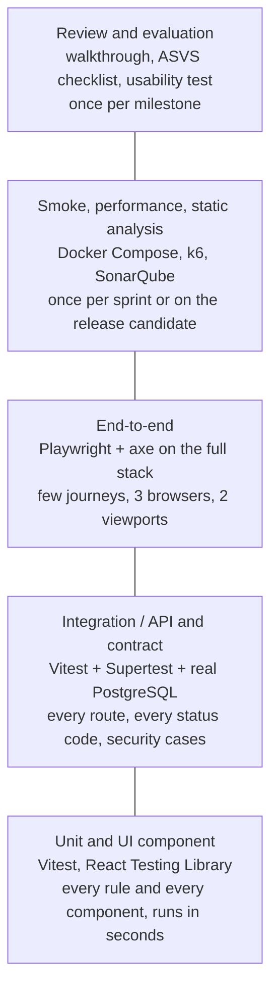
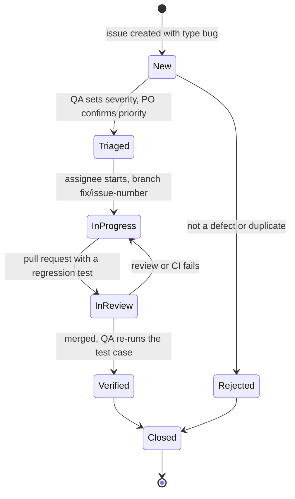

# QA Test Plan

| Field | Value |
|---|---|
| Project | PhishGuard Trainer – a phishing-awareness simulator |
| Version | 2.0 (version 1.0 is the Sprint 1 initial plan) |
| Date | 2026-11-15 |
| Owner | Erol Yağız Gemalmaz (`ygzgemalmaz`) – QA / Test Automation |
| Team | SENG 321 – Team 16 |
| Related tasks | T-64 (this update), T-56 (non-functional requirements), T-57 (decision log), T-58 (refined backlog), T-62 (ADR-0001), T-70 (Sprint 3 unit-test and coverage report), T-74 (integration test report), T-47 (end-to-end tests), T-50 (SonarQube scan), T-43 (clean-machine start) |
| Related stories | US-20 (this plan); the test cases cover the Must stories US-01 … US-06, US-08 … US-15 and US-17 … US-20 |
| Related work | [QA task #30](https://github.com/seng321-team16/phishguard-trainer/issues/30), [US-20 #22](https://github.com/seng321-team16/phishguard-trainer/issues/22) |

---

## 1 Purpose

This plan says how PhishGuard Trainer is verified: which tests exist, at which level, with which tool, in which environment, and what counts as passed at each milestone.

Version 1.0 was written in Sprint 1, before the technology and the open acceptance questions were decided. Version 2.0 makes the plan concrete:

| Change in version 2.0 | Section | Source |
|---|---|---|
| The tools are named | 4 | ADR-0001, decision D-16 |
| Each test level says what it covers and where its files live | 5 | `playbook` conventions, ADR-0001 |
| Three test environments are described | 6 | `docker-compose.yml`, ADR-0001 |
| Entry and exit criteria are given per sprint | 7 | NFR document, section 4 (quality gates) |
| The coverage metric is fixed | 8 | Decision D-07 |
| The three security cases are linked to their test files | 9 | Decision D-16, AC-20.3 |
| NFR verification matrix: one row per `NFR-01 … NFR-37` | 10 | NFR document, sections 2.3 and 5 |
| Test-case catalogue: `TC-01 … TC-80` for the Must stories | 11 | Refined backlog, section 4 |
| Defect workflow with labels and severities | 13 | Sprint 1 repository workflow |

Documents this plan depends on:

| Short name | File |
|---|---|
| SRS | `docs/sprint-2/01-Software-Requirements-Specification.md` |
| NFR document | `docs/sprint-2/02-Non-Functional-Requirements-and-Quality-Measures.md` |
| Refined backlog | `docs/sprint-2/03-Refined-Product-Backlog.md` |
| Decision log | `docs/process/decision-log.md` |
| ADR-0001 | `docs/adr/0001-technology-stack.md` |
| API contract | `api/openapi.yaml` |

If this plan and the decision log disagree, the decision log wins and this plan is corrected.

---

## 2 Quality objectives

- Authentication, authorisation, training and scoring behave as the refined backlog and the API contract say.
- A learner cannot use an admin function and cannot read or change another learner's data.
- The answer key of a scenario is not sent before the learner has answered it.
- Invalid input gets a safe RFC 9457 problem response (`application/problem+json`) without stack trace, SQL text or secret.
- The application starts from a clean checkout with one Docker Compose command.
- CI reports the unit-test line coverage and fails below 50 % (D-07).
- Every non-functional requirement has a named way to verify it (section 10).
- Tests, defects and acceptance decisions can be traced to GitHub issues and pull requests.

---

## 3 Scope

### 3.1 In scope

- Registration, login, token expiry and logout in the user interface
- Role-based access control and protection against insecure direct object references (IDOR)
- Request validation, safe errors, login rate limit and escaping of scenario text
- Seed scenario library and scenario selection
- Answer submission, ownership, duplicate submission, scoring and completion
- Score history and trend
- Admin scenario create, read, update, delete and audit events
- First-admin bootstrap
- Conformance of every API response to the contract; contract lint and mock
- Main learner journey and admin journey end to end, in three browsers and two viewports
- Accessibility scan, keyboard operation and focus visibility
- Response time under a small load and initial page load
- Clean start, restart without data loss, one published port
- Static analysis, dependency audit and secret scanning

### 3.2 Out of scope

- Real phishing email delivery, real brands, real targets and external mail providers
- Single sign-on, payments, multi-tenancy and native mobile applications
- Penetration testing of a production installation (the security review T-76 is a checklist review on the local stack)
- Load beyond the 20 concurrent users of NFR-03
- Field studies that claim a reduction of real phishing incidents
- The Should and Could stories US-07, US-16, US-21 … US-25 in the test-case catalogue of section 11. Their tests are written by their own tasks (section 12); the NFRs that touch them are still in section 10.

---

## 4 Tools

All tools are those of ADR-0001 (testing, lint and contract tooling, CI and static-analysis rows) and of decision D-16. Two tools are not named in ADR-0001: **axe** and **k6**. They are named by the NFR document as the measurement tools of NFR-10, NFR-12, NFR-14 and NFR-03. Both are test-time tools only, add no runtime dependency to the product, and do not replace any ADR-0001 choice.

| Tool | Used for | Runs in | In ADR-0001 |
|---|---|---|---|
| Vitest | Test runner for unit, integration and component tests in `api` and `web` | Local, CI | Yes |
| `@vitest/coverage-v8` | Line coverage, lcov output in `coverage/api` and `coverage/web` | Local, CI | Yes |
| Supertest | HTTP calls against the Express app in API tests, without opening a port | Local, CI | Yes |
| `express-openapi-validator` | Request validation in the product; **response** validation switched on in the integration tests, so a response that breaks the contract fails the test | Local, CI | Yes |
| PostgreSQL 16 container (`db-test`) | Disposable real database for the integration tests | Local, CI | Yes |
| React Testing Library (with `@testing-library/jest-dom`, jsdom) | Component tests of the web application; controls are selected by role and label | Local, CI | Yes |
| Playwright | End-to-end tests against the full Compose stack; browser projects for Chrome, Firefox and Edge; viewport projects 390×844 and 1366×768; navigation timing | Local (compose), Final CI job | Yes |
| axe (`@axe-core/playwright`) | Automated accessibility scan (WCAG 2.1 A and AA rule tags) inside the Playwright tests | Local (compose) | No – named by the NFR document |
| k6 (`grafana/k6` container) | Load test for NFR-03: 20 virtual users, p95 per operation, thresholds in the script | Demo laptop (compose) | No – named by the NFR document |
| Spectral | Lint of `api/openapi.yaml` (`npm run lint:api`), zero errors (D-17) | Local, CI | Yes |
| Prism | Mock server from the contract (`npm run mock`); mock smoke call per operation | Local | Yes |
| ESLint, Prettier, TypeScript | Lint, format check and strict type check | Local, CI | Yes |
| SonarQube Community + `sonar-scanner` | Static analysis, duplication, maintainability rating, technical-debt ratio; reads the lcov report | Local (Docker) | Yes |
| `npm audit` | Vulnerability audit of the production dependencies | CI | Yes |
| GitHub secret scanning | Secrets in the repository history | GitHub, every push | – (repository setting) |
| Docker Compose, shell, `curl` | Clean start, restart check, port inspection | Local, CI Docker job | Yes |
| GitHub Actions | Runs six jobs on every pull request: `lint`, `test`, `build`, `docker` (required by D-07, from T-44), `audit` (added by T-49) and `e2e` (added by T-47) | CI | Yes |
| GitHub Issues | Defect tracking (section 13) | GitHub | – |

**k6 or autocannon.** The task allowed either. k6 is chosen because NFR-03 needs a scripted user flow (log in, start a session, ten answers, complete) with a separate 95th percentile for each of the three operations and pass/fail thresholds. autocannon measures one URL at a time and cannot keep the session state between calls without extra code. k6 runs from its official container, so nothing is installed with npm. k6 is licensed under AGPL-3.0; it is used only as an external tool and is not distributed with the product (the same position as SonarQube in ADR-0001). `@axe-core/playwright` (MPL-2.0) is a development dependency of the `e2e` workspace only and appears in the licence report of T-49.

---

## 5 Test levels

### 5.1 The test pyramid of this project

Many fast tests at the bottom, few slow tests at the top. A rule is tested at the lowest level that can prove it.

- **Unit and component tests** are the base. They need no database and no browser, run on every save and give the coverage number of the 50 % gate.
- **Integration tests** carry most of the security checks, because a security rule (403, 429, no answer key) is a property of a real HTTP response from the real middleware chain and the real database.
- **End-to-end tests** are few: the main learner journey, the admin journey and the checks that only a real browser can do (layout, keyboard, accessibility, page load).
- **The top two layers** are not run on every pull request. They are measured once per sprint or on the release candidate.

### 5.2 Levels in detail

| Level | What it covers | Tool | Where the tests live | Runs |
|---|---|---|---|---|
| Unit | One function or module without input/output: score rounding (D-03), trend rule (D-05), scenario selection with a seeded random source (D-14), configuration parsing, indicator vocabulary, seed data counts (D-09) | Vitest | Next to the code: `api/src/**/*.test.ts`, `web/src/**/*.test.ts` | Every pull request (`test` job); locally with `npm test` |
| UI/component | One React component or page with a faked API: forms and validation messages, scenario view (escaped text, links not clickable), verdict controls and feedback, summary, history, admin table, form and delete confirmation, route guards | Vitest + React Testing Library | Next to the component: `web/src/**/*.test.tsx` | Every pull request (`test` job) |
| Integration/API | One HTTP request through routes, middleware, services, repositories and a real PostgreSQL: status codes, response bodies, stored data, role checks, ownership, rate limit, error format, audit events | Vitest + Supertest, `db-test` container | `api/test/integration/*.test.ts` | Every pull request (`test` job) |
| Contract | The contract itself is valid, and the implementation follows it: Spectral lint; response validation active in every integration test; mock answers every operation | Spectral, `express-openapi-validator`, Prism | `api/openapi.yaml`, `.spectral.yaml`; no own test files – the integration suite is the conformance suite | Lint: every pull request (`lint` job). Mock smoke: once per sprint |
| End-to-end | A user journey in a real browser against the Compose stack: register → log in → session → summary → history; admin create, edit, delete; layout at two viewports; keyboard-only run; focus visibility; accessibility scan; page-load time | Playwright, `@axe-core/playwright` | `e2e/tests/*.spec.ts` | Final sprint: before every release candidate and in the E2E report (T-47) |
| Smoke/deployment | The stack starts healthy from a clean checkout within 180 s, publishes one port, keeps its data over a restart, seeds 30 scenarios once | Docker Compose, shell, `curl` | `deploy/smoke/*.sh` | Once per sprint on the demo laptop; clean machine at Final (T-43) |
| Performance | Response time of `startSession`, `submitAnswer`, `completeSession` with 20 concurrent users | k6 | `e2e/perf/session-flow.k6.js` | Sprint 3 for information; Final on the release candidate |
| Static analysis | Lint, format, types; code smells, duplication, debt ratio; vulnerable dependencies; secrets | ESLint, Prettier, TypeScript, SonarQube, `npm audit`, GitHub secret scanning | `eslint.config.js`, `sonar-project.properties`, CI workflow | Lint and audit: every pull request. SonarQube: Sprint 3 for information, Final gate |
| Usability evaluation | First session within 5 minutes without help; SUS score | Timed task, SUS form | `docs/final/` report of T-80 | Once, Final |
| Review | A person checks a list: acceptance walkthrough, as-built traceability, ASVS Level 1 checklist, open defects, inspection criteria (for example "no default password in the code") | Checklists | Reports of T-71, T-76, T-79 | Sprint review and Final |

**File locations are planned.** The folders `api/test/integration/`, `e2e/`, `e2e/perf/` and `deploy/smoke/` do not exist yet; the first task that needs one creates it. A test task may choose a better file name than the one planned in sections 9 to 11; it then corrects the row in this plan in the same commit. In the tables of sections 9 to 11 a long path is printed in two parts, folder and file name (for example `api/test/integration/` `register.test.ts`), so that it can wrap in the PDF; it is one path.

**Naming rule.** A test that verifies an acceptance criterion carries the criterion identifier in its name, for example `AC-11.3 completing with unanswered scenarios returns 409` (refined backlog, section 1.1). A failing test then points to the broken criterion and to its row in section 11.

**What exists at the end of Sprint 2.** The skeleton has unit and component tests only: `api/src/app.test.ts` (health check, no framework header), `api/src/config.test.ts`, `api/src/domain/indicators.test.ts` (AC-07.1, AC-07.2), `api/src/utils/async-handler.test.ts` and `web/src/App.test.tsx`. Everything else in this plan is planned work of Sprint 3 and the Final sprint.

---

## 6 Test environments and data

| Environment | What runs | Database | Used for | Started with |
|---|---|---|---|---|
| **Local** | Vitest in the developer's checkout (Node.js 20). API tests call the Express app in-process through Supertest; web tests run in jsdom. | None for unit and component tests. Integration tests use the `db-test` container. | Unit, component and integration tests while developing | `npm test`, `npm run test:coverage` |
| **CI** | GitHub Actions on an Ubuntu runner, from T-44. Six jobs: `lint`, `test`, `build`, `docker` (required by D-07), `audit` (added by T-49) and `e2e` (added by T-47). | A PostgreSQL 16 service equal to `db-test`, empty at the start of every run | The gate for every pull request: lint, contract lint, unit and integration tests with the coverage gate, build, image build, dependency audit | Automatically on every pull request and on every push to `develop` and `main` |
| **Compose test profile** | Only the disposable database `db-test` of `docker-compose.yml`: PostgreSQL 16 on `127.0.0.1:5433`, its own credentials, storage in memory (`tmpfs`), so every start is an empty database | `db-test` | Integration tests on a developer machine, without touching the data of the normal stack | `docker compose --profile test up -d db-test` |
| **Full Compose stack** ("demo laptop") | `db`, `api`, `web` (nginx) from the production images at `http://localhost:8080`, with the seed library and the bootstrap admin from `.env` | `db` with the named volume `db-data` | End-to-end, accessibility, smoke, restart, performance and usability tests | `docker compose up -d --wait` |

Rules for all environments:

- **Clean start.** Local and CI runs start from a clean checkout. The integration suite applies the Prisma migrations to the empty test database before the first test.
- **Isolation.** Every integration test file creates the users and scenarios it needs and removes them (or truncates the tables) before the next file. No test depends on the order of execution or on data left by another test.
- **Fictional data only.** Test data uses invented names and the reserved domains `example.com`, `example.org` and `.test`. No real brand, no real address, no clickable link.
- **Secrets.** Test credentials are fixed, obviously fake values in the test setup or come from environment variables. No real credential is committed. The test password used for the leak check (AC-01.5) is a unique string that cannot appear by chance.
- **Time.** Time-dependent rules (token expiry, the 60-second rate-limit window) are tested with a controlled clock (Vitest fake timers or an injected clock), never by waiting.
- **Randomness.** Scenario selection takes its random source as a parameter; tests pass a seeded one and compare exact results (D-14).
- **Reported hardware.** Every report that contains a time measurement (NFR-03, NFR-04, NFR-15) names the processor, memory and operating system of the machine.

---

## 7 Entry and exit criteria

### 7.1 For every story (all sprints)

| | Criterion |
|---|---|
| Entry | The story meets the Definition of Ready of the refined backlog: Given/When/Then criteria, owner, estimate, dependencies done. |
| Entry | The API operation exists in `api/openapi.yaml` for API-facing behaviour, and every decision the story names (`D-xx`) is accepted. |
| Entry | The test cases of the story are listed in section 11 with level and planned location. |
| Exit | Every acceptance criterion has passing evidence: an automated test, or a recorded inspection or demonstration where section 11 says *No*. |
| Exit | The pull request passes the required checks and is reviewed by someone other than the author. |
| Exit | No open defect of severity Critical or High is linked to the story. |

### 7.2 Per sprint

| Sprint | Entry criteria | Exit criteria |
|---|---|---|
| **Sprint 2** – documents and skeleton (`v0.2.0`) | SRS, NFR document and decision log are committed. ADR-0001 is accepted. The monorepo skeleton builds. | This plan names the tools of ADR-0001. Every NFR has a row in section 10. Every Must story has at least one test case in section 11. The existing skeleton tests pass with `npm test`; `npm run lint` and `npm run lint:api` report no error. |
| **Sprint 3** – MVP (`v0.3.0`) | Sprint 2 exit met. The `db-test` profile starts. The CI workflow exists (T-44) before the first test task is merged. For each test task: the code task it depends on is merged. | All automated test cases of section 11 planned for Sprint 3 pass in CI. Unit-test line coverage of `api` + `web` ≥ 50 % and the gate is active (T-45). All *required* items of the Sprint 3 quality gate (NFR document, section 4.1) are ticked; the *reported* items are measured and written down. The three security cases of section 9 pass and are linked to their files. No open Critical or High defect (NFR-17). The unit-test and coverage report is written (T-70). The acceptance walkthrough is done (T-71). |
| **Final** (`v1.0.0`) | `v0.3.0` is tagged. The full stack starts with one command. The `e2e` workspace exists. The Should stories planned for the Final sprint are merged before their tests are written. | Every item of the Final quality gate (NFR document, section 4.2) is ticked – all 37 NFRs. The integration test report (T-74) and the E2E report with axe results (T-47) are written. The main journey passes in Chrome, Firefox and Edge and at both viewports. The SonarQube gate of D-08 passes (T-50, T-75). The clean-machine start passes on Windows 11 and Ubuntu (T-43). The ASVS Level 1 checklist is 100 % for applicable items (T-76). No open Critical or High defect. |

A milestone is not tagged while a required exit criterion fails. The only exception is the rule of the NFR document, section 3: the Product Owner may accept a failed *sprint review* or *Final* measure as a known limitation in the submission document. Security measures (NFR-18 … NFR-28) cannot be accepted this way.

---

## 8 Coverage policy (D-07)

The metric is no longer open. Decision D-07 and NFR-29 fix it:

| Item | Rule |
|---|---|
| Metric | **Line coverage** of the unit tests (unit and component level) |
| Threshold | ≥ 50 % over `api` and `web` together |
| How the gate is enforced | The `test` job fails below the threshold. A threshold of 50 % lines in each of the two workspaces is an accepted way to enforce it, because it guarantees the combined value (D-07). |
| Tool and output | Vitest with `@vitest/coverage-v8`; `npm run test:coverage` writes lcov to `coverage/api` and `coverage/web`. The same lcov files are read by SonarQube. |
| Reported | The value per workspace and the combined value; statement and branch coverage for information, without a gate |
| Not counted | Generated code (`packages/contract`), configuration files, type declaration files, the test files themselves, and the start-up files that only bind a port or mount the application (`api/src/server.ts`, `web/src/main.tsx`) |
| Never excluded | Security, scoring and validation modules |
| Changing the rule | Lowering the threshold or excluding more files needs a decision of the whole team in the decision log (QM-29) |

Coverage is a floor, not a goal. New or changed business logic gets tests even when the repository is already above 50 %, and a line that is executed without an assertion does not count as tested in a review.

The integration tests are not part of the 50 % number. Their evidence is the test report and the conformance of every response to the contract (NFR-02).

---

## 9 Security and negative test baseline

### 9.1 Baseline cases

Every case below is automated at the integration or component level and runs on every pull request.

| Case | Expected result | Decision / NFR | Test cases |
|---|---|---|---|
| No token, malformed token, expired token on a protected operation | 401 | D-01, NFR-20 | TC-08 |
| Learner calls any operation under `/admin` (6 operations) | 403, nothing read or changed | NFR-20 | TC-11, TC-12 |
| User B answers or completes a session of user A, or lists results | 403; B never sees data of A | NFR-21 | TC-13, TC-14, TC-38, TC-46, TC-50 |
| 6th failed login for the same address + username in one fixed 60-second window | 429 with `Retry-After` from 1 to 60 | D-02, NFR-22 | TC-15 … TC-18 |
| Unknown username and wrong password | Identical 401 bodies | AC-02.2 | TC-07 |
| Wrong type, unknown field, over-length value | 400 problem details, `errors[]` names the field (tests assert field names, not message texts) | D-12, NFR-23 | TC-03, TC-20, TC-58 |
| Any error, including a forced 500 | `application/problem+json`; no stack trace, SQL text or path | NFR-23 | TC-21 |
| Scenario text containing `` and at least 4 more payloads → text shown literally, no element added, no script run | UI/component | Yes | `web/src/pages/training/` `ScenarioView.test.tsx` · T-14 |

### 11.2 E2 Scenario library and E3 Training session

| TC | Story | Criterion | What the test checks | Level | Auto | Location (planned) · task |
|---|---|---|---|---|---|---|
| TC-23 | US-06 | AC-06.1 | Seed data: exactly 30 scenarios, 18 phishing, 12 legitimate, ≥ 8 per difficulty (D-09) | Unit | Yes | `api/prisma/` `seed-data.test.ts` · T-16 |
| TC-24 | US-06 | AC-06.2 | Every seed scenario has all required fields; indicators use only codes of the vocabulary | Unit | Yes | `api/prisma/` `seed-data.test.ts` · T-16 |
| TC-25 | US-06 | AC-06.3 | Every address and link target is on `example.com`, `example.org` or `.test` (automated); no real brand or logo (review T-17) | Unit, Review | Partly | `api/prisma/` `seed-data.test.ts` · T-16; review record · T-17 |
| TC-26 | US-06 | AC-06.4 | Clean start seeds 30 scenarios without a manual step; running the seed twice still gives 30 | Integration/API, Smoke/deployment | Yes | `api/test/integration/` `seed.test.ts` · T-16; `deploy/smoke/` `clean-start.sh` · T-43 |
| TC-27 | US-08 | AC-08.1 | Start without a number → 201 with 10 different scenarios | Integration/API | Yes | `api/test/integration/` `session-start.test.ts` · T-20, T-21 |
| TC-28 | US-08 | AC-08.2 | Count 1 and 20 → exactly that many; 0, 21 and 2.5 → 400, no session created | Integration/API | Yes | `api/test/integration/` `session-start.test.ts` · T-20, T-21 |
| TC-29 | US-08 | AC-08.3 | Same seed and pool → same scenarios in the same order; no scenario twice (D-14) | Unit | Yes | `api/src/services/` `scenario-selection.test.ts` · T-19 |
| TC-30 | US-08 | AC-08.4 | `startSession` response: no scenario object contains `isPhishing`, `indicators` or `explanation` | Integration/API | Yes | `api/test/integration/` `session-start.test.ts` · T-21 |
| TC-31 | US-08 | AC-08.5 | Pool smaller than the requested number → 422, no session created | Integration/API | Yes | `api/test/integration/` `session-start.test.ts` · T-21 |
| TC-32 | US-09 | AC-09.1 | Scenario is shown with sender name, sender address, reply-to when present, subject and body | UI/component | Yes | `web/src/pages/training/` `ScenarioView.test.tsx` · T-22 |
| TC-33 | US-09 | AC-09.2 | Links appear as label and real target in text; no anchor element with a target, no click or keyboard action | UI/component | Yes | `web/src/pages/training/` `ScenarioView.test.tsx` · T-22 |
| TC-34 | US-09 | AC-09.3 | Training screens at 390×844 and 1366×768: page width ≤ viewport width (no horizontal scroll) | End-to-end | Yes (Final); demonstration at Sprint 3 | `e2e/tests/` `layout.spec.ts` · T-47 |
| TC-35 | US-09 | AC-09.4 | Main learner journey passes in Chrome, Firefox and Edge | End-to-end | Yes (Final); Chrome demonstration at Sprint 3 | `e2e/tests/` `learner-journey.spec.ts` · T-47 |
| TC-36 | US-10 | AC-10.1 | Verdict with and without indicators on an open scenario → 200 with result, correct verdict, indicators, missed indicators, explanation, points | Integration/API | Yes | `api/test/integration/` `submit-answer.test.ts` · T-24, T-26 |
| TC-37 | US-10 | AC-10.2 | Second verdict for an answered scenario → 409, first answer still stored | Integration/API | Yes | `api/test/integration/` `submit-answer.test.ts` · T-26 |
| TC-38 | US-10 | AC-10.3 | Verdict on another user's session → 403, nothing stored | Integration/API | Yes | `api/test/integration/` `submit-answer.test.ts` · T-26 |
| TC-39 | US-10 | AC-10.4 | Unknown session, or scenario not part of the session → 404 | Integration/API | Yes | `api/test/integration/` `submit-answer.test.ts` · T-26 |
| TC-40 | US-10 | AC-10.5 | Verdict on a completed session → 409 | Integration/API | Yes | `api/test/integration/` `submit-answer.test.ts` · T-26 |
| TC-41 | US-10 | AC-10.6 | Two choices *Phishing* / *Legitimate* and an optional indicator checklist; after submit the feedback of AC-10.1 is shown on the same screen | UI/component (also in the E2E journey) | Yes | `web/src/pages/training/` `VerdictPanel.test.tsx` · T-25; `e2e/tests/` `learner-journey.spec.ts` · T-47 |
| TC-42 | US-11 | AC-11.1 | Completion of a fully answered session → 200 with identifier, completion time, counts and score; result stored and in the history | Integration/API | Yes | `api/test/integration/` `complete-session.test.ts` · T-27, T-74 |
| TC-43 | US-11 | AC-11.2 | Score table 0/10→0, 1/3→33, 1/8→13, 3/8→38, 2/3→67, 7/8→88, 10/10→100 (round half up, whole-number formula, D-03) | Unit | Yes | `api/src/services/` `scoring.test.ts` · T-28 |
| TC-44 | US-11 | AC-11.3 | Completion with an unanswered scenario → 409 with `detail`; session stays open, no score, not in history; can be completed later (D-04) | Integration/API | Yes | `api/test/integration/` `complete-session.test.ts` · T-27, T-74 |
| TC-45 | US-11 | AC-11.4 | Second completion → 409, stored result unchanged | Integration/API | Yes | `api/test/integration/` `complete-session.test.ts` · T-27, T-74 |
| TC-46 | US-11 | AC-11.5 | Other user's session → 403; unknown session → 404; check order 404, 403, 409, 409 | Integration/API | Yes | `api/test/integration/` `complete-session.test.ts` · T-27, T-74 |
| TC-47 | US-12 | AC-12.1 | Summary shows score, correct out of total and the list of wrongly answered scenarios | UI/component (also in the E2E journey) | Yes | `web/src/pages/training/` `SummaryPage.test.tsx` · T-29; `e2e/tests/` `learner-journey.spec.ts` · T-47 |
| TC-48 | US-12 | AC-12.2 | All verdicts correct → empty list and the "nothing missed" message | UI/component | Yes | `web/src/pages/training/` `SummaryPage.test.tsx` · T-29 |

### 11.3 E4 Progress and E5 Admin dashboard

| TC | Story | Criterion | What the test checks | Level | Auto | Location (planned) · task |
|---|---|---|---|---|---|---|
| TC-49 | US-13 | AC-13.1 | History lists the user's completed sessions newest first with date and score, one page at a time | Integration/API | Yes | `api/test/integration/` `results.test.ts` · T-30 |
| TC-50 | US-13 | AC-13.2 | Completed sessions of other users are not in the list | Integration/API | Yes | `api/test/integration/` `results.test.ts` · T-30, T-09 |
| TC-51 | US-13 | AC-13.3 | Trend table: first session → no trend; 70→80 improving; 80→80 flat; 80→79 declining; open sessions ignored (D-05) | Unit | Yes | Next to the trend function (`trend.test.ts` in `api` or `web`, decided in T-30) · T-30, T-31 |
| TC-52 | US-13 | AC-13.4 | No completed session → empty list and the invitation to start a session | UI/component | Yes | `web/src/pages/history/` `HistoryPage.test.tsx` · T-31 |
| TC-53 | US-13 | AC-13.5 (Could part) | Chart of the score over time for two or more sessions. Written only if FR-51 is built. | UI/component | Yes | `web/src/pages/history/` `HistoryPage.test.tsx` · T-31 |
| TC-54 | US-14 | AC-14.1 | Admin creates a valid scenario → 201 with identifier, creation time and creating admin | Integration/API | Yes | `api/test/integration/` `admin-scenarios.test.ts` · T-34 |
| TC-55 | US-14 | AC-14.2 | Admin lists (paged) and reads a scenario → 200 including the answer key | Integration/API | Yes | `api/test/integration/` `admin-scenarios.test.ts` · T-34 |
| TC-56 | US-14 | AC-14.3 | Replace with valid data → 200 with the new state; unknown scenario → 404 | Integration/API | Yes | `api/test/integration/` `admin-scenarios.test.ts` · T-34 |
| TC-57 | US-14 | AC-14.4 | Delete → 204 and the scenario is never offered in a new session; unknown scenario → 404 | Integration/API | Yes | `api/test/integration/` `admin-scenarios.test.ts` · T-34 |
| TC-58 | US-14 | AC-14.5 | Missing required field, over-length text, 6 links, unknown field, unknown indicator code → 400 with `errors[]`, nothing stored | Integration/API | Yes | `api/test/integration/` `admin-scenarios.test.ts` · T-34 |
| TC-59 | US-14 | AC-14.6 | Each successful create, update, delete writes exactly one audit event with actor, UTC timestamp, action, scenarioId and changed field names; no values (D-06) | Integration/API | Yes | `api/test/integration/` `admin-audit.test.ts` · T-34 |
| TC-60 | US-14 | AC-14.7 | Rejected request (400, 403, 404) writes no audit event; no operation changes or deletes an event | Integration/API | Yes | `api/test/integration/` `admin-audit.test.ts` · T-34 |
| TC-61 | US-15 | AC-15.1 | Admin opens scenario management → table of scenarios, one page at a time | UI/component | Yes | `web/src/pages/admin/` `ScenarioListPage.test.tsx` · T-35 |
| TC-62 | US-15 | AC-15.2 | Invalid field → message next to the field, nothing saved; valid data → saved and shown in the table | UI/component | Yes | `web/src/pages/admin/` `ScenarioFormPage.test.tsx` · T-36 |
| TC-63 | US-15 | AC-15.3 | Delete asks for confirmation; confirm removes the row, cancel deletes nothing | UI/component (also in the E2E admin journey) | Yes | `web/src/pages/admin/` `DeleteScenarioDialog.test.tsx` · T-37; `e2e/tests/` `admin-scenarios.spec.ts` · T-47 |
| TC-64 | US-15 | AC-15.4 | Learner sees no administration entry; opening an administration address directly does not show the screen | UI/component (also in the E2E admin journey) | Yes | `web/src/pages/admin/` `ScenarioListPage.test.tsx` · T-35; `e2e/tests/` `admin-scenarios.spec.ts` · T-47 |
| TC-65 | US-17 | AC-17.1 | Bootstrap values set and no such account → admin account with hashed password exists and can log in | Integration/API | Yes | `api/test/integration/` `bootstrap-admin.test.ts` · T-40 |
| TC-66 | US-17 | AC-17.2 | Second start → no second account, existing account unchanged | Integration/API | Yes | `api/test/integration/` `bootstrap-admin.test.ts` · T-40 |
| TC-67 | US-17 | AC-17.3 | Values missing → no admin account; start-up log says so and prints no secret | Integration/API | Yes | `api/test/integration/` `bootstrap-admin.test.ts` · T-40 |
| TC-68 | US-17 | AC-17.4 | No default administrator password in code or build artefacts; `.env.example` holds a placeholder only | Review (inspection) | No | Walkthrough sheet · T-71; security review · T-76 |
| TC-69 | US-17 | AC-17.5 | The README describes how the operator sets the first-admin values | Review (inspection) | No | Walkthrough sheet · T-71 |

### 11.4 E6 Platform and quality

| TC | Story | Criterion | What the test checks | Level | Auto | Location (planned) · task |
|---|---|---|---|---|---|---|
| TC-70 | US-18 | AC-18.1 | Clean machine, images built: `docker compose up -d --wait` → three services healthy and health check 200 through port 8080 within 180 s (D-15) | Smoke/deployment | Partly (scripted and timed; started by a person) | `deploy/smoke/` `clean-start.sh`; clean-machine report · T-43 |
| TC-71 | US-18 | AC-18.2 | On the started stack the bootstrap admin logs in and a session with seed scenarios starts | End-to-end | Yes (Final); demonstration at Sprint 3 | `e2e/tests/` `admin-scenarios.spec.ts`, `e2e/tests/` `learner-journey.spec.ts` · T-47 |
| TC-72 | US-18 | AC-18.3 | `GET /api/v1/health` without a token → 200 and `status` `ok` | Unit (in-process HTTP) | Yes | `api/src/app.test.ts` · exists since T-63 |
| TC-73 | US-18 | AC-18.4 | No secret in the repository; `.env` not tracked; `.env.example` without real values | Static analysis, Review (inspection) | Partly (secret scanning automatic; inspection by a person) | GitHub security tab; `git ls-files .env` · T-76 |
| TC-74 | US-19 | AC-19.1 | A pull request runs the six jobs of the workflow: `lint`, `test`, `build`, `docker` (D-07), `audit` (T-49) and `e2e` (T-47) | Review (demonstration) | No | CI run of a pull request, linked in the Sprint 3 report · T-44, T-70 |
| TC-75 | US-19 | AC-19.2 | The four jobs of D-07 (`lint`, `test`, `build`, `docker`) are required status checks, and so are `audit` and `e2e`, which the workflow header also names for the branch protection; a failing job blocks the merge | Review (inspection) | No | Branch-protection settings of the official repository · T-44, T-71 |
| TC-76 | US-19 | AC-19.3 | Line coverage per workspace and combined is reported (lcov artefact); the `test` job fails below 50 %; exclusions follow D-07 | Review (inspection of configuration and CI run) | Partly (the gate itself is automatic) | `api/vitest.config.ts`, `web/vitest.config.ts`, CI workflow · T-45; coverage report · T-70 |
| TC-77 | US-20 | AC-20.1 | The test plan states levels, scope, responsibilities, evidence and the ADR-0001 tools | Review (inspection) | No | This document, sections 3, 4, 5, 14, 15 · T-64 |
| TC-78 | US-20 | AC-20.2 | Unit tests for scoring and validation and integration tests for authentication and the session flow exist and pass in CI | Review of the CI test report | Partly (the tests are automatic) | TC-43 (scoring), TC-03, TC-20 (validation), TC-06 … TC-09 (authentication), TC-27, TC-36, TC-42 (session flow); report · T-70, T-74 |
| TC-79 | US-20 | AC-20.3 | The three security cases are linked to their test files, and the tests pass in CI | Review (inspection) and CI | Partly (the tests are automatic) | Section 9.2 of this document; TC-11, TC-15, TC-30 · T-64, T-70 |
| TC-80 | US-20 | AC-20.4 | The sprint submission contains the CI test report and the lcov artefact with ≥ 50 % line coverage | Review (inspection) | No | Coverage report · T-70; submission documents · T-72, T-89 |

### 11.5 Checks on the catalogue

| Story (Must) | Criteria | Test cases | Count |
|---|---|---|---|
| US-01 | AC-01.1 … AC-01.5 | TC-01 … TC-05 | 5 |
| US-02 | AC-02.1 … AC-02.5 | TC-06 … TC-10 | 5 |
| US-03 | AC-03.1 … AC-03.4 | TC-11 … TC-14 | 4 |
| US-04 | AC-04.1 … AC-04.5 | TC-15 … TC-19 | 5 |
| US-05 | AC-05.1 … AC-05.3 | TC-20 … TC-22 | 3 |
| US-06 | AC-06.1 … AC-06.4 | TC-23 … TC-26 | 4 |
| US-08 | AC-08.1 … AC-08.5 | TC-27 … TC-31 | 5 |
| US-09 | AC-09.1 … AC-09.4 | TC-32 … TC-35 | 4 |
| US-10 | AC-10.1 … AC-10.6 | TC-36 … TC-41 | 6 |
| US-11 | AC-11.1 … AC-11.5 | TC-42 … TC-46 | 5 |
| US-12 | AC-12.1, AC-12.2 | TC-47, TC-48 | 2 |
| US-13 | AC-13.1 … AC-13.5 | TC-49 … TC-53 | 5 |
| US-14 | AC-14.1 … AC-14.7 | TC-54 … TC-60 | 7 |
| US-15 | AC-15.1 … AC-15.4 | TC-61 … TC-64 | 4 |
| US-17 | AC-17.1 … AC-17.5 | TC-65 … TC-69 | 5 |
| US-18 | AC-18.1 … AC-18.4 | TC-70 … TC-73 | 4 |
| US-19 | AC-19.1 … AC-19.3 | TC-74 … TC-76 | 3 |
| US-20 | AC-20.1 … AC-20.4 | TC-77 … TC-80 | 4 |
| **18 Must stories** | **80 criteria** | **80 test cases** | **80** |

| Check | Result |
|---|---|
| Every Must story has at least one test case. | Pass – 18 of 18 stories. |
| Every acceptance criterion of a Must story has exactly one test case. | Pass – 80 of 80 criteria. |
| Automated (*Yes*, including the three that are demonstrated at Sprint 3 and automated at Final: TC-34, TC-35, TC-71). | 68 of 80. |
| *Partly* (automatic check with a manual part). | 6 of 80: TC-25, TC-70, TC-73, TC-76, TC-78, TC-79. |
| *No* (inspection or demonstration, as the criterion itself says). | 6 of 80: TC-68, TC-69, TC-74, TC-75, TC-77, TC-80; recorded in the walkthrough of T-71 and in the submission documents. |

---

## 12 Traceability: story → test tasks

Section 11 gives the detail for the Must stories. This table covers all stories, including Should and Could, and names the task that writes the tests.

| Story | Pri | Verification | Test cases | Test task(s) |
|---|---|---|---|---|
| US-01 | M | Registration validation, duplicate account, password storage and leak check | TC-01 … TC-05 | T-04 |
| US-02 | M | Login, generic 401, token expiry, client-side logout (D-01) | TC-06 … TC-10 | T-07, T-06 |
| US-03 | M | Admin-role denial and IDOR | TC-11 … TC-14 | T-09 |
| US-04 | M | Threshold, fixed window, `Retry-After`, configuration (D-02) | TC-15 … TC-19 | T-11 |
| US-05 | M | Schema-negative tests, safe errors, XSS escaping | TC-20 … TC-22 | T-14 |
| US-06 | M | Seed counts, required fields, fictional domains, idempotent seed | TC-23 … TC-26 | T-16, T-17, T-43 |
| US-07 | S | Vocabulary equals the contract enum; unique names and descriptions; unknown code → 400 | – (tests exist: `api/src/domain/indicators.test.ts`) | T-18 (done), T-34 |
| US-08 | M | Count boundaries, seeded selection, 422, answer-key leakage | TC-27 … TC-31 | T-19, T-20, T-21 |
| US-09 | M | Inbox view, non-clickable links, two viewports, three browsers | TC-32 … TC-35 | T-22, T-23, T-47 |
| US-10 | M | Feedback, duplicate answer, ownership, 404 and 409 cases | TC-36 … TC-41 | T-24, T-25, T-26 |
| US-11 | M | Score table, incomplete completion, repeat completion, check order | TC-42 … TC-46 | T-27, T-28, T-74 |
| US-12 | M | Summary content, empty missed list | TC-47, TC-48 | T-29 |
| US-13 | M | History order and ownership, trend table, empty state | TC-49 … TC-53 | T-30, T-31 |
| US-14 | M | CRUD, validation, soft delete from selection, audit events (D-06) | TC-54 … TC-60 | T-34 |
| US-15 | M | Table, form validation, delete confirmation, learner has no admin access | TC-61 … TC-64 | T-35, T-36, T-37 |
| US-16 | S | Average rounding, hardest scenarios and ties (D-11), aggregates only, learner gets 403 | – (written with the story) | T-38, T-39, T-74 |
| US-17 | M | Bootstrap creates one admin once; nothing without values; no default password | TC-65 … TC-69 | T-40, T-71 |
| US-18 | M | Clean start in 180 s, working application, health check, no secrets | TC-70 … TC-73 | T-43, T-47 |
| US-19 | M | Six jobs (four of D-07, `audit`, `e2e`), required checks, coverage gate | TC-74 … TC-76 | T-44, T-45 |
| US-20 | M | Test plan content, required tests, security-case trace, evidence | TC-77 … TC-80 | T-64, T-70, T-74, T-47 |
| US-21 | S | Spectral zero errors (D-17), mock answers 14 of 14 operations | – (NFR-05) | T-48 (done), T-44 |
| US-22 | S | Dependabot configured, `npm audit` gate, licence list | – (NFR-26) | T-49 |
| US-23 | S | SonarQube report content and gate (D-08) | – (NFR-30 … NFR-33) | T-50, T-75 |
| US-24 | C | Reset rules of D-18; written only if the story is built | – | T-81 |
| US-25 | C | Difficulty filter rules of D-19; written only if the story is built | – | T-82 |

---

## 13 Defect management

### 13.1 Reporting

A defect is a GitHub issue in the official repository, created from the *Bug report* template:

- Title: `[BUG] <short description>`
- Labels: `type:bug` (set by the template), exactly one severity label (13.2), the epic label of the affected story, and `security` when a security rule is broken
- Body: environment and revision (branch and commit), preconditions, steps to reproduce, expected result with the criterion or NFR identifier (for example `AC-10.2` or `NFR-21`), actual result, evidence (test output, screenshot, log line without secrets)
- Link to the story issue and, when a test found it, the test-case identifier `TC-xx`

A failing automated test on `develop` or `main` is always reported as a defect; it is never fixed by deleting or skipping the test.

### 13.2 Severity

| Label | Severity | Meaning | Handling |
|---|---|---|---|
| `severity:critical` | Critical | A security boundary is bypassed, data is exposed or lost, or the system cannot be used | Blocks merge and release; fixed at once |
| `severity:high` | High | A Must-path criterion fails and there is no acceptable workaround | Fixed before the story is accepted; blocks the release (NFR-17) |
| `severity:medium` | Medium | Wrong secondary behaviour with a workaround | Planned in the current or the next sprint |
| `severity:low` | Low | Cosmetic or small documentation problem | Prioritised with the Product Owner |

A failed security measure (QM-18 … QM-28) is at least High. A missed threshold of another NFR starts as Medium unless it blocks a Must path.

The `type:bug` label exists since Sprint 1. The four `severity:*` labels are new with this plan; QA creates them in the official repository before the first defect is filed.

### 13.3 Workflow

| Step | Who | Rule |
|---|---|---|
| New → Triaged | QA, with the Product Owner | Within one working day. QA sets the severity; only the Product Owner may lower it, with a written reason in the issue. |
| Triaged → In progress | Owner of the affected story | Critical and High are assigned at once. The fix branch follows the Git flow of Sprint 1 (`fix/<issue>-<short-name>`). |
| In progress → In review | Assignee | The pull request contains a test that fails without the fix and passes with it, and names the issue (`Fixes #n`). |
| In review → Verified | Reviewer (not the author), then QA | CI passes. QA re-runs the test case on the merged code. |
| Verified → Closed | QA | The issue is closed with a link to the merged pull request. |

### 13.4 Release check (NFR-17)

On the release day the query `is:issue is:open label:type:bug label:severity:critical,severity:high` must return no issue. The result is written into the submission document (T-72, T-89).

---

## 14 Responsibilities

| Role | Member | Responsibility in testing |
|---|---|---|
| QA / Test Automation | Erol Yağız Gemalmaz | Owns this plan, the test design, the test tasks of section 12, defect triage, the coverage, integration, E2E and SonarQube reports |
| Lead Architect, DevOps | Ali Kaan Demiralp | Owns the CI workflow and the coverage gate, the contract, the test database profile; adds unit tests with every API task; runs the security review |
| Requirements & UX Engineer | Duhan Kaan Şenol | Adds component tests with every learner screen; runs the acceptance walkthrough (T-71), the usability evaluation (T-80) and the as-built traceability (T-79) |
| Scrum Master | Furkan Berkay Öztürk | Adds component tests with the admin screens; runs the quality-gate checklist at the sprint review; puts the evidence into the submission documents |
| Product Owner | Murat Yatağan | Decides requirement questions and severity changes; accepts or rejects stories; adds tests with the seed and statistics tasks |

Rules: the author of a change writes its unit or component tests in the same commit (conventions). A reviewer who is not the author checks the test evidence before the merge.

---

## 15 Evidence and reporting

Evidence required at each submission (D-16):

| Evidence | Source | Sprint 3 | Final |
|---|---|---|---|
| Test report of the CI run | `test` job of GitHub Actions | T-70 | T-74 |
| Coverage artefact (lcov), value per workspace and combined | `coverage/api`, `coverage/web` | T-70 | T-74 |
| Trace of the three security cases to their test files | Section 9.2 of this plan, with the CI result | T-70 | T-74 |
| Quality-gate checklist | NFR document, section 4 | T-72 | T-89 |
| Acceptance walkthrough | Refined backlog, criteria `AC-xx.y` | T-71 | T-79 (as built) |
| Integration test report | Integration suite | – | T-74 |
| E2E report with axe results, three browsers, two viewports | Playwright HTML report | – | T-47 |
| k6 summary | `e2e/perf/session-flow.k6.js` run on the demo laptop | T-70 (for information) | T-74 |
| SonarQube report | SonarQube dashboard export | T-70 (first scan, for information) | T-50, T-75 |
| Clean-machine start report | `deploy/smoke/*.sh` output | Timed start on the demo laptop | T-43 |
| Open-defect query | GitHub Issues (13.4) | T-72 | T-89 |

---

## 16 Risks and limitations

| Risk or limitation | Effect | Answer |
|---|---|---|
| At the end of Sprint 2 only skeleton tests exist. | No coverage or security evidence yet. | This plan does not mark US-20 as done. The evidence arrives with the Sprint 3 test tasks and the report T-70. |
| Test tasks depend on code tasks of other members and come late in Sprint 3. | Tests are written in a hurry, coverage misses the gate. | Code tasks add their own unit tests in the same commit; QA tasks add the security and negative cases. The coverage gate is active from T-45, before the last features. |
| Planned file names in sections 9 to 11 may not match the final code structure. | Broken trace from the plan to the files. | The task that changes a name corrects the row in the same commit; T-70 and T-74 check the table against the repository. |
| Integration and E2E tests need Docker. | A member without Docker cannot run them locally. | CI runs them; Docker is already a prerequisite of the project (C-01). |
| Timing results depend on the machine. | NFR-03, NFR-04 and NFR-15 are not comparable between runs. | Gated runs happen on the demo laptop; every report names the hardware. |
| Automated accessibility scans find only part of the WCAG problems. | False confidence. | The keyboard-only test, the focus test and the usability evaluation (T-80) complement the axe scan. |
| k6 and axe are not in ADR-0001. | Tool list drifts from the architecture record. | Both come from the NFR document and are test-time tools only (section 4). If the Lead Architect prefers, they are added to ADR-0001 in the as-built update (T-78). |

---

## Revision history

| Version | Date | Author | Change |
|---|---|---|---|
| 1.0 | Sprint 1 | Erol Yağız Gemalmaz | Initial plan: objectives, scope, levels, entry and exit criteria, proposed coverage metric, security baseline, defect severities. |
| 2.0 | 2026-11-15 | Erol Yağız Gemalmaz | Task T-64: tools of ADR-0001 named (plus axe and k6 from the NFR document); test levels with locations; three environments; entry and exit criteria per sprint; coverage metric fixed by D-07; security-case trace (D-16); NFR verification matrix for NFR-01 … NFR-37; test-case catalogue TC-01 … TC-80 for the 18 Must stories; defect workflow with `type:bug` and `severity:*` labels; RFC 7807 replaced by RFC 9457; the former reference to T-46 replaced by T-64. |
