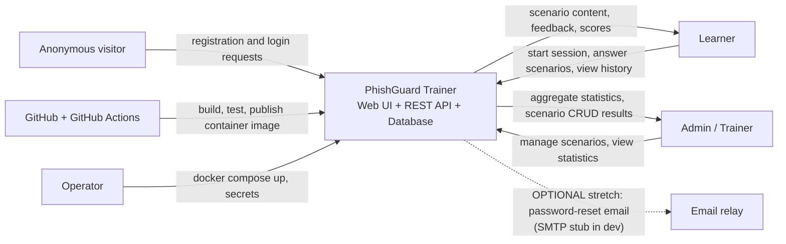

# System Vision and System Boundary

## System vision

> For learners who are not security specialists and for the trainers who teach them, **PhishGuard Trainer** is a web-based phishing-awareness simulator that lets people practise judging realistic *fake* emails, see exactly which red flags they missed, and track their improvement over time. Unlike slide-based awareness training, it gives immediate, specific feedback and measurable progress. The first release is a simulator only: it never sends email and never contacts real targets.

## Users and responsibilities

| Actor | Does what | Trust level |
|---|---|---|
| Learner | Registers, logs in, runs training sessions, views own score history | Authenticated, least privilege |
| Admin (trainer) | Everything a learner can, plus manages scenarios and views aggregate statistics | Authenticated, elevated |
| Anonymous visitor | Can only register and log in | Untrusted |
| Operator (DevOps) | Deploys and configures the system (secrets, DB) | Out-of-band, not an app user |

## System context diagram

Relationship notes (information, direction, purpose, trust):
- **Learner → System:** credentials, verdicts (`phishing` / `legitimate`), optional flagged elements. Purpose: score the answer. Trust: input is untrusted, validated server-side.
- **System → Learner:** scenario content *without* the answer key until the verdict is submitted, then feedback and explanation. The answer key must never leak in the "get scenario" response.
- **Admin → System:** scenario create/edit/delete, statistics queries. Purpose: maintain content. Trust: admin role is checked on every request. Scenario HTML/text is treated as untrusted when rendered (no raw HTML injection; see security notes).
- **Email relay:** optional and deferred. In dev it is a stub that writes to the log. Not required for MVP.
- **CI/CD:** receives source, produces tested container image. No production secrets in the repository.

## Boundary: inside vs. outside

**Inside the software responsibility**
- Account registration, login, password hashing, session tokens.
- Role-based access control (`learner`, `admin`).
- Scenario library (fake emails with indicators and explanations).
- Training session lifecycle and scoring.
- Score history per user.
- Admin dashboard and aggregate statistics.
- Input validation, rate limiting, audit logging of admin actions.

**Outside or deferred**
- Sending real or simulated phishing emails to real people.
- Integration with mail providers, Slack or Teams.
- External identity providers or SSO (local accounts only).
- Real-world click tracking, field campaigns, HR reporting.
- Mobile app, localisation, accessibility certification (basic good practice only).
- Hosting infrastructure itself (the team only provides Docker artefacts).

> The boundary names responsibility. The optional email relay may be essential for a future password-reset feature without becoming part of our implementation.

## Assumptions
- Users have a modern browser; only a desktop-first web UI is built.
- A single Postgres (or equivalent) database instance is enough.
- Scenario content is English text, fictional brands and reserved domains only.
- All traffic is over HTTPS in any real deployment (terminated at a proxy; the demo may use HTTP on localhost).

## Constraints
- Course: runs from one Docker / docker-compose command; ≥ 50 % unit-test coverage in CI; OpenAPI-first; open-source licence.
- Team: 5 members (Takım 16), 10 weeks.
- Ethics: simulator only, no real phishing infrastructure, no real brand impersonation.

## Security design basics (architecture drivers)
| Concern | Decision |
|---|---|
| Password storage | Argon2id (preferred) or bcrypt with per-user salt; never store or log plaintext; minimum length 12 |
| Authentication | Short-lived signed access token (JWT or opaque session); logout and expiry; tokens never in URLs |
| Authorisation | Role claim checked server-side on every route; admin endpoints under `/admin/**`; learners can only read their own results (prevent IDOR) |
| Input validation | Schema validation on every request body and query (derived from OpenAPI); reject unknown fields; max lengths |
| Output safety | Scenario bodies stored as plain text/limited markup, rendered escaped to prevent stored XSS (an admin-authored field is still untrusted) |
| Rate limiting | Strict limit on `/auth/login` and `/auth/register` (e.g. 5 attempts/min/IP+account, with 429 and `Retry-After`); looser global limit |
| SQL injection | Parameterised queries / ORM only |
| Answer-key leakage | Scenario `isPhishing` and explanations are returned only after the answer is submitted |
| Secrets | Environment variables / Docker secrets; `.env` is git-ignored; secret scanning enabled on the repo |
| Dependencies | Dependabot + `npm audit`/`pip-audit` in CI |
| Auditability | Admin changes to scenarios recorded with user id and timestamp |
| Error handling | RFC 7807 problem responses; no stack traces or SQL errors to clients |
| Transport / headers | HTTPS in deployment, security headers (CSP, `X-Content-Type-Options`, etc.), restrictive CORS |

## Provisional architecture sketch (to be finalised in Sprint 2 C4 work)
Browser SPA → REST API (stateless) → relational database. Everything packaged with `docker-compose` (`web`, `api`, `db`). Technology choice is the Lead Architect's call; the OpenAPI contract is stack-agnostic.
