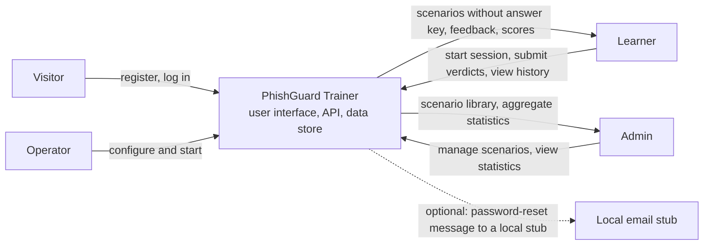
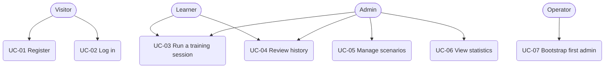
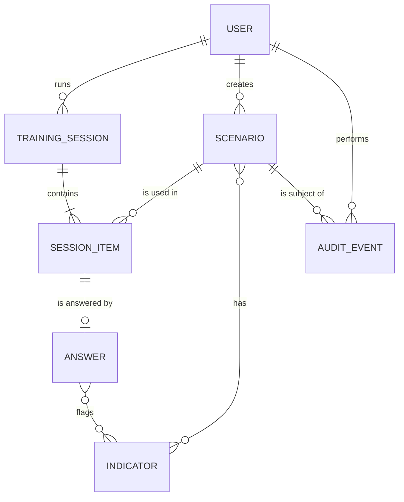

# Software Requirements Specification (SRS)

| Field | Value |
|---|---|
| Project | PhishGuard Trainer – a phishing-awareness simulator |
| Version | 1.0 |
| Date | 2026-11-15 |
| Owner | Duhan Kaan Şenol (`ThatsKafiBRO`) – Requirements & UX Engineer |
| Team | SENG 321 – Team 16 |
| Related tasks | T-53 (this document), T-56 (non-functional requirements), T-57 (decision log), T-58 (refined backlog) |
| Related stories | US-01 … US-25 (all stories of the Sprint 1 backlog) |
| Standard | Structure follows ISO/IEC/IEEE 29148:2018 (software requirements specification) |

---

## 1 Introduction

### 1.1 Purpose

This document states **what** PhishGuard Trainer must do. It is the agreed reference for the team, the course instructor and the jury:

- developers build against it,
- the QA engineer derives tests from it,
- the Product Owner uses it to accept or reject work.

It does not say **how** the system is built. Design decisions are in the architecture documents and the architecture decision records (see 1.4).

### 1.2 Scope

PhishGuard Trainer is a web application in which people practise judging realistic but **fake** emails. A learner decides whether each email is phishing or legitimate, gets immediate feedback that names the red flags, and can follow their score over time. An administrator maintains the email scenarios and sees aggregate statistics.

**In scope for release 1 (MVP):** account registration and login, two roles (`learner`, `admin`), a library of fake email scenarios, training sessions with instant feedback, scoring and score history, scenario management, aggregate statistics, and the security basics (password hashing, role-based access control, input validation, rate limiting).

**Out of scope:** sending real or simulated phishing email to real people, integration with email providers or chat tools, browser plug-ins, a mobile app, external identity providers and single sign-on, multi-tenant organisations, payments, localisation, leaderboards, and field testing with real users.

The product is a **simulator only**. It never sends email and never contacts real targets.

### 1.3 Definitions, acronyms and abbreviations

| Term | Meaning |
|---|---|
| Scenario | One fake email (sender, subject, body, links) with its answer key. |
| Answer key | The hidden part of a scenario: the correct verdict, its indicators and the explanation. |
| Verdict | The learner's decision for one scenario: `phishing` or `legitimate`. |
| Indicator (red flag) | A named sign that an email is suspicious, for example a sender domain that does not match the claimed sender. |
| Training session | One practice round: a set of scenarios given to one learner, answered one by one and then scored. |
| Score | Percentage of correct verdicts in one completed session (0–100). |
| Visitor | A person who is not logged in. |
| Learner | A logged-in user with the role `learner`. |
| Admin | A logged-in user with the role `admin` (the trainer). |
| Operator | The person who installs, configures and starts the system. Not an application user. |
| Access token | A short-lived credential issued at login and sent with every later request. |
| API | Application programming interface – here the REST interface between the user interface and the server. |
| API contract | The machine-readable description of the API in `api/openapi.yaml`. |
| Problem details | The standard error body format `application/problem+json` (RFC 9457). |
| IDOR | Insecure direct object reference – reading someone else's data by guessing an identifier. |
| XSS | Cross-site scripting – making a browser run injected script. |
| RBAC | Role-based access control. |
| CI | Continuous integration – automatic checks that run on every pull request. |
| MVP | Minimum viable product – the Sprint 3 release. |
| SRS | Software requirements specification (this document). |
| FR / NFR | Functional requirement / non-functional requirement. |
| UC | Use case. |
| US | User story from the product backlog. |
| OI | Open issue (a question that still needs a decision). |
| M / S / C | Priority: Must / Should / Could. |

### 1.4 References

| # | Document | Location |
|---|---|---|
| R-1 | Project Proposal and Problem Definition (Sprint 1) | `docs/sprint-1/01-Project-Proposal.md` |
| R-2 | System Vision and System Boundary (Sprint 1) | `docs/sprint-1/02-System-Vision-and-Boundary.md` |
| R-3 | Initial Product Backlog (Sprint 1) | `docs/sprint-1/06-Initial-Product-Backlog.md` |
| R-4 | API contract (OpenAPI 3.1, version 0.2.0) | `api/openapi.yaml` |
| R-5 | Acceptance Criteria Testability Review | `docs/qa/Acceptance-Criteria-Review.md` |
| R-6 | Non-Functional Requirements and Quality Measures | `docs/sprint-2/02-Non-Functional-Requirements-and-Quality-Measures.md` |
| R-7 | UI/UX Prototypes | `docs/sprint-2/04-UI-UX-Prototypes.md` |
| R-8 | Architecture decision records | `docs/adr/` |
| R-9 | ISO/IEC/IEEE 29148:2018, Systems and software engineering – Life cycle processes – Requirements engineering | external standard |
| R-10 | RFC 9457, Problem Details for HTTP APIs | external standard |

### 1.5 Document conventions

- **Identifiers.** Functional requirements `FR-xx`, non-functional requirements `NFR-xx`, constraints `C-xx`, assumptions `A-xx`, use cases `UC-xx`, screens `SCR-xx`, user flows `FLOW-xx`, decisions `D-xx`, open issues `OI-xx`, stories `US-xx`. Identifiers are never reused or renumbered.
- **Wording.** Every requirement uses **shall**. "The system" means the whole product (user interface, API and data store). "The user interface" means the part that runs in the browser.
- **Priority.** M = Must (needed for the MVP), S = Should (planned, removed first if time runs out), C = Could (only after the MVP works). A requirement takes the priority of its story unless stated otherwise.
- **Verification method.** *Test* = an automated or scripted test with a pass/fail result. *Inspection* = reading a document, file or data set. *Demonstration* = showing the behaviour in the running system.
- **Technology neutrality.** Sections 1 to 6 name no programming language, framework or product. Those choices are recorded in the architecture decision records (R-8) so that they can change without changing the requirements.
- **HTTP outcomes.** Where a requirement names a status code (for example 409), the code is part of the requirement because it is fixed by the API contract (R-4).

---

## 2 Overall description

### 2.1 Product perspective

PhishGuard Trainer is a new, self-contained product. It replaces nothing and depends on no other running system. It has three parts that are delivered together: a user interface in the browser, an API, and a data store.

The full system context diagram is in the Sprint 1 document [System Vision and System Boundary](../sprint-1/02-System-Vision-and-Boundary.md#system-context-diagram) (R-2). The diagram below is a short version of it that shows only the actors and what they exchange with the system.

The only external element is the optional local email stub used by the Could-have password-reset story (US-24). It writes messages to a local log and never delivers email.

### 2.2 Product functions (summary)

| # | Function | Feature | Section |
|---|---|---|---|
| 1 | Create an account, log in and log out | F1.1 | 4.1 |
| 2 | Restrict functions by role, slow down password guessing, reject invalid input safely | F1.2 | 4.2 |
| 3 | Provide a library of fake email scenarios with named red flags | F2.1 | 4.3 |
| 4 | Run a training session: start, answer with instant feedback, complete and score | F3.1 | 4.4 |
| 5 | Show scenarios like inbox messages and show a session summary | F3.2 | 4.5 |
| 6 | Show the learner's own score history and trend | F4.1 | 4.6 |
| 7 | Let admins create, change and delete scenarios; create the first admin at start-up | F5.1 | 4.7 |
| 8 | Show aggregate statistics to admins | F5.2 | 4.8 |
| 9 | Start the whole system with one command; check every change automatically | F6.1 | 4.9 |
| 10 | Verify the product with a test plan, automated tests and static analysis | F6.2 | 4.10 |
| 11 | Provide a mock of the API and check the contract | F6.3 | 4.11 |
| 12 | Optional: password reset and difficulty filter | F7.1 | 4.12 |

### 2.3 User classes and characteristics

| User class | Who they are | What they do | Skills assumed | Trust level |
|---|---|---|---|---|
| Visitor | Anyone who opens the application without logging in | Registers and logs in. Nothing else. | Can use a web form | Untrusted |
| Learner | Student, staff member or office employee; not a security specialist | Runs training sessions, reads feedback, views own score history | Everyday email and browser use; reads plain English | Authenticated, least privilege |
| Admin | Trainer who maintains the content | Everything a learner can do, plus scenario management and aggregate statistics | Knows phishing red flags; no programming needed | Authenticated, elevated |
| Operator | Team member or grader who installs the system | Sets the configuration values, starts and stops the system, creates the first admin through configuration | Can use a command line | Out of band; not an application user |

The learner is the primary user. The most frequent use is one short training session of about ten scenarios.

### 2.4 Operating environment

- **Client.** A current desktop or mobile web browser with scripting enabled. The user interface is designed desktop-first and must also work at phone width.
- **Server.** One machine (a laptop or a small virtual machine) that can run software containers. The user interface, the API and the data store start together from one command.
- **Network.** In the demo the application is reached at `http://localhost:8080`. Any real deployment uses HTTPS, terminated in front of the application.
- **Language.** English only.

### 2.5 Design and implementation constraints

Sprint 1 stated the constraints as prose in R-1 and R-2. They are listed here with the identifiers C-01 to C-11 and keep these identifiers in all later documents.

| ID | Constraint | Source |
|---|---|---|
| C-01 | The whole system shall start with one container-orchestration command from a clean checkout. | Course; R-2 Constraints |
| C-02 | At least 50 % of the code shall be covered by unit tests, and CI shall enforce this. | Course; R-2 Constraints |
| C-03 | The API is designed contract-first: the machine-readable API contract (R-4) is the single source of truth, and the implementation follows it. | Course; R-2 Constraints |
| C-04 | The product is open source under the Apache License 2.0; dependencies must have compatible licences. | Course; R-1 §8 |
| C-05 | The team has five members and ten weeks; the MVP is due in week 8. Scope is kept small on purpose. | R-1 §4; R-2 Constraints |
| C-06 | Simulator only: the system shall never send email to real people, contact real targets or operate real phishing infrastructure. | R-1 §4, §5; R-2 Constraints |
| C-07 | Scenario content shall use fictional brands and reserved domains only (`example.com`, `example.org`, `.test`); no real logos and no clickable links. | R-1 §4; R-2 Assumptions |
| C-08 | The system shall store no personal data beyond username, email address, password hash and training results. | R-1 §4 (Data) |
| C-09 | Local accounts only: no external identity provider, no single sign-on, no integration with email providers or chat tools. | R-2 Boundary |
| C-10 | Web application only, desktop-first, in English: no mobile app, no browser plug-in, no localisation. | R-1 §5; R-2 Assumptions |
| C-11 | No secret (password, signing key, connection string) shall be stored in the repository; configuration is supplied by the operator at deployment. | R-2 Security design basics |

### 2.6 Assumptions and dependencies

The assumptions are reused from R-1 §6 and keep their numbers.

| ID | Assumption | Effect if it is wrong |
|---|---|---|
| A-01 | 30 scenarios are enough for a convincing demo. | More scenarios must be written (FR-21). |
| A-02 | Learners understand English scenarios. | Localisation would have to enter the scope (C-10). |
| A-03 | The instructor accepts a simulator without field testing. | A field study would have to be planned; none is specified. |
| A-04 | The team can host the demo with containers on one laptop or a low-cost virtual machine. | The deployment requirements (FR-68, FR-69) would need a different target. |

**Dependencies.**

- The API contract (R-4) must exist before the user interface and the API are built. It exists in version 0.2.0.
- The open questions in the Appendix must be decided by the Product Owner (task T-57) before the affected tests are written.
- The optional password-reset story (US-24) depends on the local email stub.

---

## 3 External interface requirements

### 3.1 User interfaces

The user interface is a web application for desktop and phone widths. This section only names the screen groups; every screen (`SCR-xx`) is specified with its elements, states and accessibility notes in R-7 (`04-UI-UX-Prototypes.md`).

| Screen group | Used by | Purpose | Requirements |
|---|---|---|---|
| Registration and login | Visitor | Create an account, log in | FR-01 … FR-10 |
| Training (inbox view, verdict controls, feedback) | Learner | Read a scenario, decide, read the feedback | FR-43 … FR-46 |
| Session summary | Learner | Score and missed scenarios at the end of a session | FR-47 |
| Score history | Learner | Past sessions and trend | FR-48 … FR-51 |
| Scenario management | Admin | Table of scenarios, create/edit form, delete confirmation | FR-58 … FR-61 |
| Statistics | Admin | Aggregate figures and hardest scenarios | FR-67 |

General rules for all screens:

- Every interactive control has a label, can be used with the keyboard and shows a visible focus.
- Error messages say what is wrong and how to fix it, next to the field they belong to.
- Scenario content is always shown as plain text; links in a scenario are never clickable (FR-20, FR-45).
- Functions a user's role may not use are not shown to that user (FR-61).

### 3.2 Software interfaces

The user interface talks to the server only through the REST API described by the API contract (R-4, `api/openapi.yaml`, version 0.2.0). The base path is `/api/v1`. The contract is the authority for paths, fields, lengths and status codes; this table lists **every** operation of the contract.

| operationId | Method and path | Purpose | Who may call | Related FRs |
|---|---|---|---|---|
| `getHealth` | GET `/health` | Liveness check | Anyone (no token) | FR-71 |
| `registerUser` | POST `/auth/register` | Create a learner account | Anyone (no token) | FR-01 … FR-05, FR-16 |
| `login` | POST `/auth/login` | Exchange credentials for an access token | Anyone (no token) | FR-06, FR-07, FR-14, FR-15 |
| `getCurrentUser` | GET `/me` | Profile of the logged-in user | Learner, Admin | FR-09 |
| `startSession` | POST `/sessions` | Start a training session | Learner, Admin | FR-28 … FR-32, FR-84, FR-85 |
| `submitAnswer` | POST `/sessions/{sessionId}/answers` | Submit a verdict for one scenario and get feedback | Owner of the session | FR-33 … FR-38 |
| `completeSession` | POST `/sessions/{sessionId}/complete` | Finish the session and get the score | Owner of the session | FR-39 … FR-42 |
| `listMyResults` | GET `/me/results` | Own score history, newest first | Learner, Admin | FR-48, FR-49 |
| `adminListScenarios` | GET `/admin/scenarios` | List scenarios with answer keys | Admin | FR-53 |
| `adminCreateScenario` | POST `/admin/scenarios` | Create a scenario | Admin | FR-52, FR-56, FR-57 |
| `adminGetScenario` | GET `/admin/scenarios/{scenarioId}` | Read one scenario with its answer key | Admin | FR-53 |
| `adminUpdateScenario` | PUT `/admin/scenarios/{scenarioId}` | Replace a scenario | Admin | FR-54, FR-56, FR-57 |
| `adminDeleteScenario` | DELETE `/admin/scenarios/{scenarioId}` | Delete a scenario | Admin | FR-55, FR-57 |
| `adminGetStats` | GET `/admin/stats` | Aggregate statistics | Admin | FR-65, FR-66 |

Other software interfaces:

- **Data store.** The API is the only component that reads or writes the data store. The data store is not reachable by users.
- **Local email stub (optional, US-24).** A stand-in that records the password-reset message locally. No real mail service is contacted (C-06).

### 3.3 Communication interfaces

| Aspect | Requirement |
|---|---|
| Protocol | HTTP/1.1 or later. HTTPS in any real deployment; plain HTTP is accepted only on `localhost` for the demo. |
| Data format | Requests and successful responses use JSON (`application/json`), encoded in UTF-8. |
| Errors | Every error response uses problem details (`application/problem+json`, RFC 9457) with at least `title` and `status`, and normally `detail`. It never contains stack traces or data-store messages (FR-18, FR-19). |
| Authentication | Protected operations need the access token in the `Authorization: Bearer <token>` header. Tokens are never put in URLs. |
| Status codes | 200/201/204 success; 400 invalid request; 401 missing or invalid token or credentials; 403 not allowed; 404 not found; 409 conflict; 422 request understood but cannot be fulfilled; 429 rate limit exceeded with a `Retry-After` header in whole seconds. |
| Paging | List operations accept `limit` (1–100, default 20) and `offset` (0 or more) and return `items` and `total`. |
| Identifiers and time | Identifiers are UUIDs. Timestamps are ISO 8601 date-times in UTC. |

---

## 4 Functional requirements

One sub-section per backlog feature (F1.1 … F7.1). Columns: **Pri** = priority (M/S/C), **Source** = user story, **Verif.** = verification method (Test / Inspection / Demonstration). Requirements that touch an open question point to the open issue (`OI-xx`) in the Appendix.

### 4.1 F1.1 Account registration and login

| ID | Requirement | Pri | Source | Verif. |
|---|---|---|---|---|
| FR-01 | The system shall let a visitor register an account by giving a username (3–32 characters: letters, digits, `_`, `.`, `-`), an email address (valid format, at most 254 characters) and a password (12–128 characters). | M | US-01 | Test |
| FR-02 | When a registration is valid, the system shall create the account with the role `learner` and answer 201 with the account profile (identifier, username, email, role, creation time). | M | US-01 | Test |
| FR-03 | The system shall reject a registration whose username or email address is already in use with 409 and shall not create an account. | M | US-01 | Test |
| FR-04 | The system shall reject a registration with an invalid email address, a password shorter than 12 characters or any other invalid field with 400 and a problem description that states the reason (see OI-01). | M | US-01 | Test |
| FR-05 | The system shall store a password only as a salted hash produced by a memory-hard password-hashing function and shall never return a password or write it to a log. | M | US-01 | Test |
| FR-06 | The system shall answer a login with valid credentials with 200 and an access token, its type and its lifetime in seconds (see OI-02). | M | US-02 | Test |
| FR-07 | The system shall reject a login with wrong credentials with 401 and shall give exactly the same response for an unknown user and for a wrong password. | M | US-02 | Test |
| FR-08 | The system shall answer 401 to every request for a protected operation that carries no access token or an invalid or expired one. | M | US-02 | Test |
| FR-09 | The system shall return the profile (identifier, username, email, role, creation time) of the logged-in user on request. | M | US-02 | Test |
| FR-10 | The system shall let a logged-in user log out; after logout the user interface shall hold no access token and shall show the login screen (see OI-02). | M | US-02 | Demonstration |

### 4.2 F1.2 Access control and abuse protection

| ID | Requirement | Pri | Source | Verif. |
|---|---|---|---|---|
| FR-11 | The system shall allow administration operations (every operation under `/admin`) only for users with the role `admin` and shall answer 403 to a logged-in learner. | M | US-03 | Test |
| FR-12 | The system shall check the caller's role on the server for every request and shall not trust any role information sent by the client. | M | US-03 | Test |
| FR-13 | The system shall refuse a user who tries to read, answer or complete a training session or result that belongs to another user. | M | US-03 | Test |
| FR-14 | The system shall answer 429 with a `Retry-After` header (whole seconds) when more than 5 failed logins are made within one minute for the same client address or account (see OI-03). | M | US-04 | Test |
| FR-15 | The system shall take the failed-login limit from the deployment configuration, so that it can be changed without changing code. | M | US-04 | Test |
| FR-16 | The system shall also limit the rate of registration requests and answer 429 with `Retry-After` when the limit is exceeded. | S | US-04 | Test |
| FR-17 | The system shall check every request against the API contract and shall reject a wrong type, an unknown field or an over-length value with 400. | M | US-05 | Test |
| FR-18 | The system shall return every error as problem details (`application/problem+json`) with at least a title and the status code. | M | US-05 | Test |
| FR-19 | The system shall never include stack traces, data-store error messages or other internal details in a response. | M | US-05 | Test |
| FR-20 | The user interface shall show scenario text as plain text, so that markup or script inside a scenario (for example `<script>`) appears as visible text and is never executed. | M | US-05 | Test |

### 4.3 F2.1 Scenario content

| ID | Requirement | Pri | Source | Verif. |
|---|---|---|---|---|
| FR-21 | The system shall be delivered with a seed library of at least 30 scenarios, about 60 % phishing and 40 % legitimate, with easy, medium and hard scenarios (see OI-04). | M | US-06 | Inspection |
| FR-22 | Each scenario shall have a sender name, a sender address, a subject, a body, a correct verdict, a difficulty, an explanation and the list of indicators that apply to it. | M | US-06 | Inspection |
| FR-23 | Scenario content shall use only fictional brands and reserved domains (`example.com`, `example.org`, `.test`) and shall contain no real logo and no working link. | M | US-06 | Inspection |
| FR-24 | The system shall load the seed library by a seed procedure that runs as part of the one-command start-up, without manual steps. | M | US-06 | Demonstration |
| FR-25 | The system shall define one fixed list of indicator codes (`sender_domain_mismatch`, `urgent_language`, `suspicious_link`, `credential_request`, `unexpected_attachment`, `generic_greeting`, `spelling_grammar`, `too_good_to_be_true`, `mismatched_reply_to`) that the user interface and the API both use (see OI-05). | S | US-07 | Inspection |
| FR-26 | The system shall show a plain-language description for every indicator code wherever an indicator is shown to a user. | S | US-07 | Demonstration |
| FR-27 | The system shall reject any indicator code that is not in the fixed list with 400. | S | US-07 | Test |

### 4.4 F3.1 Training session lifecycle

| ID | Requirement | Pri | Source | Verif. |
|---|---|---|---|---|
| FR-28 | The system shall let a logged-in user start a training session and shall answer 201 with the session and, by default, 10 scenarios. | M | US-08 | Test |
| FR-29 | The system shall accept a requested number of scenarios from 1 to 20 and shall reject any other number with 400. | M | US-08 | Test |
| FR-30 | The system shall choose the scenarios of a session at random from the library, with no scenario appearing twice in the same session (see OI-06). | M | US-08 | Test |
| FR-31 | The system shall not reveal the answer key (correct verdict, indicators, explanation) of a scenario to a learner before the learner has submitted a verdict for it. | M | US-08 | Test |
| FR-32 | The system shall answer 422 and create no session when fewer scenarios are available than requested. | M | US-08 | Test |
| FR-33 | The system shall let the owner of a session submit one verdict (`phishing` or `legitimate`) for a scenario of that session, optionally with the indicators the learner noticed. | M | US-10 | Test |
| FR-34 | The system shall answer a submitted verdict with feedback: whether it was correct, the correct verdict, the indicators of the scenario, the indicators the learner missed, the explanation and the points awarded. | M | US-10 | Test |
| FR-35 | The system shall reject a second verdict for the same scenario in the same session with 409 and shall keep the first verdict. | M | US-10 | Test |
| FR-36 | The system shall reject a verdict submitted to a session that belongs to another user with 403. | M | US-10 | Test |
| FR-37 | The system shall answer 404 when a verdict is submitted to a session that does not exist or for a scenario that is not part of the session. | M | US-10 | Test |
| FR-38 | The system shall reject a verdict submitted to a session that is already completed with 409. | M | US-10 | Test |
| FR-39 | The system shall calculate the session score as the number of correct verdicts divided by the number of scenarios in the session, times 100, rounded to a whole number from 0 to 100 (see OI-07). | M | US-11 | Test |
| FR-40 | The system shall let the owner complete a session, shall store the result and shall answer with the session identifier, completion time, number of scenarios, number of correct verdicts and score (see OI-08). | M | US-11 | Test |
| FR-41 | The system shall reject the completion of an already completed session with 409. | M | US-11 | Test |
| FR-42 | The system shall reject the completion of another user's session with 403 and of a session that does not exist with 404. | M | US-11 | Test |
| FR-43 | The user interface shall offer the two verdict choices *Phishing* and *Legitimate* and an optional checklist of indicators for each scenario, and shall show the feedback of FR-34 as soon as the verdict is submitted. | M | US-10 | Demonstration |

### 4.5 F3.2 Learner interface

| ID | Requirement | Pri | Source | Verif. |
|---|---|---|---|---|
| FR-44 | The user interface shall show each scenario like a message in an email inbox: sender name, sender address, reply-to address when present, subject and body. | M | US-09 | Demonstration |
| FR-45 | The user interface shall show every link of a scenario as its label together with its real target as text, and no link shall be clickable or lead anywhere. | M | US-09 | Test |
| FR-46 | The user interface shall be usable at laptop width and at phone width without horizontal scrolling (see OI-09). | M | US-09 | Demonstration |
| FR-47 | The user interface shall show a summary after the last scenario of a session: the score, the number of correct verdicts out of the total and which scenarios were answered wrongly. | M | US-12 | Demonstration |

### 4.6 F4.1 Score history

| ID | Requirement | Pri | Source | Verif. |
|---|---|---|---|---|
| FR-48 | The system shall show a logged-in user the list of their completed sessions, newest first, each with completion date and score, one page at a time. | M | US-13 | Test |
| FR-49 | The system shall include only the caller's own sessions in the score history. | M | US-13 | Test |
| FR-50 | The user interface shall show a trend indicator (improving, flat or declining) that compares a session's score with the previous one (see OI-10). | M | US-13 | Demonstration |
| FR-51 | The user interface shall show the score history as a chart of score over time. | C | US-13 | Demonstration |

### 4.7 F5.1 Scenario management

| ID | Requirement | Pri | Source | Verif. |
|---|---|---|---|---|
| FR-52 | The system shall let an admin create a scenario and shall answer 201 with the stored scenario, its identifier, its creation time and the identifier of the admin who created it. | M | US-14 | Test |
| FR-53 | The system shall let an admin list all scenarios one page at a time and read a single scenario, in both cases including the answer key. | M | US-14 | Test |
| FR-54 | The system shall let an admin replace all fields of an existing scenario and shall answer 404 when the scenario does not exist. | M | US-14 | Test |
| FR-55 | The system shall let an admin delete a scenario, answer 204, never offer the deleted scenario in a new session, and answer 404 when the scenario does not exist. | M | US-14 | Test |
| FR-56 | The system shall reject a scenario that breaks the API contract (missing required field, over-length text, more than five links, unknown field) with 400 and shall store nothing. | M | US-14 | Test |
| FR-57 | The system shall record, for every creation, change and deletion of a scenario, which admin did it, what was done and when (see OI-11). | M | US-14 | Test |
| FR-58 | The user interface shall show an admin a table of all scenarios. | M | US-15 | Demonstration |
| FR-59 | The user interface shall let an admin add and edit a scenario through a form that shows a validation message for each invalid field. | M | US-15 | Demonstration |
| FR-60 | The user interface shall ask for confirmation before it deletes a scenario. | M | US-15 | Demonstration |
| FR-61 | The user interface shall never show the administration screens or their navigation entries to a learner. | M | US-15 | Test |
| FR-62 | The system shall create the first admin account at start-up from values in the deployment configuration when that account does not exist yet. | M | US-17 | Test |
| FR-63 | The system shall contain no default administrator password in its source code or in its build artefacts. | M | US-17 | Inspection |
| FR-64 | The project README shall describe how the operator sets the first-admin values. | M | US-17 | Inspection |

### 4.8 F5.2 Administrator statistics

| ID | Requirement | Pri | Source | Verif. |
|---|---|---|---|---|
| FR-65 | The system shall give an admin the total number of users, the total number of completed sessions, the average score and the five hardest scenarios, meaning those with the lowest rate of correct verdicts (see OI-12). | S | US-16 | Test |
| FR-66 | The system shall return aggregate figures only in the statistics and shall not reveal the answers or scores of any single user. | S | US-16 | Test |
| FR-67 | The user interface shall show the statistics of FR-65 to an admin on a statistics screen. | S | US-16 | Demonstration |

### 4.9 F6.1 Deployment and delivery pipeline

The requirements in 4.9 to 4.11 describe how the product is delivered and checked. They come from the platform stories of the backlog (epic E6) and are verified on the repository and its pipeline, not in the running application.

| ID | Requirement | Pri | Source | Verif. |
|---|---|---|---|---|
| FR-68 | The system shall start completely (user interface, API, data store and seed data) with one command from a clean checkout (see OI-13). | M | US-18 | Demonstration |
| FR-69 | The system shall be reachable at `http://localhost:8080` after the start-up of FR-68. | M | US-18 | Demonstration |
| FR-70 | The system shall read all secrets from a deployment configuration file that is not in the repository; the repository shall contain only an example file without real values. | M | US-18 | Inspection |
| FR-71 | The system shall provide a liveness check that needs no login and reports that the API is running. | M | US-18 | Test |
| FR-72 | The CI pipeline shall run the linter, the unit tests and the build on every pull request, and a pull request shall not be mergeable while a check fails (see OI-14). | M | US-19 | Inspection |
| FR-73 | The CI pipeline shall report the unit-test coverage and shall fail when the coverage is below 50 % (see OI-14). | M | US-19, US-20 | Inspection |
| FR-74 | The repository shall have automatic dependency-update checks, and the CI pipeline shall run a dependency vulnerability audit. | S | US-22 | Inspection |
| FR-75 | The project shall generate the list of dependency licences that is used for the NOTICE file. | S | US-22 | Inspection |

### 4.10 F6.2 Quality assurance

| ID | Requirement | Pri | Source | Verif. |
|---|---|---|---|---|
| FR-76 | The project shall keep a test plan that states the test levels, the scope, the responsibilities and the evidence to be produced (see OI-15). | M | US-20 | Inspection |
| FR-77 | The project shall have automated unit tests for scoring and input validation and automated integration tests for authentication and for the session flow (start, answer, complete). | M | US-20 | Inspection |
| FR-78 | The project shall have automated security tests showing that a wrong role gets 403, that the login rate limit gives 429 and that starting a session does not leak the answer key. | M | US-20 | Inspection |
| FR-79 | The project shall run a static-analysis scan that produces the technical-debt report for the final submission (see OI-17). | S | US-23 | Inspection |

### 4.11 F6.3 API tooling

| ID | Requirement | Pri | Source | Verif. |
|---|---|---|---|---|
| FR-80 | The project shall provide a mock server generated from the API contract that answers every operation of the contract, so that the user interface can be built before the API is ready. | S | US-21 | Demonstration |
| FR-81 | The CI pipeline shall lint the API contract and shall fail when the linter reports an error (see OI-16). | S | US-21 | Inspection |

### 4.12 F7.1 Optional enhancements

| ID | Requirement | Pri | Source | Verif. |
|---|---|---|---|---|
| FR-82 | The system shall let a user who forgot their password request a reset message and set a new password with it (see OI-18). | C | US-24 | Test |
| FR-83 | The system shall deliver the reset message only to the local email stub and shall send no real email. | C | US-24 | Inspection |
| FR-84 | The system shall accept an optional difficulty (`easy`, `medium` or `hard`) when a session is started, shall then return only scenarios of that difficulty, and shall reject any other value with 400 (see OI-19). | C | US-25 | Test |
| FR-85 | The system shall answer 422 when fewer scenarios of the requested difficulty are available than requested (see OI-06, OI-19). | C | US-25 | Test |

---

## 5 Use cases

An admin can do everything a learner can do. Every use case except UC-01, UC-02 and UC-07 starts with a logged-in user; a request without a valid token always ends with 401 and the login screen (FR-08).

### UC-01 Register

| Item | Description |
|---|---|
| Actor | Visitor |
| Goal | Have an account so that progress is saved. |
| Preconditions | The visitor is not logged in. The system is running. |
| Main flow | 1. The visitor opens the registration screen. 2. The visitor enters a username, an email address and a password. 3. The user interface checks the format and sends the registration. 4. The system validates the data and checks that username and email are free. 5. The system stores the account with a hashed password and the role `learner`. 6. The system answers 201 with the profile. 7. The user interface confirms and shows the login screen. |
| Alternative and exception flows | **4a** Invalid email, short password or other invalid field: 400 with the reason; the form shows the message next to the field and the visitor corrects it. **4b** Username or email already in use: 409; no account is created; the form asks for another value. **4c** Too many registration requests: 429 with `Retry-After`; the form asks the visitor to wait. |
| Postconditions | Success: one new learner account exists; the password is stored only as a hash. Failure: nothing is stored. |
| Related FRs | FR-01 … FR-05, FR-16, FR-17 … FR-19 |

### UC-02 Log in

| Item | Description |
|---|---|
| Actor | Visitor (becomes Learner or Admin) |
| Goal | Get access to the functions of the account. |
| Preconditions | The visitor has an account. |
| Main flow | 1. The visitor enters username and password on the login screen. 2. The system checks the credentials. 3. The system answers 200 with an access token and its lifetime. 4. The user interface keeps the token, asks for the profile and shows the start screen for the user's role. 5. Later the user chooses *Log out*; the user interface discards the token and shows the login screen. |
| Alternative and exception flows | **2a** Unknown user or wrong password: 401 with the same message in both cases; the form stays open. **2b** More than 5 failed logins in a minute: 429 with `Retry-After`; the form shows how long to wait. **2c** Malformed request: 400. **4a** The token has expired during later use: the next request gets 401 and the user interface returns to the login screen. **1a** (Could, US-24) The visitor chooses *Forgot password*, receives a reset message through the local email stub and sets a new password. |
| Postconditions | Success: the user is logged in with the role stored for the account. After logout or expiry: the user interface holds no token. |
| Related FRs | FR-06 … FR-10, FR-12, FR-14, FR-15, FR-82, FR-83 |

### UC-03 Run a training session

| Item | Description |
|---|---|
| Actor | Learner (or Admin acting as a learner) |
| Goal | Practise on a short round of scenarios and learn from the feedback. |
| Preconditions | The actor is logged in. The library holds at least as many scenarios as requested. |
| Main flow | 1. The learner chooses *Start session* (default 10 scenarios). 2. The system creates the session, picks the scenarios at random and answers 201 with the scenarios without their answer keys. 3. The user interface shows the first scenario like an inbox message. 4. The learner chooses *Phishing* or *Legitimate* and may tick indicators. 5. The system stores the answer and answers 200 with the feedback (correct or not, correct verdict, indicators, missed indicators, explanation). 6. The learner reads the feedback and goes to the next scenario; steps 3–6 repeat until the last scenario. 7. The user interface asks the system to complete the session. 8. The system calculates and stores the score and answers 200 with the result. 9. The user interface shows the session summary. |
| Alternative and exception flows | **1a** The learner asks for another number of scenarios: 1–20 is accepted; anything else gives 400. **1b** (Could, US-25) The learner chooses a difficulty; only scenarios of that difficulty are used. **2a** Fewer scenarios available than requested: 422; no session is created; the user interface explains this. **5a** The scenario was already answered in this session: 409; the first answer stays. **5b** The session belongs to another user: 403. **5c** The session does not exist or the scenario is not part of it: 404. **5d** The session is already completed: 409. **8a** The session was already completed: 409. **8b** The session belongs to another user: 403; it does not exist: 404. |
| Postconditions | Success: the session is completed and its result is stored and appears in the history. If the learner leaves early: the given answers stay stored and the session stays open. |
| Related FRs | FR-20, FR-25 … FR-47, FR-84, FR-85 |

### UC-04 Review history

| Item | Description |
|---|---|
| Actor | Learner (or Admin) |
| Goal | See past scores and whether they are improving. |
| Preconditions | The actor is logged in. |
| Main flow | 1. The learner opens the history screen. 2. The system answers 200 with the learner's completed sessions, newest first, one page at a time. 3. The user interface shows date and score for each session and a trend indicator. 4. The learner may move to the next page. |
| Alternative and exception flows | **2a** No completed session yet: the list is empty and the screen invites the learner to start a session. **2b** Invalid paging values: 400. **3a** Only one session exists: no trend is shown (see OI-10). |
| Postconditions | Nothing is changed. The learner has seen only their own results. |
| Related FRs | FR-13, FR-48 … FR-51 |

### UC-05 Manage scenarios

| Item | Description |
|---|---|
| Actor | Admin |
| Goal | Keep the scenario library up to date without changing code. |
| Preconditions | The actor is logged in with the role `admin`. |
| Main flow | 1. The admin opens the scenario management screen. 2. The system answers 200 with a page of scenarios including answer keys; the user interface shows them in a table. 3. **Create:** the admin fills in the form and saves; the system validates, stores the scenario, records the action and answers 201. 4. **Edit:** the admin opens a scenario (200), changes fields and saves; the system validates, replaces the scenario, records the action and answers 200. 5. **Delete:** the admin chooses delete and confirms; the system removes the scenario from the library, records the action and answers 204. 6. The table shows the new state. |
| Alternative and exception flows | **1a** The caller is a learner: every admin operation answers 403 and the user interface never shows the screen. **3a/4a** Invalid data (missing field, text too long, unknown indicator, more than five links): 400; the form shows the messages; nothing is stored. **4b/5a** The scenario does not exist (any more): 404; the table is refreshed. **5b** The admin cancels the confirmation: nothing is deleted. |
| Postconditions | Success: the library is changed and the action is recorded with admin, action and time. Failure: the library is unchanged. |
| Related FRs | FR-11, FR-12, FR-52 … FR-61 |

### UC-06 View statistics

| Item | Description |
|---|---|
| Actor | Admin |
| Goal | See how learners perform overall and which scenarios are hardest. |
| Preconditions | The actor is logged in with the role `admin`. |
| Main flow | 1. The admin opens the statistics screen. 2. The system answers 200 with the total users, total sessions, average score and the five hardest scenarios. 3. The user interface shows the figures. |
| Alternative and exception flows | **1a** The caller is a learner: 403. **2a** No completed session yet: the totals are zero and the list of hardest scenarios is empty. **2b** Fewer than five scenarios have answers: the list is shorter (see OI-12). |
| Postconditions | Nothing is changed. No data of a single user has been shown. |
| Related FRs | FR-11, FR-65 … FR-67 |

### UC-07 Bootstrap first admin

| Item | Description |
|---|---|
| Actor | Operator |
| Goal | Have a first admin account without a default password in the code. |
| Preconditions | The operator has a clean checkout and a machine that can run the system. |
| Main flow | 1. The operator copies the example configuration file and sets the first-admin username and password and the other secrets. 2. The operator starts the system with one command. 3. The system starts the data store, the API and the user interface and loads the seed scenarios. 4. The system creates the first admin account from the configured values with a hashed password. 5. The liveness check answers 200. 6. The admin logs in (UC-02) with the configured credentials. |
| Alternative and exception flows | **4a** The admin account already exists (restart): no second account is created and the existing one is not changed. **4b** The first-admin values are missing: no admin account is created and the start-up log says so without printing any secret. **6a** Wrong credentials: 401 as in UC-02. |
| Postconditions | Success: exactly one account with the configured admin username exists; no password is stored in plain text or in the repository. |
| Related FRs | FR-05, FR-24, FR-62 … FR-64, FR-68 … FR-71 |

---

## 6 Data requirements

### 6.1 Conceptual entities

The model below is conceptual. It names what must be stored, not how tables or columns are built.

| Entity | Attributes | Rules |
|---|---|---|
| **User** | identifier; username; email address; password hash; role (`learner` or `admin`); creation time | Username and email are each unique. The password itself is never stored. The role is `learner` for every registered account; only the bootstrap creates an `admin`. |
| **Scenario** | identifier; subject (≤ 200); sender name (≤ 100); sender address (≤ 254); reply-to address (optional); body (plain text, ≤ 5000); displayed links (0–5, each a label and a target shown as text); correct verdict (phishing or not); difficulty (`easy`, `medium`, `hard`); explanation (≤ 2000); creation time; creating admin | Correct verdict, indicators and explanation form the answer key. Content follows C-07. |
| **Indicator** | code; plain-language description | Fixed list of nine codes (FR-25). A scenario has zero or more indicators; each at most once. |
| **TrainingSession** | identifier; owner (user); start time; completion time (empty while open); number of scenarios; number of correct verdicts; score (0–100) | Belongs to exactly one user. Count of correct verdicts and score are set when the session is completed and do not change afterwards. |
| **SessionItem** | session; scenario; position in the session | One item per scenario of the session; a scenario appears at most once per session. |
| **Answer** | session item; verdict (`phishing` or `legitimate`); flagged indicators (0–9 codes); correct (yes/no); points awarded; answer time | At most one answer per session item. An answer is never changed after it is stored. |
| **AuditEvent** | identifier; acting admin; action (create, update, delete); scenario concerned; time; changed fields | Written for every scenario change (FR-57). Never changed or deleted through the application. The exact fields are open (OI-11). |

### 6.2 Data retention and privacy rules

| # | Rule | Basis |
|---|---|---|
| DR-1 | The only personal data stored are username, email address and password hash, together with the user's training sessions, answers and scores. No real name, address, phone number, device data or location is collected. | C-08 |
| DR-2 | Passwords are stored only as salted hashes and are never returned, displayed or logged. Access tokens are never logged and never placed in URLs. | FR-05, C-08 |
| DR-3 | A user's sessions, answers and results are visible only to that user. Admins see aggregate figures only, never the answers or scores of a single user. | FR-13, FR-49, FR-66 |
| DR-4 | The email address is used only to identify the account (and for the optional password reset through the local stub). It is never used to send real email. | C-06 |
| DR-5 | Accounts, sessions, answers, results and audit events are kept for the lifetime of the installation. The MVP has no automatic deletion and no self-service account deletion; the operator removes all data by removing the installation's data volume. | C-05 (scope), C-08 |
| DR-6 | Stored data survives a restart of the system. | FR-68 |
| DR-7 | A deleted scenario is no longer offered in new sessions. Results of sessions that were completed before the deletion keep their score. | FR-55 |
| DR-8 | The answer key leaves the system only in the feedback to a submitted verdict and in admin operations. | FR-31, FR-53 |
| DR-9 | The repository and the seed data contain no real personal data and no secrets; example accounts use reserved domains. | C-07, C-11 |
| DR-10 | The installation is for training and demonstration. It must not be used to store real credentials or other sensitive data. | C-06 |

---

## 7 Non-functional requirements

The non-functional requirements are not repeated here. They are specified, each with a metric, a target value and a measurement method, in **`02-Non-Functional-Requirements-and-Quality-Measures.md`** (R-6), using the identifiers `NFR-xx`. That document covers security (password hashing, access control, rate limiting, safe errors, output escaping, dependency audit), performance (response time and page load), usability (time to complete a first session), accessibility (contrast, keyboard use, labels, visible focus), reliability (start-up time, no data loss on restart), maintainability (test coverage and static-analysis gates) and portability (supported browsers and viewports). Where a functional requirement in section 4 has a quality target, the target is defined there.

---

## 8 Traceability

### 8.1 Story → FR → UC matrix

| Story | Title | Pri | Feature | Functional requirements | Use cases |
|---|---|---|---|---|---|
| US-01 | Register an account | M | F1.1 | FR-01, FR-02, FR-03, FR-04, FR-05 | UC-01 |
| US-02 | Log in and out | M | F1.1 | FR-06, FR-07, FR-08, FR-09, FR-10 | UC-02 |
| US-03 | Role-based access control | M | F1.2 | FR-11, FR-12, FR-13 | UC-04, UC-05, UC-06 |
| US-04 | Rate limiting on auth endpoints | M | F1.2 | FR-14, FR-15, FR-16 | UC-01, UC-02 |
| US-05 | Request validation and safe errors | M | F1.2 | FR-17, FR-18, FR-19, FR-20 | UC-01, UC-03 |
| US-06 | Seed scenario library | M | F2.1 | FR-21, FR-22, FR-23, FR-24 | UC-07 |
| US-07 | Indicator vocabulary | S | F2.1 | FR-25, FR-26, FR-27 | UC-03 |
| US-08 | Start a session | M | F3.1 | FR-28, FR-29, FR-30, FR-31, FR-32 | UC-03 |
| US-09 | View a scenario in the UI | M | F3.2 | FR-44, FR-45, FR-46 | UC-03 |
| US-10 | Submit a verdict and get feedback | M | F3.1 | FR-33, FR-34, FR-35, FR-36, FR-37, FR-38, FR-43 | UC-03 |
| US-11 | Scoring and session result | M | F3.1 | FR-39, FR-40, FR-41, FR-42 | UC-03 |
| US-12 | Session summary screen | M | F3.2 | FR-47 | UC-03 |
| US-13 | Score history | M | F4.1 | FR-48, FR-49, FR-50, FR-51 | UC-04 |
| US-14 | Scenario data model and CRUD API | M | F5.1 | FR-52, FR-53, FR-54, FR-55, FR-56, FR-57 | UC-05 |
| US-15 | Admin scenario management UI | M | F5.1 | FR-58, FR-59, FR-60, FR-61 | UC-05 |
| US-16 | Admin statistics | S | F5.2 | FR-65, FR-66, FR-67 | UC-06 |
| US-17 | Bootstrap first admin | M | F5.1 | FR-62, FR-63, FR-64 | UC-07 |
| US-18 | One-command deployment | M | F6.1 | FR-68, FR-69, FR-70, FR-71 | UC-07 |
| US-19 | CI pipeline | M | F6.1 | FR-72, FR-73 | – (delivery process) |
| US-20 | Test suite and test plan | M | F6.2 | FR-73, FR-76, FR-77, FR-78 | – (delivery process) |
| US-21 | API mock and contract check | S | F6.3 | FR-80, FR-81 | – (delivery process) |
| US-22 | Dependency and licence scanning | S | F6.1 | FR-74, FR-75 | – (delivery process) |
| US-23 | Static analysis report | S | F6.2 | FR-79 | – (delivery process) |
| US-24 | Forgot-password flow | C | F7.1 | FR-82, FR-83 | UC-02 (flow 1a) |
| US-25 | Difficulty filter at session start | C | F7.1 | FR-84, FR-85 | UC-03 (flow 1b) |

Stories US-19 to US-23 describe how the product is built and checked. No end user interacts with them, so they have requirements but no use case.

### 8.2 Use case → FR summary

| Use case | Functional requirements |
|---|---|
| UC-01 Register | FR-01 … FR-05, FR-16, FR-17 … FR-19 |
| UC-02 Log in | FR-06 … FR-10, FR-12, FR-14, FR-15, FR-82, FR-83 |
| UC-03 Run a training session | FR-20, FR-25 … FR-47, FR-84, FR-85 |
| UC-04 Review history | FR-13, FR-48 … FR-51 |
| UC-05 Manage scenarios | FR-11, FR-12, FR-52 … FR-61 |
| UC-06 View statistics | FR-11, FR-65 … FR-67 |
| UC-07 Bootstrap first admin | FR-05, FR-24, FR-62 … FR-64, FR-68 … FR-71 |

### 8.3 Traceability check

The check was done on this version of the document by comparing the **Source** column of every table in section 4 with the matrix in 8.1.

| Check | Rule | Result |
|---|---|---|
| Forward | Every story US-01 … US-25 has at least one FR. | Pass – 25 of 25 stories; the smallest number of FRs per story is 1 (US-12, US-23). |
| Backward | Every FR-01 … FR-85 names at least one story as its source. | Pass – 85 of 85 requirements; FR-73 has two sources (US-19, US-20). |
| Consistency | The FRs listed for a story in 8.1 are exactly the FRs whose Source column names that story. | Pass. |
| Completeness of form | Every FR uses *shall* and has exactly one priority and one verification method. | Pass – 85 of 85. |
| Contract coverage | Every `operationId` of the API contract appears in section 3.2 and is linked to at least one FR. | Pass – 14 of 14 operations. |
| Use cases | Every use case UC-01 … UC-07 is linked to at least one FR and one story. | Pass – 7 of 7. |

Priority count: 68 Must, 12 Should, 5 Could. Verification methods: 52 Test, 17 Inspection, 16 Demonstration.

The check is repeated whenever a requirement or story changes (task T-58) and again against code and tests at the end of the project (task T-79).

---

## Appendix A – Open issues

Every open question of the Acceptance Criteria Testability Review (R-5) is listed here. The questions are decided by the Product Owner in the decision log (task T-57, `docs/process/decision-log.md`); the wording of the affected requirements is then updated in this document (task T-58). Until then, the affected requirements keep the wording of the Sprint 1 backlog.

| ID | Story | Open question | Affected FRs | Decision owner | Status |
|---|---|---|---|---|---|
| OI-01 | US-01 | What exactly is a "clear reason" in a validation error (stable code or field list), and how is it verified that passwords never appear in responses and logs? | FR-04, FR-05 | Product Owner + Lead Architect | Open |
| OI-02 | US-02 | Is logout only the client discarding its token, or does the server invalidate the token? How long is a token valid? | FR-06, FR-10 | Product Owner + Lead Architect | Open |
| OI-03 | US-04 | Which attempt triggers the limit (the sixth?), is the minute a fixed or a rolling window, and are the limits per client address and per account independent? | FR-14, FR-15 | Lead Architect | Open |
| OI-04 | US-06 | What are the exact counts behind "about 60 %" phishing and the mix of difficulties in the seed library? | FR-21 | Product Owner | Open |
| OI-05 | US-07 | Which source is the canonical list of indicator codes, and must every code have a unique, non-empty description in both the user interface and the API? | FR-25, FR-26 | Product Owner | Open |
| OI-06 | US-08 | How can random scenario selection be made repeatable for tests, and is the 422 rule applied to the pool of the selected difficulty? | FR-30, FR-32, FR-85 | Lead Architect | Open |
| OI-07 | US-11 | Which rounding rule applies to the score when the result ends in .5? | FR-39 | Product Owner + Lead Architect | Open |
| OI-08 | US-11 | What happens when a session is completed while scenarios are still unanswered? | FR-40 | Product Owner + Lead Architect | Open |
| OI-09 | US-09 | Which viewports and browsers stand for "laptop and phone widths", and how is "not clickable" checked? | FR-45, FR-46 | Requirements & UX Engineer | Open |
| OI-10 | US-13 | What are the rules for improving / flat / declining, and what is shown for the first session? | FR-50 | Product Owner | Open |
| OI-11 | US-14 | Which audit events are recorded and with which fields (actor, time, action, resource, changed fields)? The current response schema holds only creator and creation time. | FR-57 | Lead Architect | Open |
| OI-12 | US-16 | How is the average rounded, how are ties among the hardest scenarios broken, and what is returned when fewer than five scenarios have answers? | FR-65 | Product Owner | Open |
| OI-13 | US-18 | When does the system count as started (health checks), and what is the longest acceptable start-up time on a clean machine? | FR-68, FR-71 | DevOps Engineer | Open |
| OI-14 | US-19 | Which coverage metric is used for the 50 % gate, and what are the exact names of the required checks? | FR-72, FR-73 | DevOps Engineer + QA Engineer | Open |
| OI-15 | US-20 | Which test tools, which scope and which form of evidence (CI report, coverage artefact, trace to the security cases) are required? | FR-76, FR-77, FR-78 | QA Engineer | Open |
| OI-16 | US-21 | Which contract linter is used, and what is the pass rule (zero errors; how are warnings handled)? | FR-81 | Lead Architect | Open |
| OI-17 | US-23 | Which fields must the static-analysis report contain, and does a failed quality gate block the final submission? | FR-79 | QA Engineer + Lead Architect | Open |
| OI-18 | US-24 | How is the reset message delivered by the stub, how long is a reset token valid, is it single-use, and what is answered for an invalid token? | FR-82, FR-83 | Product Owner | Open |
| OI-19 | US-25 | Must every returned scenario match the requested difficulty, is an invalid value a 400, and what is answered when the pool is too small? | FR-84, FR-85 | Product Owner + QA Engineer | Open |

The review's finding for US-11 holds two separate questions (rounding and incomplete completion); they are listed as OI-07 and OI-08 so that each can be closed by one decision.

## Appendix B – Revision history

| Version | Date | Author | Change |
|---|---|---|---|
| 1.0 | 2026-11-15 | Duhan Kaan Şenol | First version for Sprint 2 (task T-53). |
