# UI/UX Prototypes and UI Specification

| Field | Value |
|---|---|
| Project | PhishGuard Trainer – a phishing-awareness simulator |
| Version | 1.0 |
| Date | 2026-11-15 |
| Owner | Duhan Kaan Şenol (`ThatsKafiBRO`) – Requirements & UX Engineer |
| Team | SENG 321 – Team 16 |
| Related tasks | T-54 (this document and the prototypes), T-59 (user flows), T-56 (non-functional requirements), T-18 (indicator vocabulary), T-69 (web app shell, uses the tokens), T-23, T-25, T-36 (screens built from this specification), T-47 (accessibility scan), T-80 (usability evaluation) |
| Related stories | Process task. The screens serve US-01 … US-05 and US-08 … US-17 (every story with a user interface) |

---

## 1 About this document

This document is the **UI specification** of PhishGuard Trainer. It describes how each screen of the user-flow document ([`05-User-Flows.md`](05-User-Flows.md)) looks, what it contains, how it behaves when data is loading, missing or wrong, and which API operation it calls.

The specification is backed by a working prototype in the `design/` folder:

| Artefact | Location | Purpose |
|---|---|---|
| Design tokens | `design/tokens.css` | Colours, type scale, spacing, radius and shadow. The only place where a colour value is written. |
| Screen prototypes | `design/screens/SCR-xx-<name>.html` | One static HTML file per screen SCR-01 … SCR-11. Each file is self-contained: it loads only `design/tokens.css` and uses no script. |
| Screen index | `design/index.html` | Links to all screens and exports by ID. |
| Export script | `design/export.mjs` | Playwright script that writes a PNG of every screen at 1366×768 and 390×844. |
| PNG exports | `design/exports/SCR-xx-<name>-desktop.png` and `-mobile.png` | 22 images, embedded in section 5 and used as the reference for the Figma file. |

How to read and reproduce:

- Open `design/index.html` in a browser to click through the prototype. Buttons and links lead to the next screen of the flow.
- Run `npm install --no-save playwright` once, then `node design/export.mjs` to make the PNG files again. The script also fails when a screen is wider than the viewport (NFR-36).
- The exports are **full-page** captures: the width is exactly 1366 or 390 pixels, and a screen that is longer than the viewport is captured to its full length so that nothing is cut off. SCR-08 is captured at viewport size because it shows a dialog that covers the window.

All data in the prototype is invented. Organisation names are fictional, and every address uses the reserved domains `example.com`, `example.org` or `.test`. The prototype contains no real brand, no logo of a real organisation and no working link inside scenario content.

---

## 2 Design principles

| # | Principle | What it means in the screens | Source |
|---|---|---|---|
| P1 | **The message is the centre.** | The training screen looks like an email client: sender name, sender address, reply-to, subject, body. The verdict controls sit beside the message (below it on a phone), never on top of it. | FR-44, US-09 |
| P2 | **Show the real target.** | Every link of a scenario is shown as its text **and** its real target, both as plain text. Nothing in a scenario can be clicked. | FR-45, NFR-24, D-10 |
| P3 | **Do not hint at the answer.** | *Phishing* and *Legitimate* are two equal, neutral cards. Red and green appear only after the verdict is submitted. | FR-43 |
| P4 | **Feedback stays next to the evidence.** | The feedback opens beside the message on the same screen and fits the window at 1366×768 without scrolling, so the learner can compare each red flag with the message. | NFR-09, FR-34 |
| P5 | **Never colour alone.** | Every state that uses colour also has an icon and a word: *Correct*, *You missed it*, *Improving*, *Phishing*. | WCAG 1.4.1, NFR-10 |
| P6 | **One primary action per screen.** | Each screen has one filled blue button (the next step of the flow). Other actions are outline buttons or links. | NFR-07 |
| P7 | **Errors say what to do.** | A message names the problem and the next step, appears next to the control that caused it, and never shows technical text. | FR-19, user flows section 5 |
| P8 | **Same words everywhere.** | Indicator names and descriptions are exactly those of the indicator vocabulary. | FR-26, AC-07.3 |
| P9 | **Phone and laptop from one layout.** | One layout change at 768 px. No screen scrolls sideways at 390×844 or 1366×768. | FR-46, NFR-36 |
| P10 | **Keyboard first.** | Every control is a native HTML control with a visible label and a visible focus ring; the reading order is the visual order. | NFR-11 … NFR-13 |

---

## 3 Design tokens

The tokens live in `design/tokens.css` as CSS custom properties. Task T-69 copies the file unchanged to `web/src/styles/tokens.css`. Screens use the **semantic** tokens; a raw colour value in a screen is a defect (QM-10).

### 3.1 Token table

**Palette**

| Token | Value | Use |
|---|---|---|
| `--color-primary-50` | `#eef2fd` | Selected card, info notice, avatar background |
| `--color-primary-100` | `#dbe4fb` | Reserved (hover of a selected card) |
| `--color-primary-600` | `#2952cc` | Primary button, progress bar, checked controls |
| `--color-primary-700` | `#1f3fa3` | Links, button hover, active navigation entry |
| `--color-primary-800` | `#182f7a` | Page header |
| `--color-neutral-0` | `#ffffff` | Surfaces, text on dark |
| `--color-neutral-50` | `#f6f7f9` | Page background |
| `--color-neutral-100` | `#eceef2` | Muted surface: table header, link box, disabled button |
| `--color-neutral-200` | `#d9dde5` | Hairline borders of cards and table rows |
| `--color-neutral-300` | `#bcc3cf` | Reserved (dividers on muted surfaces) |
| `--color-neutral-500` | `#6b7385` | Borders of inputs and controls |
| `--color-neutral-600` | `#555d6e` | Muted text |
| `--color-neutral-700` | `#3d4453` | Reserved (secondary headings) |
| `--color-neutral-900` | `#1a1f2b` | Body text |
| `--color-success-50` / `-600` / `-700` | `#e8f6ee` / `#1e7d47` / `#176639` | Background / border and icon / text of success states |
| `--color-danger-50` / `-600` / `-700` | `#fdecec` / `#c62828` / `#a31c1c` | Background / border, filled button / text of error states |
| `--color-warning-50` / `-600` / `-800` | `#fff4dc` / `#a86400` / `#7a4b00` | Background / border / text of warning states |
| `--color-focus` | `#7a2fd0` | Focus ring only (violet, so that it is never confused with a state colour) |

**Semantic colours**

| Token | Points to | Use |
|---|---|---|
| `--color-bg` | neutral-50 | Page background |
| `--color-surface` | neutral-0 | Cards, inputs, dialogs |
| `--color-surface-muted` | neutral-100 | Table header, link box, tracks |
| `--color-text` | neutral-900 | Body text |
| `--color-text-muted` | neutral-600 | Helper text, secondary data |
| `--color-text-on-primary`, `--color-text-on-danger` | neutral-0 | Text on filled buttons and on the header |
| `--color-link` | primary-700 | Links, outline button label |
| `--color-border` | neutral-200 | Card and row borders (decoration only) |
| `--color-border-strong` | neutral-500 | Borders that identify a control (inputs, checkboxes, outline buttons) |
| `--color-scrim` | neutral-900 at 55 % | Layer behind a dialog |

**Typography**

| Token | Value | Use |
|---|---|---|
| `--font-family-base` | System UI font stack | All text. No web font is loaded (faster first load, NFR-04; no third-party request, ASVS V10.3.2). |
| `--font-family-mono` | System monospace stack | Email addresses and link targets, so that look-alike characters are easier to tell apart |
| `--font-size-xs` | 0.75 rem (12 px) | Counters, address under a sender name in tables |
| `--font-size-sm` | 0.875 rem (14 px) | Helper text, badges, table header |
| `--font-size-md` | 1 rem (16 px) | Body text, inputs, buttons |
| `--font-size-lg` | 1.125 rem (18 px) | Card titles |
| `--font-size-xl` | 1.375 rem (22 px) | Email subject; page title on a phone |
| `--font-size-2xl` | 1.75 rem (28 px) | Page title on a laptop |
| `--font-size-3xl` | 3 rem (48 px) | Score and statistics figures |
| `--font-weight-regular` / `-medium` / `-bold` | 400 / 500 / 700 | Text / labels and buttons / titles |
| `--line-height-tight` / `-base` | 1.2 / 1.5 | Titles / text |

**Spacing, radius, shadow, sizes**

| Token | Value | Use |
|---|---|---|
| `--space-1` … `--space-8` | 4, 8, 12, 16, 24, 32, 48, 64 px | 4 px grid. 16 px inside cards on a phone, 24 px on a laptop. |
| `--radius-sm` / `-md` / `-lg` / `-pill` | 4 / 8 / 12 / 999 px | Small marks / inputs and buttons / cards and dialogs / badges and chips |
| `--shadow-sm` / `-md` / `-lg` | see file | Cards / skip link / dialog and toast |
| `--size-control` | 2.75 rem (44 px) | Smallest height of a button, input or checklist row on a phone |
| `--size-header` | 3.5 rem (56 px) | Page header on a laptop |
| `--size-content` | 70 rem (1120 px) | Widest content column |
| `--size-form` | 26 rem (416 px) | Login and registration card |
| `--focus-ring-width` / `-offset` | 3 px / 2 px | Focus ring |
| Breakpoint | 48 rem (768 px) | One layout change. Written as a number in media queries, because custom properties cannot be used there. |

### 3.2 Contrast check

Every pair of tokens that the screens use for text was checked with the WCAG formula, contrast = (L1 + 0.05) ÷ (L2 + 0.05) with L1 the lighter relative luminance (QM-10). The target for text is **4.5:1** (NFR-10). Borders, icons and focus rings that identify a control are checked against **3:1** (WCAG 1.4.11).

**Text pairs**

| Text token | Background token | Ratio | Target | Result | Used for |
|---|---|---|---|---|---|
| `text` #1a1f2b | `surface` #ffffff | 16.47:1 | 4.5:1 | Pass | Body text on cards, tables and inputs |
| `text` #1a1f2b | `bg` #f6f7f9 | 15.36:1 | 4.5:1 | Pass | Body text on the page background |
| `text` #1a1f2b | `surface-muted` #eceef2 | 14.18:1 | 4.5:1 | Pass | Table header, link box, state icon |
| `text-muted` #555d6e | `surface` #ffffff | 6.60:1 | 4.5:1 | Pass | Helper text, secondary data |
| `text-muted` #555d6e | `bg` #f6f7f9 | 6.16:1 | 4.5:1 | Pass | Helper text on the page background |
| `text-muted` #555d6e | `surface-muted` #eceef2 | 5.69:1 | 4.5:1 | Pass | Helper text in muted boxes, disabled button label |
| `link` #1f3fa3 | `surface` #ffffff | 9.13:1 | 4.5:1 | Pass | Links, outline button label |
| `link` #1f3fa3 | `bg` #f6f7f9 | 8.52:1 | 4.5:1 | Pass | Links on the page background |
| `primary-700` #1f3fa3 | `primary-50` #eef2fd | 8.16:1 | 4.5:1 | Pass | Info notice title, avatar initial |
| `text` #1a1f2b | `primary-50` #eef2fd | 14.71:1 | 4.5:1 | Pass | Text in a selected card or info notice |
| `text-on-primary` #ffffff | `primary-600` #2952cc | 6.61:1 | 4.5:1 | Pass | Primary button label |
| `text-on-primary` #ffffff | `primary-700` #1f3fa3 | 9.13:1 | 4.5:1 | Pass | Primary button label on hover, active navigation entry |
| `text-on-primary` #ffffff | `primary-800` #182f7a | 12.16:1 | 4.5:1 | Pass | Page header: product name, navigation, user name |
| `success-700` #176639 | `surface` #ffffff | 7.00:1 | 4.5:1 | Pass | Trend *Improving* |
| `success-700` #176639 | `success-50` #e8f6ee | 6.29:1 | 4.5:1 | Pass | Success notice, *Correct* banner, *Legitimate* badge, *You spotted it* tag |
| `text` #1a1f2b | `success-50` #e8f6ee | 14.78:1 | 4.5:1 | Pass | Body text inside a success notice |
| `danger-700` #a31c1c | `surface` #ffffff | 7.66:1 | 4.5:1 | Pass | Field error message, outline danger button, trend *Declining* |
| `danger-700` #a31c1c | `danger-50` #fdecec | 6.70:1 | 4.5:1 | Pass | Error notice, *Not correct* banner, *Phishing* badge, *You missed it* tag |
| `text` #1a1f2b | `danger-50` #fdecec | 14.42:1 | 4.5:1 | Pass | Body text inside an error notice |
| `text-on-danger` #ffffff | `danger-600` #c62828 | 5.62:1 | 4.5:1 | Pass | Filled danger button label |
| `text-on-danger` #ffffff | `danger-700` #a31c1c | 7.66:1 | 4.5:1 | Pass | Filled danger button label on hover |
| `warning-800` #7a4b00 | `surface` #ffffff | 7.41:1 | 4.5:1 | Pass | Warning text on a card |
| `warning-800` #7a4b00 | `warning-50` #fff4dc | 6.78:1 | 4.5:1 | Pass | Warning notice (rate limit) |
| `text` #1a1f2b | `warning-50` #fff4dc | 15.08:1 | 4.5:1 | Pass | Body text inside a warning notice |

**Non-text pairs**

| Token | Background token | Ratio | Target | Result | Used for |
|---|---|---|---|---|---|
| `border-strong` #6b7385 | `surface` #ffffff | 4.75:1 | 3:1 | Pass | Border of inputs, checkboxes, radio buttons |
| `focus` #7a2fd0 | `surface` #ffffff | 6.67:1 | 3:1 | Pass | Focus ring on cards |
| `focus` #7a2fd0 | `bg` #f6f7f9 | 6.22:1 | 3:1 | Pass | Focus ring on the page background |
| `focus` #7a2fd0 | `primary-50` #eef2fd | 5.96:1 | 3:1 | Pass | Focus ring on a selected card |
| `neutral-0` #ffffff | `primary-800` #182f7a | 12.16:1 | 3:1 | Pass | Focus ring inside the page header (white) |
| `primary-600` #2952cc | `surface` #ffffff | 6.61:1 | 3:1 | Pass | Checked checkbox and radio button, selected card border |
| `primary-600` #2952cc | `surface-muted` #eceef2 | 5.69:1 | 3:1 | Pass | Progress bar and rate bar on their track |
| `success-600` #1e7d47 | `success-50` #e8f6ee | 4.62:1 | 3:1 | Pass | Left border of a success notice |
| `danger-600` #c62828 | `danger-50` #fdecec | 4.92:1 | 3:1 | Pass | Left border of an error notice, border of an invalid input |
| `warning-600` #a86400 | `warning-50` #fff4dc | 4.28:1 | 3:1 | Pass | Left border of a warning notice |

Result: **24 of 24 text pairs reach at least 4.5:1** (lowest: 5.62:1) and 10 of 10 non-text pairs reach at least 3:1 (lowest: 4.28:1). The border token `--color-border` (neutral-200) is decoration only: it never is the only sign that something is a control.

---

## 4 Component inventory

Every screen is built from the components below. The class names are those of the prototype; the web app implements each one as a React component with a CSS Module (task T-69 and the screen tasks).

| Component | Prototype class | Variants and states | Rules | Used on |
|---|---|---|---|---|
| **Button** | `.btn` | Primary (filled blue), secondary (outline), danger (filled red), danger outline, on-dark (header), small; states: hover, focus, disabled | At least 44 px high (36 px for the small variant inside table rows on a laptop). One primary button per screen. A disabled button stays readable and says why in nearby text. A danger button is used only for deleting. | All screens |
| **Input** (text, password, select, textarea) | `.field`, `.label`, `.input`, `.hint`, `.error-text`, `.counter` | Default, focus, invalid, with hint, with character counter | The label is always visible above the control (no placeholder as label). The error text sits directly under the control, has an icon and is tied to the control with `aria-describedby`; the control has `aria-invalid`. | SCR-01, 02, 03, 09 |
| **Checkbox and radio** | `.check`, `.choice` | Checkbox row (optional description); radio card (*Phishing* / *Legitimate*) with selected state | Native controls. The whole row or card is the click target. The selected card has a thicker blue border **and** the filled radio button. | SCR-04, 09 |
| **Card** | `.card`, `.card-title` | Plain, with title, table card, form section | White surface, 12 px radius, hairline border, small shadow. Groups one topic. | All screens |
| **Email header** | `.email-head`, `.email-from`, `.email-meta`, `.avatar` | With and without reply-to | Subject as the heading; sender name in bold followed by the full address in monospace; *Reply-to* row only when the scenario has one. Shows only fields that the contract delivers (`ScenarioPublic`): no date, no recipient. The avatar is the first letter of the sender name and is decoration. | SCR-04, 05 |
| **Link box** | `.email-links` | 0 to 5 links | Each link is two lines of text: *Link text* and *Really goes to* (monospace). No anchor element, no click or key action (FR-45). Hidden when the scenario has no link. | SCR-04, 05 |
| **Indicator chip / row** | `.chip`, `.check`, `.flags` | Checklist row (name), feedback row (name, description, tag), chip (name only, for compact lists) | Name and description always come from the indicator vocabulary. In the feedback every row carries the tag *You spotted it* (green, check icon) or *You missed it* (red, cross icon). | SCR-04, 05, 09 |
| **Feedback panel** | `.result`, `.answer-line`, `.flags`, `.explanation` | Correct, not correct; with 0 to 9 indicators | Order: result banner with points, your verdict and the correct verdict, red flags, explanation, *Next scenario* button. See SCR-05. | SCR-05 |
| **Badge and tag** | `.badge`, `.tag` | Phishing (red), legitimate (green), neutral | Always contains the word; colour is an extra. | SCR-05, 06, 08 |
| **Notice** | `.notice` | Success, error, warning, info | Left border, icon, short text. Used inside the page for messages that belong to a form or a screen: account created, wrong credentials, rate limit, error summary. Error and rate limit use `role="alert"`, the others `role="status"`. | SCR-01, 02, 03, 09, 11 |
| **Data table** | `.table`, `.table-stack`, `.table-foot` | Plain; stacking (each row becomes a block with the column name in front of each value on a phone); with paging footer | Column headers are `th scope="col"`. Paging shows "Showing *a*–*b* of *total*" and *Previous* / *Next*, disabled on the first and last page. | SCR-07, 08, 10 |
| **Progress** | `.progress` | – | Text "Scenario *n* of *N*" above a bar. The text carries the information; the bar is an extra. | SCR-04, 05 |
| **Stat tile** | `.stat-label`, `.stat-value` | – | Label above a large figure. | SCR-03, 06, 10 |
| **Toast** | `.toast` | Success | Short confirmation of a finished action ("Scenario saved.", "Scenario deleted."). Top right on a laptop, bottom on a phone. `role="status"`; disappears after 5 seconds; never used for errors or for anything the user must act on. Visible in the default state of `SCR-08-admin-scenario-list.html`. | SCR-08 |
| **Modal dialog** | `.scrim`, `.dialog` | Confirmation | Names the object, says what happens, has *Cancel* (outline) and the action (danger). Focus moves into the dialog and is kept there; `Esc` and *Cancel* close it and return focus to the control that opened it. | SCR-08, SCR-04 (leave session) |
| **State block** | `.state` | Forbidden, not found, something went wrong, nothing here yet | Icon, title, one sentence, one action. See SCR-11. | SCR-11, used on SCR-03 … 10 |
| **Page header** | `.header`, `.nav`, `.account` | Learner (Home, History), admin (adds Scenarios, Statistics) | Product name, navigation, user name, role badge, *Log out*. The current entry is marked with `aria-current="page"`, a lighter background and an underline. The first focusable element of every page is a *Skip to main content* link. | SCR-03 … 11 |

---

## 5 Screens

Each section gives the purpose, the two exports, the elements, the states, the API operation and the accessibility notes of one screen, and links it to its flows. Screen IDs, routes and flows are those of [`05-User-Flows.md`](05-User-Flows.md).

In every section the **left image is the desktop export (1366 px wide)** and the **right image is the mobile export (390 px wide)**. The files are in `design/exports/` at full size.

States that apply to **every** screen from SCR-03 to SCR-10 are described once here and not repeated:

| State | Behaviour |
|---|---|
| Loading | The page header stays. The content area shows the text "Loading…" with `role="status"` after 300 ms (no flash for fast answers). Buttons that started a request are disabled until the answer arrives. |
| 401 | The token is discarded and SCR-01 opens with the notice "Your session has expired. Please log in again." (FLOW-07). |
| 403, 404 | SCR-11 *forbidden* or *not found* replaces the content (FLOW-07). |
| Network or unexpected error | SCR-11 *something went wrong* with *Retry* is shown inside the screen. |

### SCR-01 Login

**Purpose.** Enter username and password; way into registration. Route `/login`. Flows: FLOW-01, FLOW-02, FLOW-07.

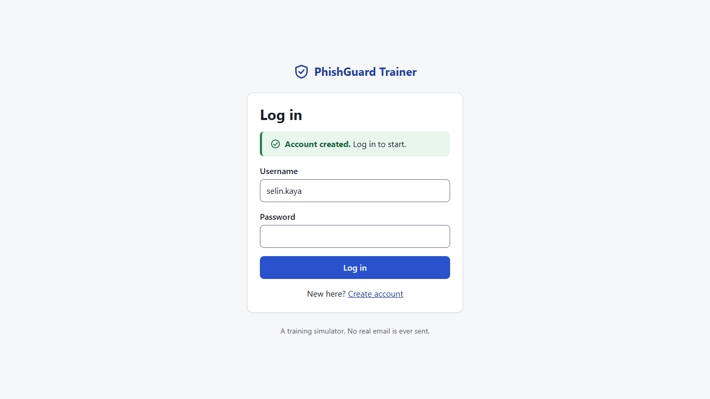 &nbsp; 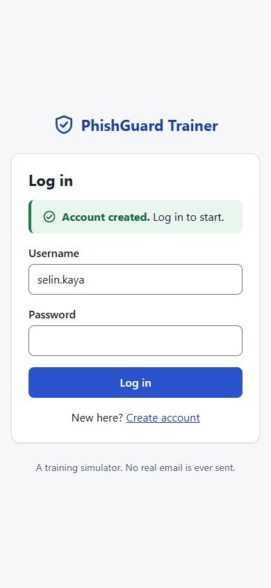

The export shows the state after a successful registration (FLOW-01 step 4): notice "Account created", username pre-filled.

| Aspect | Specification |
|---|---|
| Elements | Product name; card with title *Log in*; notice area above the form; *Username*; *Password*; primary button *Log in*; link *Create account* (to SCR-02); one line that says the product is a simulator. |
| States | **Default:** empty form, no notice. **Account created:** green notice, username pre-filled, password empty. **Session expired:** info notice "Your session has expired. Please log in again." **Empty field:** message under the field, nothing is sent. **400:** error notice "Enter your username and password." **401:** error notice "Username or password is wrong." – the same text for an unknown user and a wrong password (FR-07); the password field is cleared. **429:** warning notice "Too many failed attempts. Try again in *n* seconds."; the button is disabled and counts down (SCR-11 state 4). **Loading:** button disabled with the label "Logging in…". |
| API operation | `login`, then `getCurrentUser`. |
| Accessibility | Labels are tied to the inputs; `autocomplete="username"` and `"current-password"` so that password managers work. A notice with an error is announced (`role="alert"`) and receives focus. `Enter` in a field submits the form. The password is never shown in a message. |
| Requirements | FR-06 … FR-08, FR-10, FR-14 |

### SCR-02 Register

**Purpose.** Create a learner account. Route `/register`. Flow: FLOW-01.

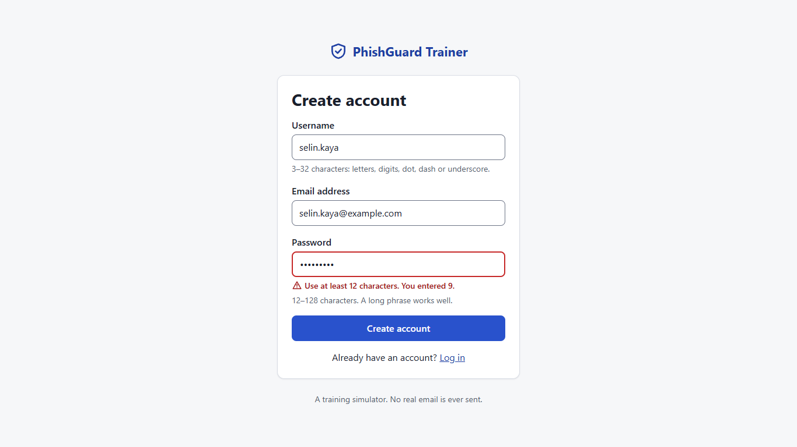 &nbsp; 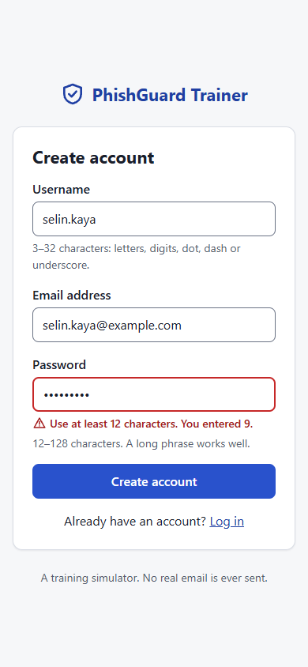

The export shows a field error: the password is too short.

| Aspect | Specification |
|---|---|
| Elements | Card with title *Create account*; *Username* with the hint "3–32 characters: letters, digits, dot, dash or underscore"; *Email address*; *Password* with the hint "12–128 characters. A long phrase works well."; primary button *Create account*; link *Log in* (to SCR-01). There is no "repeat password" field and no composition rule (ASVS V2.1.9). |
| States | **Default:** empty form. **Invalid in the browser:** red border and message under each invalid field, focus on the first one; nothing is sent. **400:** the message of each entry of `errors[]` under its field (D-12). **409:** error notice "This username or email address is already in use."; the form stays filled, the password is cleared. **429:** warning notice with the seconds from `Retry-After`; button disabled until then. **201:** SCR-01 opens with the notice "Account created. Log in to start." |
| API operation | `registerUser`. |
| Accessibility | An invalid field has `aria-invalid="true"` and its message is tied to it with `aria-describedby`, before the hint. Messages say how to fix the value ("Use at least 12 characters. You entered 9."). `autocomplete="new-password"`. |
| Requirements | FR-01 … FR-04, FR-16 |

### SCR-03 Home / Dashboard

**Purpose.** Start screen after login: start a session, see the last result, go to the history; admins also reach the administration. Route `/`. Flows: FLOW-01 … FLOW-07.

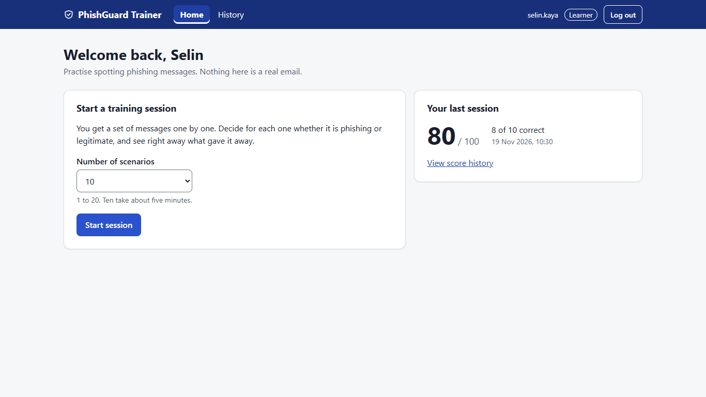 &nbsp; 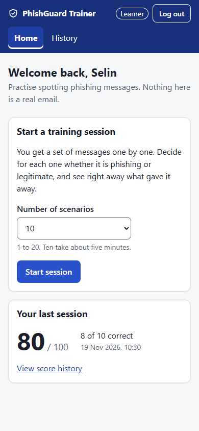

The export shows the learner. The admin variant is in the prototype: `design/screens/SCR-03-home.html#admin`.

| Aspect | Specification |
|---|---|
| Elements | Page header; greeting; card *Start a training session* with one sentence that explains a session, the select *Number of scenarios* (1–20, default 10) and the primary button *Start session*; card *Your last session* with score, "*x* of *N* correct", date and the link *View score history*. **Admin only:** navigation entries *Scenarios* and *Statistics* and the card *Administration* with *Manage scenarios* and *View statistics*. A learner never receives these elements (FR-61). If US-25 (Could) is built, a *Difficulty* select is added next to the number. |
| States | **No session yet:** the card *Your last session* shows "You have not completed a session yet." **422:** error notice under the button, "Not enough scenarios are available. Choose a smaller number." **429:** warning notice with the seconds; the button is disabled until then. **400:** cannot be caused from the select; shown as *something went wrong*. **Loading:** the button is disabled with the label "Starting…". |
| API operation | `startSession` (button); `listMyResults` with `limit=1` (last session); `getCurrentUser` (role for the navigation). |
| Accessibility | The select has a visible label and a hint. The cards are sections with headings, so a screen-reader user can jump between them. The admin elements are not rendered for a learner at all (not only hidden). |
| Requirements | FR-09, FR-28, FR-29, FR-61 |

### SCR-04 Inbox scenario view

**Purpose.** Show one scenario like a message in an inbox and take the learner's verdict. Route `/training`. Flow: FLOW-03.

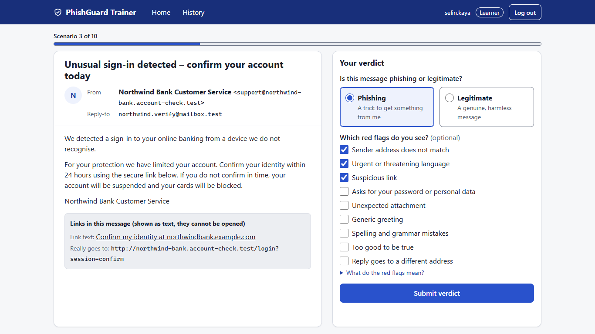 &nbsp; 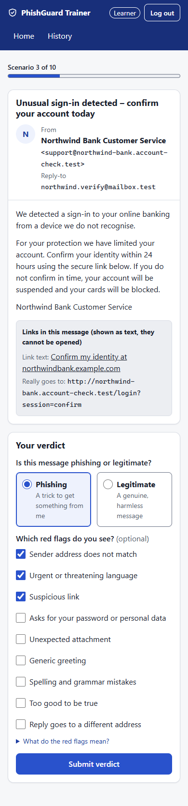

| Aspect | Specification |
|---|---|
| Elements | Page header; progress "Scenario *n* of *N*" with a bar. **Message card:** subject, avatar initial, *From* (sender name in bold, full address in monospace), *Reply-to* (only when present), body as plain text, link box with *Link text* and *Really goes to* for each link. **Verdict card:** question "Is this message phishing or legitimate?" with the two radio cards *Phishing* and *Legitimate*; optional checklist "Which red flags do you see?" with the nine indicator names; the disclosure *What do the red flags mean?* with the nine descriptions; primary button *Submit verdict*. |
| Layout | Laptop: message on the left, verdict card on the right (480 px); the whole screen fits the window and only the message text scrolls when it is long. Phone: message first, verdict card below it. |
| States | **Nothing chosen:** *Submit verdict* is disabled and the hint "Choose Phishing or Legitimate first" is shown. **Submitting:** all controls are locked so that the answer cannot be sent twice. **200:** SCR-05 opens in place of the verdict card. **409 already answered:** info notice "You already answered this scenario. Your first answer is kept." and the next scenario is shown. **409 session completed:** notice with a link to SCR-07. **403 / 404 / 400:** SCR-11. **Leaving an unfinished session:** a confirmation dialog "Leave this session? Your answers so far are kept, but the session cannot be resumed." |
| API operation | `submitAnswer`. The scenarios come from the `startSession` answer of SCR-03; this screen loads nothing itself. |
| Accessibility | The two verdicts are one radio group with a `legend`; the arrow keys change the choice. The checklist is a second `fieldset`. Each checkbox is tied to its description (`aria-describedby`), so a screen reader reads the description even while the disclosure is closed. The message text is a focusable region, so it can be scrolled with the keyboard. Scenario text is rendered as text; markup in it is shown, never executed (FR-20). The verdict cards have the same colour and size, and *Phishing* is listed first on every scenario. |
| Requirements | FR-20, FR-43 … FR-46 |

**Usability decisions.**

1. *Links as two lines of text.* A phishing link is recognised by comparing what it says with where it goes. An email client shows the target only on hover, which does not exist on a phone and would need a clickable element. The link box shows both lines at once and makes the comparison the natural reading step.
2. *Addresses in monospace.* Look-alike domains differ by one character; a monospace font makes `rn` and `m`, or `1` and `l`, easier to tell apart.
3. *Neutral verdict cards.* Red for *Phishing* and green for *Legitimate* would read as "danger" and "safe" and push the learner towards one answer.
4. *Descriptions one step away.* Nine names fit beside the message without scrolling; nine names with descriptions do not. The descriptions are in a disclosure on this screen and are always shown in full in the feedback (SCR-05), where they matter most.
5. *The checklist is optional.* A first-time user can finish a session with ten single choices (NFR-07); the checklist is there for learners who want to practise naming the red flags.

### SCR-05 Feedback panel

**Purpose.** Tell the learner whether the verdict was right and why, next to the message. It is a panel of SCR-04, not a page. Flow: FLOW-03.

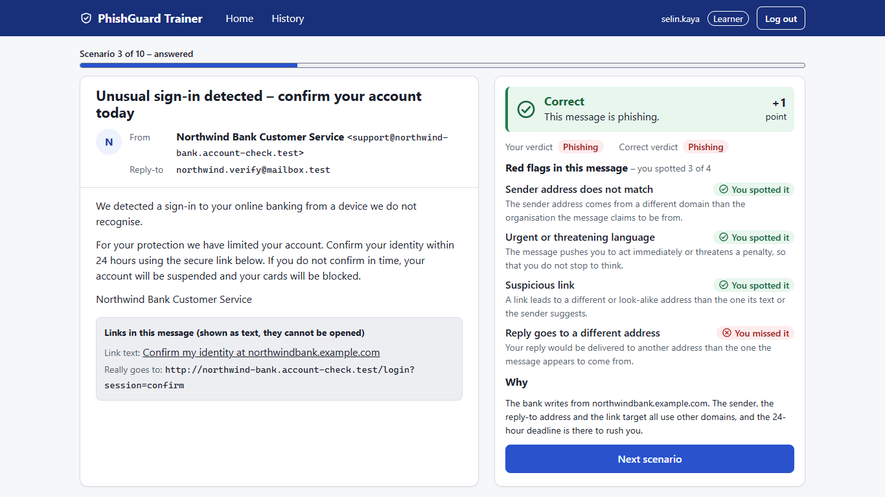 &nbsp; 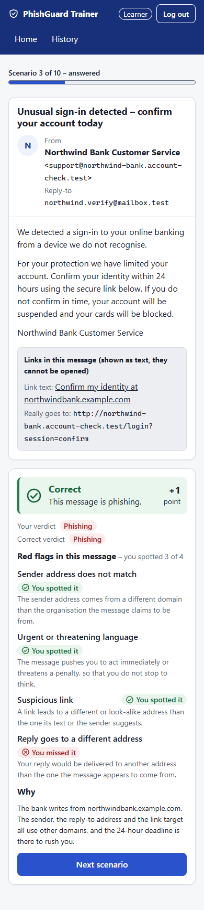

| Aspect | Specification |
|---|---|
| Elements | In the place of the verdict card: **result banner** (icon, *Correct* or *Not correct*, "This message is phishing / legitimate", points awarded); **verdict line** (*Your verdict*, *Correct verdict* as badges); **Red flags in this message** with "you spotted *x* of *y*" and one row per indicator of the scenario: name, tag *You spotted it* or *You missed it*, description; **Why** with the explanation; primary button *Next scenario* (*See results* on the last scenario). The progress text adds "– answered". |
| Layout | Laptop: the panel replaces the verdict card on the right; the message stays where it was. With four indicators and an explanation of three lines the panel ends at 752 px of the 768 px window and needs no scrolling, neither of the page nor inside the panel (NFR-09). A longer panel scrolls inside itself, never the page. Phone: the panel is below the message and is scrolled into view. |
| States | **Correct:** green banner, check icon. **Not correct:** red banner, cross icon, "Not correct – this message is legitimate". **Legitimate scenario without indicators:** the red-flag section shows "This message has no red flags." **Indicators flagged that the scenario does not have:** not listed, the feedback only names what is in the message. **Last scenario:** button *See results* calls `completeSession`. **409 scenarios unanswered:** the first unanswered scenario opens (D-04). **409 already completed:** SCR-07 opens. |
| API operation | Shows the `AnswerFeedback` of `submitAnswer` (`correct`, `correctVerdict`, `correctIndicators`, `missedIndicators`, `explanation`, `pointsAwarded`). *See results* calls `completeSession`. |
| Accessibility | When the panel opens, focus moves to it and the result is announced (`role="status"`). The result is given by icon and word, not by colour. *Next scenario* is the last element of the panel and the next stop of the Tab key. On the next scenario, focus moves to the subject of the new message. |
| Requirements | FR-26, FR-34, FR-43, NFR-09 |

**Usability decisions.**

1. *Same screen, beside the message.* Feedback on a new page would make the learner remember the message. Here every red flag can be checked against the sender, the reply-to address and the link target while reading.
2. *Result first, reasons second.* The banner answers "was I right?" in one glance; the list answers "what should I have seen?".
3. *Missed flags stand out.* The one thing a learner can improve is what they did not see. Missed indicators carry a red tag; spotted ones a quiet green tag.
4. *No scrolling at laptop size.* The training layout takes the height of the window, so the button for the next scenario is always in the same place and the session keeps its pace.

### SCR-06 Session summary

**Purpose.** Show the result of the finished session. Route `/training/summary`. Flows: FLOW-03, FLOW-04.

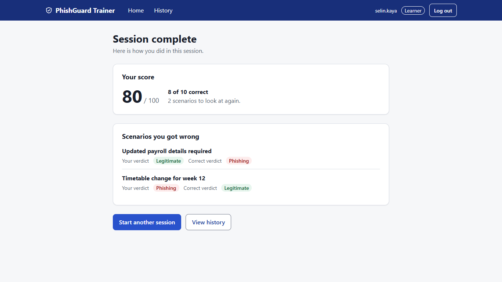 &nbsp; 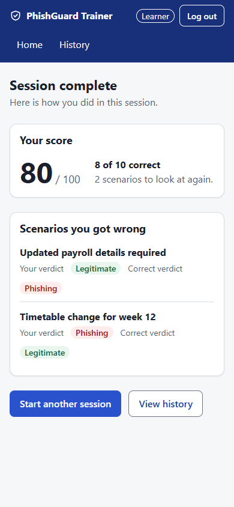

| Aspect | Specification |
|---|---|
| Elements | Title *Session complete*; card *Your score* with the score (0–100), "*x* of *N* correct" and the number of scenarios to look at again; card *Scenarios you got wrong* with subject, *Your verdict* and *Correct verdict* for each; primary button *Start another session* (SCR-03); secondary button *View history* (SCR-07). |
| States | **All correct:** the second card shows "You got every scenario right." **Opened without a finished session** (for example after a reload): SCR-03 opens, because the result can be read in the history. |
| API operation | Shows the `SessionResult` of `completeSession`. The list of wrong scenarios is built from the feedback already received in SCR-05; nothing is loaded. |
| Accessibility | The score is text, not an image. The title receives focus when the screen opens so that the result is read first. |
| Requirements | FR-47 |

### SCR-07 Score history

**Purpose.** List the learner's own completed sessions, newest first, with a trend. Route `/history`. Flows: FLOW-03, FLOW-04.

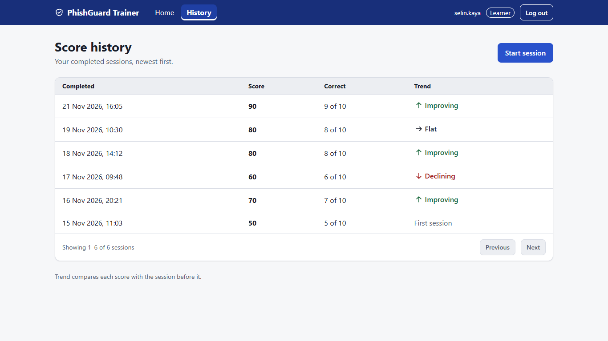 &nbsp; 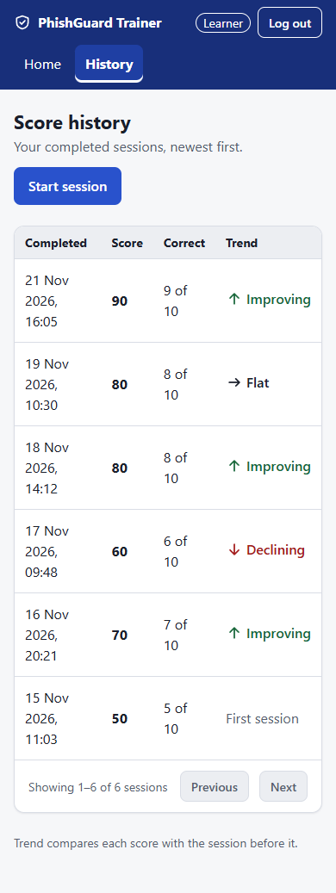

| Aspect | Specification |
|---|---|
| Elements | Title; primary button *Start session*; table with *Completed* (date and time), *Score*, *Correct* ("*x* of *N*"), *Trend*; footer "Showing *a*–*b* of *total* sessions" with *Previous* and *Next*; one line that explains the trend. If FR-51 (Could) is built, a chart of score over time sits above the table. |
| Trend | Compared with the session before it (D-05): higher – up arrow and *Improving* (green); equal – right arrow and *Flat*; lower – down arrow and *Declining* (red). The oldest session shows *First session* and no arrow. |
| States | **Empty** (`total` = 0): SCR-11 state 5 "You have not completed a session yet" with *Start session* in place of the table. **One page only:** both paging buttons disabled. **Loading a page:** the table stays, the buttons are disabled. **Error:** SCR-11 *something went wrong* with *Retry*. |
| API operation | `listMyResults` (`limit` 20, `offset` by page). |
| Accessibility | A real table with column headers. The trend is icon plus word. Disabled paging buttons stay in the reading order and are announced as unavailable. |
| Requirements | FR-48 … FR-51 |

### SCR-08 Admin scenario list

**Purpose.** Table of all scenarios; way into creating, editing and deleting. Route `/admin/scenarios`. Flows: FLOW-05, FLOW-06, FLOW-07.

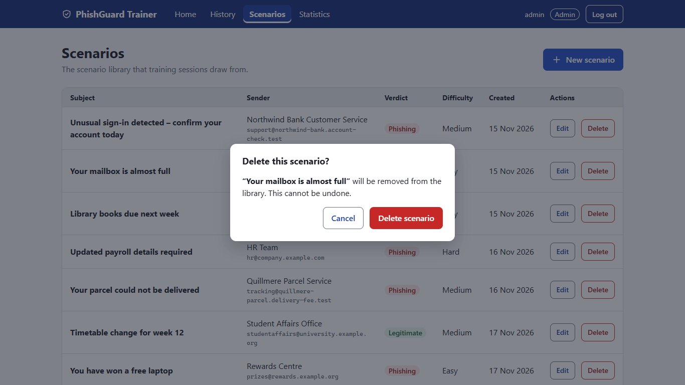 &nbsp; 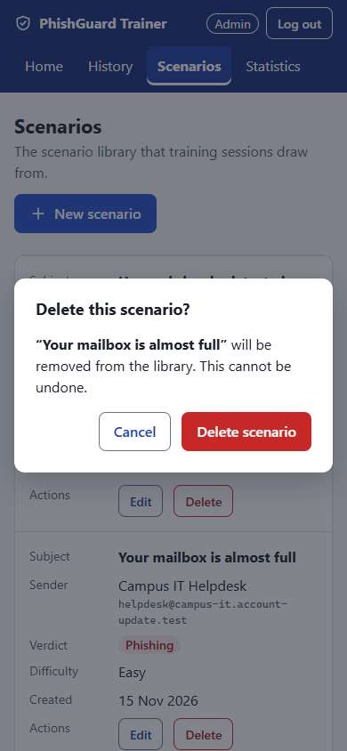

The export shows the delete confirmation dialog (FLOW-05 step 7). The plain list with the toast "Scenario saved." is the default state of `design/screens/SCR-08-admin-scenario-list.html`.

| Aspect | Specification |
|---|---|
| Elements | Title; primary button *New scenario*; table with *Subject*, *Sender* (name and address), *Verdict* (badge *Phishing* or *Legitimate*), *Difficulty*, *Created*, *Actions* (*Edit*, *Delete*); paging footer. On a phone each scenario is a block with the column name in front of each value. **Dialog:** title "Delete this scenario?", the subject of the scenario in quotes, "This cannot be undone.", *Cancel* and *Delete scenario*. **Toast:** "Scenario saved." or "Scenario deleted." |
| States | **Empty library:** SCR-11 state 5 "No scenarios yet" with *New scenario*. **Dialog open:** nothing is sent until *Delete scenario* is chosen; *Cancel* and `Esc` close it and delete nothing. **204:** dialog closes, toast "Scenario deleted.", table reloads. **404 on edit or delete:** info notice "This scenario no longer exists." and the table reloads. **Learner opens the route:** SCR-11 *forbidden*; no admin operation is called. |
| API operation | `adminListScenarios` (table and paging), `adminDeleteScenario` (dialog). *Edit* leads to SCR-09, which calls `adminGetScenario`. |
| Accessibility | *Edit* and *Delete* carry the subject in their accessible name ("Delete: Your mailbox is almost full"), so that they can be told apart out of context. The dialog is an `alertdialog` with a title and a description; focus starts on *Cancel*, the safe choice, stays inside the dialog and returns to the *Delete* button of the row afterwards. The verdict badge contains the word. |
| Requirements | FR-53, FR-58, FR-60 |

### SCR-09 Admin scenario form

**Purpose.** Create or edit one scenario, with a message for each invalid field. Routes `/admin/scenarios/new` and `/admin/scenarios/{scenarioId}/edit`. Flows: FLOW-05, FLOW-07.

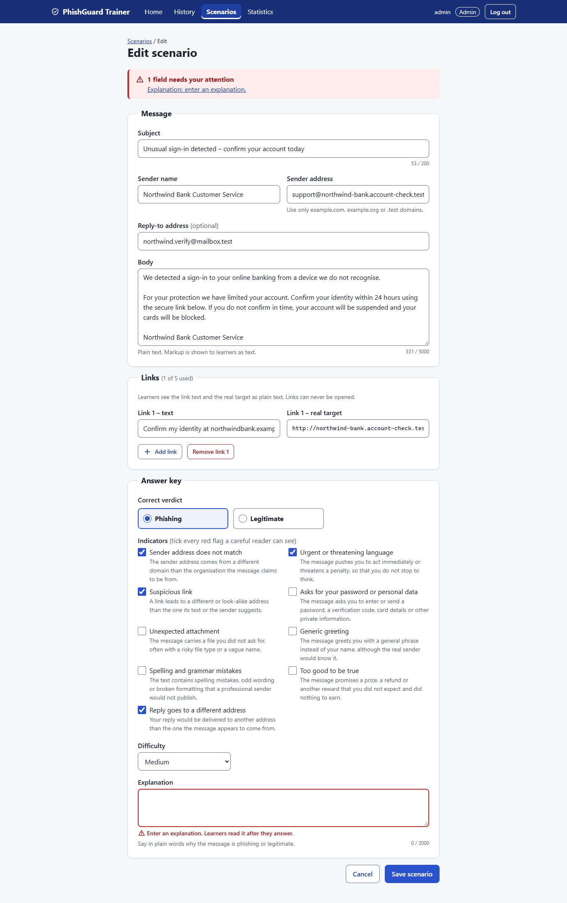 &nbsp; 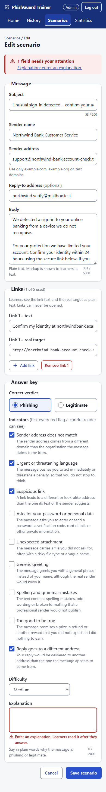

The export shows the edit form with one invalid field (the explanation is empty).

| Aspect | Specification |
|---|---|
| Elements | Path *Scenarios / Edit*; title *Edit scenario* or *New scenario*; error summary (only when a field is invalid). **Message:** *Subject* (200), *Sender name* (100), *Sender address* (254), *Reply-to address* (optional, 254), *Body* (5000, plain text). **Links:** up to five pairs *text* and *real target*, *Add link*, *Remove link n*, counter "*n* of 5 used". **Answer key:** *Correct verdict* (radio cards), *Indicators* (nine checkboxes with name and description), *Difficulty* (Easy, Medium, Hard), *Explanation* (2000). Buttons *Cancel* (back to SCR-08, nothing sent) and *Save scenario*. Long fields show a character counter. |
| States | **New:** empty form, verdict not chosen, no indicator ticked. **Edit:** filled from `adminGetScenario`. **Invalid in the browser or 400:** error summary at the top with one link per invalid field, red border and message under each field; the entered values stay; nothing is stored. **Five links used:** *Add link* is disabled. **201 / 200:** SCR-08 opens with the toast "Scenario saved." **404:** SCR-08 opens with the notice "This scenario no longer exists." **Legitimate chosen:** the indicator list stays available but a hint says "A legitimate message normally has no red flags." |
| API operation | `adminGetScenario` (edit only), `adminCreateScenario` or `adminUpdateScenario` (*Save scenario*). |
| Accessibility | The three parts are `fieldset`s with a `legend`. After a failed save, focus moves to the error summary; each entry is a link to its field. Messages are tied to their fields with `aria-describedby`. The indicator list comes from the contract enum, so an unknown code cannot be entered. The hint under *Sender address* reminds the author to use only `example.com`, `example.org` or `.test` domains. |
| Requirements | FR-52, FR-54, FR-56, FR-59 |

### SCR-10 Admin statistics

**Purpose.** Aggregate figures and the hardest scenarios. Route `/admin/stats`. Flows: FLOW-06, FLOW-07.

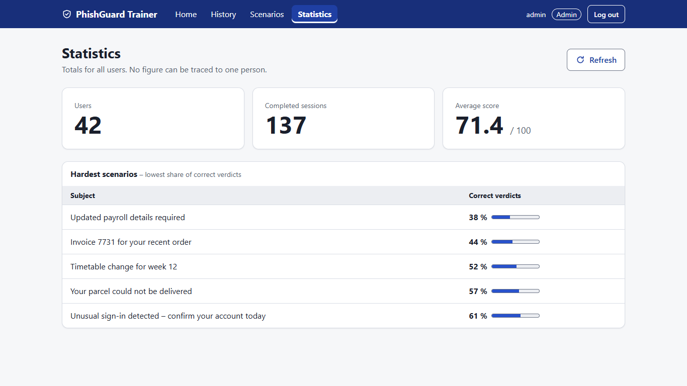 &nbsp; 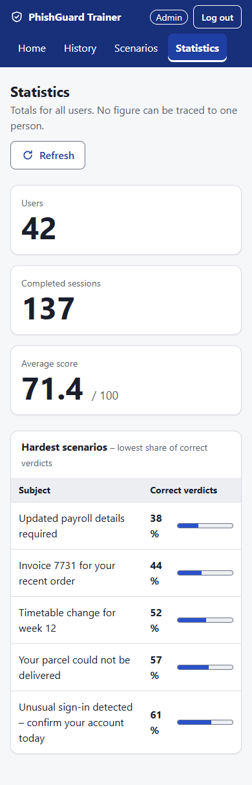

| Aspect | Specification |
|---|---|
| Elements | Title with the line "Totals for all users. No figure can be traced to one person."; secondary button *Refresh*; three stat tiles *Users*, *Completed sessions*, *Average score* (one decimal, out of 100); table *Hardest scenarios* with *Subject* and *Correct verdicts* (percentage with a small bar), at most five rows, lowest rate first. |
| States | **No completed session:** the tiles show 0 and the table is replaced by SCR-11 state 5 "No answers yet". **Fewer than five scenarios with answers:** a shorter table. **Refreshing:** the figures stay, the button is disabled. **Error:** SCR-11 *something went wrong* with *Retry*. **Learner opens the route:** SCR-11 *forbidden*. |
| API operation | `adminGetStats`. `correctRate` (0–1) is shown as a whole percentage. |
| Accessibility | Each tile is a labelled section, read as "Users, 42". The percentage is text; the bar is decoration and hidden from assistive technology. The table has a caption. No row is a link: the operation returns no per-user data (FR-66). |
| Requirements | FR-65 … FR-67 |

### SCR-11 Error and empty states

**Purpose.** One pattern for every case in which a screen cannot show its normal content. It is a family of five states, not one page. Flows: FLOW-03 … FLOW-07.

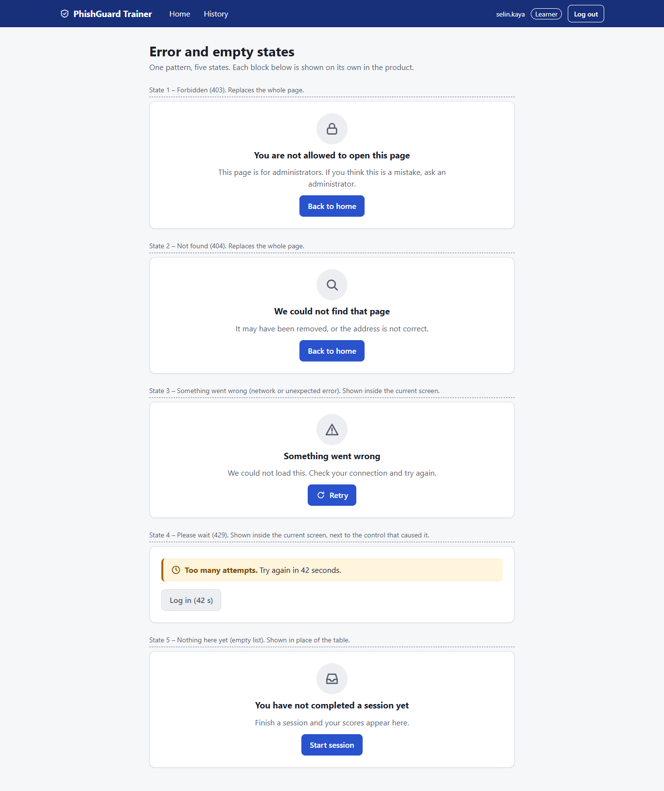 &nbsp; 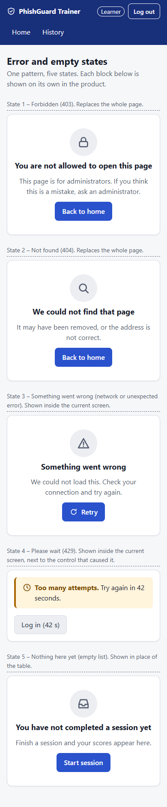

The export shows the five states below each other. The dashed captions are notes for the reader and are not part of the product.

| # | State | Trigger | Where | Text | Action |
|---|---|---|---|---|---|
| 1 | Forbidden | 403, or a learner opens an admin route | Replaces the page content (`/forbidden`) | "You are not allowed to open this page" | *Back to home* (SCR-03) |
| 2 | Not found | 404, or an unknown route | Replaces the page content | "We could not find that page" | *Back to home* (SCR-03) |
| 3 | Something went wrong | Network error or a status that the screen does not handle | Inside the current screen | "Something went wrong. We could not load this. Check your connection and try again." | *Retry* (repeats the request) |
| 4 | Please wait | 429 | Inside the current screen, next to the control that caused it (SCR-01, 02, 03) | "Too many attempts. Try again in *n* seconds." | The control is disabled and counts down from `Retry-After` |
| 5 | Nothing here yet | A list with `total` = 0 | In place of the table (SCR-07, 08, 10) | Says what is missing and how it gets filled | The next useful action (*Start session*, *New scenario*) |

| Aspect | Specification |
|---|---|
| Elements | State block: icon in a circle, title, one sentence, one button. State 4 uses the warning notice and the disabled button instead. |
| Rules | No status code, no stack trace, no technical word in any text (FR-19, NFR-23). The page header stays, so the user can always navigate away. States 3 to 5 keep the user on the screen they were on. |
| API operation | None of its own. It shows the outcome of the operation of the screen it appears on. |
| Accessibility | States 1 and 2 put the title in the page heading and move focus to it. States 3 and 4 are announced with `role="alert"`. The countdown updates the visible text every second but is announced only once, so a screen reader is not flooded. The icon is decoration. |
| Requirements | FR-08, FR-11, FR-18, FR-19, FR-61 |

---

## 6 How the accessibility targets are met

| NFR | Target | How the design meets it |
|---|---|---|
| NFR-09 | Feedback visible without scrolling at 1366×768 | The training layout takes exactly the window height; message and panel sit side by side; only the message text scrolls. Measured in the prototype: the panel ends at 752 px of 768 px with four indicators, with no scrolling inside it. |
| NFR-10 | Contrast at least 4.5:1 | All colours come from the tokens; the 24 text pairs of section 3.2 reach at least 5.62:1. |
| NFR-11 | Keyboard only, no trap | Only native controls (links, buttons, inputs, radio buttons, checkboxes, select, details). The dialog keeps focus inside while it is open and gives it back when it closes. The scrolling message text is focusable. |
| NFR-12 | Every control has a label | Visible `label` or `legend` for every input and group; row buttons in tables carry the subject in their accessible name; icons are decoration (`aria-hidden`). |
| NFR-13 | Visible focus | One global rule: a 3 px violet ring with a 2 px gap on every focusable element, white inside the dark header. The colour is used for nothing else. |
| NFR-14 | No serious or critical axe violation | Landmarks (`header`, `nav`, `main`), one `h1` per screen, headings in order, `lang="en"`, tables with header cells. Checked by the scan of T-47. |
| NFR-36 | No horizontal scrolling at 390×844 and 1366×768 | One layout change at 768 px; wide tables stack on a phone; long addresses wrap. `design/export.mjs` fails when a screen is wider than its viewport; the last run passed for all 22 captures. |
| NFR-07 | First session within 5 minutes | One primary action per screen; registration with three fields; a session needs one choice and one button per scenario. Measured in T-80. |

---

## 7 Coverage checks

### 7.1 Screens → prototype, specification, flows and operations

| Screen | Prototype file (`design/screens/`) | Spec section | Flows | API operations |
|---|---|---|---|---|
| SCR-01 | `SCR-01-login.html` | 5, SCR-01 | FLOW-01, 02, 07 | `login`, `getCurrentUser` |
| SCR-02 | `SCR-02-register.html` | 5, SCR-02 | FLOW-01 | `registerUser` |
| SCR-03 | `SCR-03-home.html` | 5, SCR-03 | FLOW-01 … 07 | `startSession`, `listMyResults`, `getCurrentUser` |
| SCR-04 | `SCR-04-inbox-scenario-view.html` | 5, SCR-04 | FLOW-03 | `submitAnswer` |
| SCR-05 | `SCR-05-feedback-panel.html` | 5, SCR-05 | FLOW-03 | `submitAnswer` (answer), `completeSession` |
| SCR-06 | `SCR-06-session-summary.html` | 5, SCR-06 | FLOW-03, 04 | `completeSession` (answer) |
| SCR-07 | `SCR-07-score-history.html` | 5, SCR-07 | FLOW-03, 04 | `listMyResults` |
| SCR-08 | `SCR-08-admin-scenario-list.html` | 5, SCR-08 | FLOW-05, 06, 07 | `adminListScenarios`, `adminDeleteScenario` |
| SCR-09 | `SCR-09-admin-scenario-form.html` | 5, SCR-09 | FLOW-05, 07 | `adminGetScenario`, `adminCreateScenario`, `adminUpdateScenario` |
| SCR-10 | `SCR-10-admin-statistics.html` | 5, SCR-10 | FLOW-06, 07 | `adminGetStats` |
| SCR-11 | `SCR-11-error-and-empty-states.html` | 5, SCR-11 | FLOW-03 … 07 | – |

### 7.2 Results

| Check | Result |
|---|---|
| Every screen of the flows document (SCR-01 … SCR-11) has a prototype and a specification section. | Pass – 11 of 11. |
| 22 PNG exports exist (11 screens × 2 viewports). | Pass. |
| Every API operation that the user interface uses (13 of 14, all but `getHealth`) belongs to at least one screen. | Pass – 13 of 13. |
| Every flow FLOW-01 … FLOW-07 is linked from at least one screen. | Pass – 7 of 7. |
| Every text pair of the tokens reaches 4.5:1. | Pass – 24 of 24 (section 3.2). |
| No real brand, real domain, logo or working link in scenario content. | Pass – all addresses use `example.com`, `example.org` or `.test`; scenario links are plain text. |
| No screen scrolls sideways at either viewport. | Pass – checked by `design/export.mjs`. |
| The indicator names and descriptions equal the indicator vocabulary (`docs/product/indicator-vocabulary.md`). | Pass – 9 of 9. |

### 7.3 Notes for the implementation tasks

- The prototype shows one fixed state per screen. The states of section 5 that are not in an export are specified in words; they use only components of section 4.
- The prototype uses links where the product uses buttons (for example *Log out*, *Delete*), so that the screens can be clicked through without script. In the product, an action is a `button` and navigation is a link.
- The points in the feedback ("+1 point") are an example; the screen shows the value of `pointsAwarded`.
- The contract has no operation to read an open session again, so the summary (SCR-06) builds its list of wrong scenarios from the feedback it already received.

---

## 8 Figma

| Item | Value |
|---|---|
| Figma file | *PhishGuard Trainer – UI* |
| Link (anyone with the link can view) | FIGMA_LINK_TBD |
| Pages | Tokens, Components, Desktop, Mobile, Flows |
| Source of the frames | The PNG exports in `design/exports/` and the tokens in `design/tokens.css` |

The Figma file is rebuilt by hand from this prototype: the tokens become Figma variables and styles, each screen becomes one frame at 1366×768 and one at 390×844 with auto layout, and the prototype interactions follow FLOW-01 … FLOW-07. The HTML prototype stays the reference; when the two differ, the tokens and this document decide.

---

## Revision history

| Version | Date | Author | Change |
|---|---|---|---|
| 1.0 | 2026-11-15 | Duhan Kaan Şenol | First version for Sprint 2 (task T-54): tokens, 11 screen prototypes, 22 exports, UI specification. |
