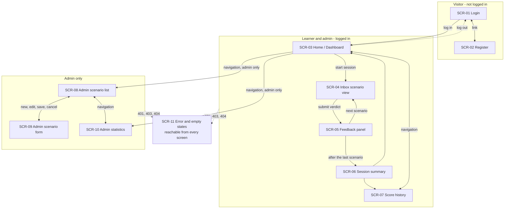
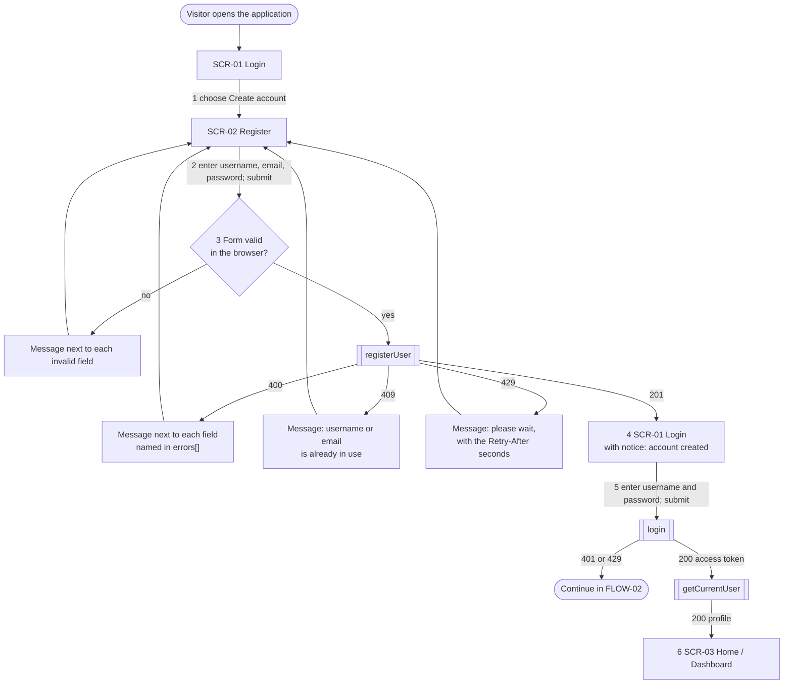
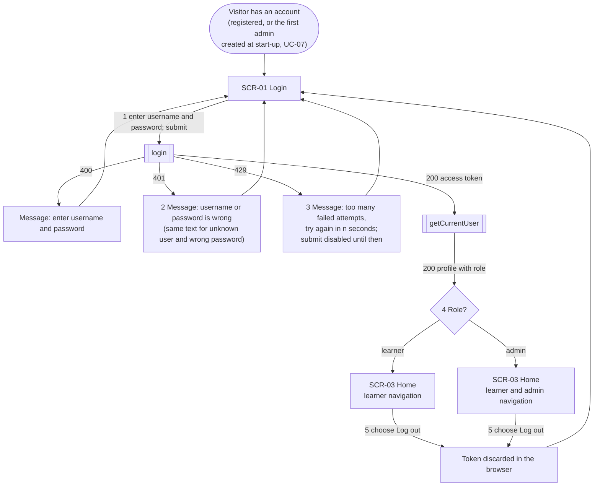
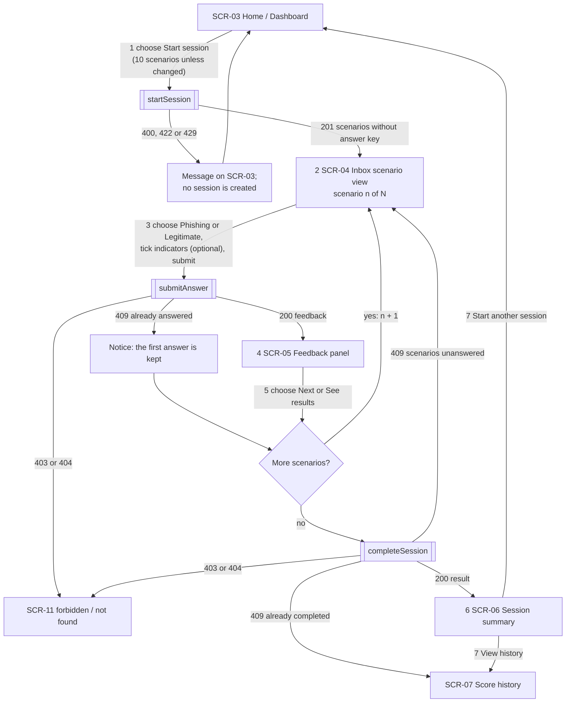
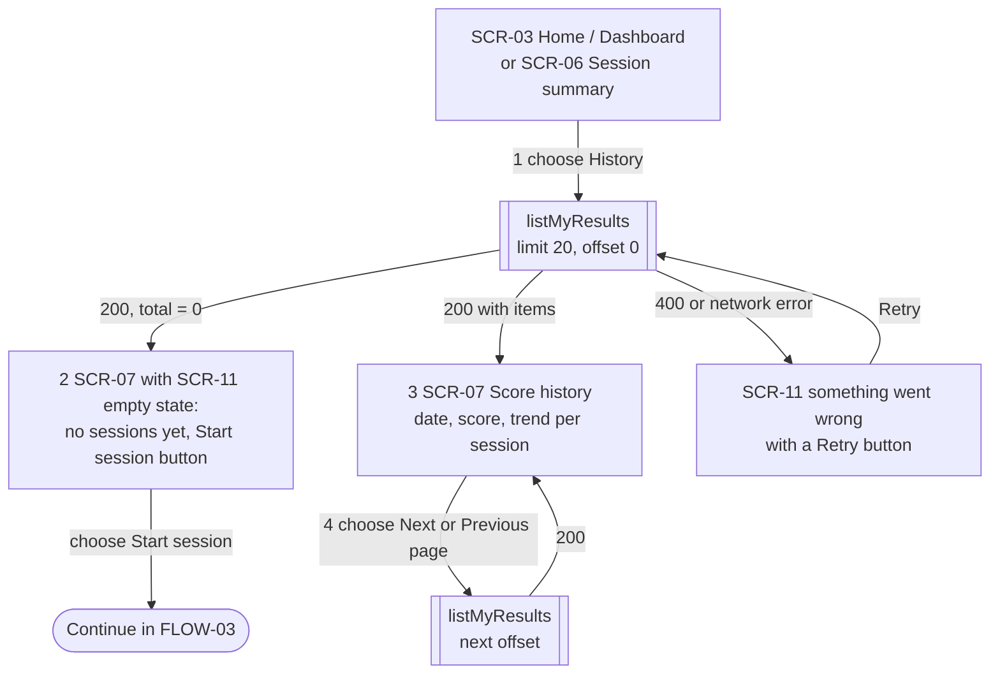
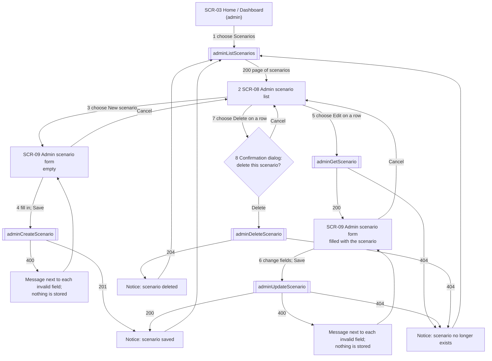
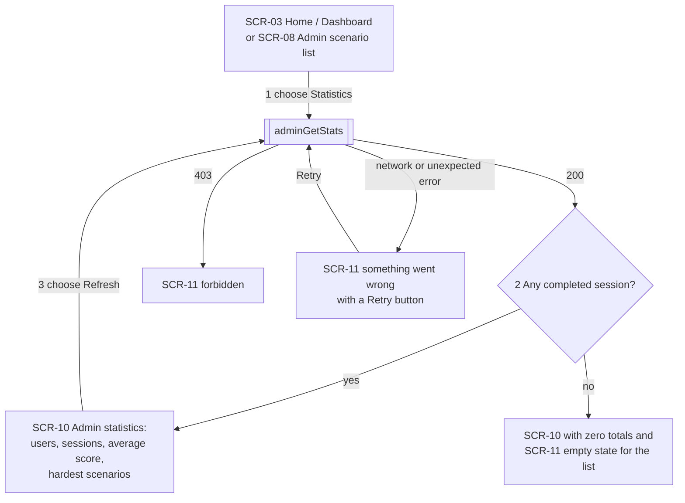
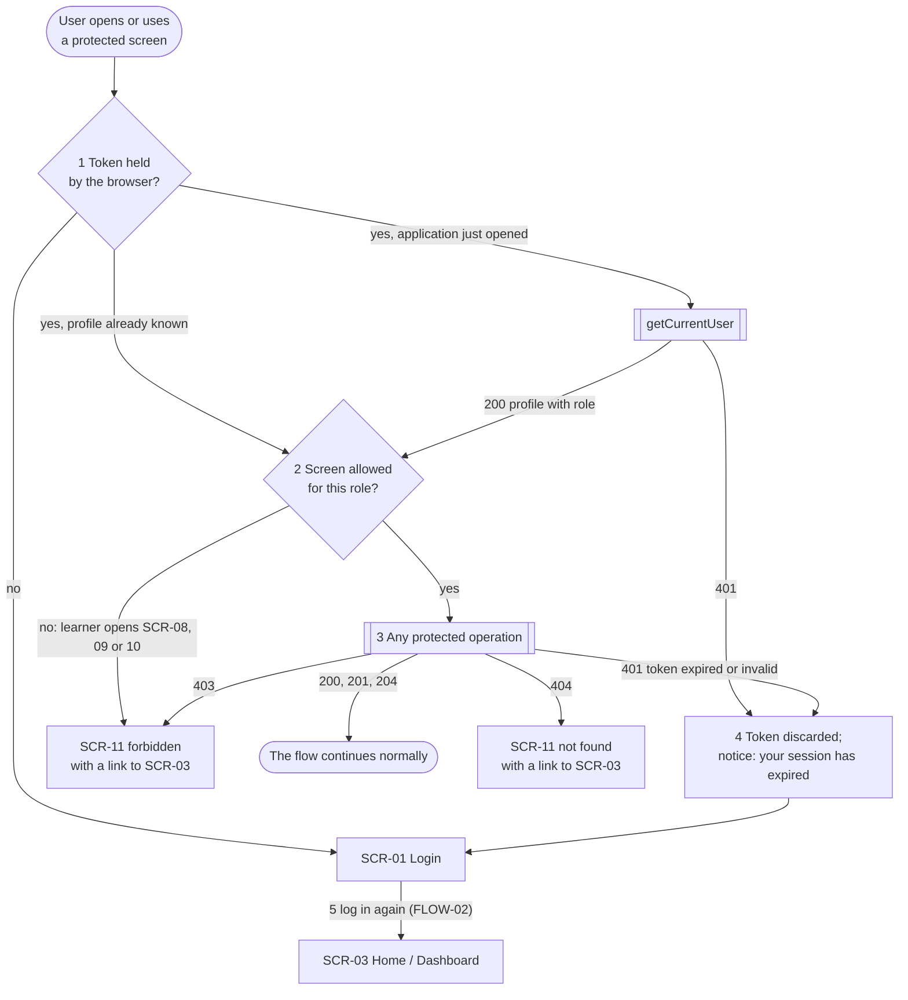

# User Flows and Site Map

| Field | Value |
|---|---|
| Project | PhishGuard Trainer – a phishing-awareness simulator |
| Version | 1.1 |
| Date | 2026-11-18 |
| Owner | Duhan Kaan Şenol (`ThatsKafiBRO`) – Requirements & UX Engineer |
| Team | SENG 321 – Team 16 |
| Related tasks | T-59 (this document), T-53 (SRS, use cases), T-57 (decision log), T-54 (UI/UX prototypes and UI specification), T-69 (web app shell) |
| Related stories | US-01 … US-05, US-08 … US-17 (every story with a user interface); US-24 and US-25 as optional branches |

---

## 1 About this document

This document shows **how a user moves through PhishGuard Trainer**: which screen they are on, what they do, what the system answers and which API operation is called. It is the bridge between the use cases of the SRS ([`01-Software-Requirements-Specification.md`](01-Software-Requirements-Specification.md), section 5) and the screen designs of the UI/UX prototypes (`04-UI-UX-Prototypes.md`, task T-54).

It contains:

- the list of screens with their identifiers `SCR-01` … `SCR-11` (section 2),
- a site map with role-based access (section 3),
- seven user flows `FLOW-01` … `FLOW-07`, each as a diagram and a step table (section 4),
- a summary of where errors and rate limits appear in the user interface (section 5),
- the coverage checks against the use cases and the API contract (section 6).

### 1.1 How the flows were derived

1. **One flow per user goal.** Every use case UC-01 … UC-06 of the SRS became a flow. UC-01 and the first login are drawn together as FLOW-01 because a new visitor does them in one go. UC-07 (bootstrap first admin) is an operator task without a screen; its only step in the user interface is the first admin login, which is part of FLOW-02.
2. **Main flow first, then every exception.** The main flow of the use case gives the steps of the table. Every alternative and exception flow of the use case (for example *4b username already in use*) gives one error branch.
3. **Each system step is tied to the contract.** Every step in which the user interface talks to the server names the `operationId` of `api/openapi.yaml` (version 0.2.0). The status codes of the error branches are the ones the contract lists for that operation.
4. **Cross-cutting behaviour is drawn once.** A missing or expired token (401) and a forbidden action (403) can happen on every protected screen. They are drawn once in FLOW-07, and the other flows refer to it.

### 1.2 Reading the diagrams

| Shape | Meaning |
|---|---|
| Rectangle | A screen (`SCR-xx`) or a message shown on a screen |
| Rectangle with double side lines | A call of an API operation (the label is the `operationId`) |
| Diamond | A decision made by the user interface or the user |
| Rounded box | Start or end of a flow |
| Label on an arrow | The user action, or the HTTP status of the answer |

The number in front of a label (for example **3**) is the step number in the table under the diagram.

---

## 2 Screens

The screen identifiers are fixed here and are used unchanged by the UI/UX prototypes (T-54) and the implementation tasks. The routes are a proposal for the web app shell (T-69); the identifiers do not depend on them.

| ID | Screen | Purpose | Who may open it | Proposed route | Requirements |
|---|---|---|---|---|---|
| SCR-01 | Login | Enter username and password; link to registration | Visitor | `/login` | FR-06 … FR-08, FR-10, FR-14 |
| SCR-02 | Register | Create a learner account | Visitor | `/register` | FR-01 … FR-04, FR-16 |
| SCR-03 | Home / Dashboard | Start screen after login: start a session, go to the history; admins also see the administration entries | Learner, Admin | `/` | FR-09, FR-28, FR-29, FR-61 |
| SCR-04 | Inbox scenario view | One scenario shown like an inbox message, with the verdict controls and the indicator checklist | Learner, Admin | `/training` | FR-20, FR-43 … FR-46 |
| SCR-05 | Feedback panel | Feedback for the submitted verdict; opens inside SCR-04, beside the message on a laptop and below it on a phone | Learner, Admin | (panel of SCR-04) | FR-26, FR-34, FR-43 |
| SCR-06 | Session summary | Score, correct answers out of total, wrongly answered scenarios | Learner, Admin | `/training/summary` | FR-47 |
| SCR-07 | Score history | Completed sessions, newest first, with trend | Learner, Admin | `/history` | FR-48 … FR-51 |
| SCR-08 | Admin scenario list | Table of all scenarios; entry to create, edit and delete (delete confirmation dialog) | Admin | `/admin/scenarios` | FR-53, FR-58, FR-60 |
| SCR-09 | Admin scenario form | Create or edit one scenario, with a message per invalid field | Admin | `/admin/scenarios/new`, `/admin/scenarios/{scenarioId}/edit` | FR-52, FR-54, FR-56, FR-59 |
| SCR-10 | Admin statistics | Aggregate figures and the hardest scenarios | Admin | `/admin/stats` | FR-65 … FR-67 |
| SCR-11 | Error and empty states | A family of states, not one page: *forbidden* (403), *not found* (404), *something went wrong* (network or unexpected error), *please wait* (429) and *nothing here yet* (empty list) | Everyone | (shown in place, or `/forbidden` and any unknown route) | FR-08, FR-11, FR-18, FR-19, FR-61 |

Notes:

- **SCR-05 is a panel, not a page.** The learner must still see the email while reading the feedback, so the feedback opens on the same screen.
- **SCR-11 is used in two ways.** *Forbidden* and *not found* replace the whole page. *Please wait*, *something went wrong* and *nothing here yet* are shown inside the screen the user is on, so the user does not lose their place.
- **Log out** is a control in the page header of every screen from SCR-03 to SCR-10. It is not a screen.

---

## 3 Site map and role-based access

| Screen | Visitor | Learner | Admin | What happens when the role is not allowed |
|---|---|---|---|---|
| SCR-01 Login | yes | – | – | A logged-in user who opens it is sent to SCR-03. |
| SCR-02 Register | yes | – | – | A logged-in user who opens it is sent to SCR-03. |
| SCR-03 Home / Dashboard | no | yes | yes | A visitor is sent to SCR-01 (FLOW-07). |
| SCR-04 Inbox scenario view | no | yes | yes | A visitor is sent to SCR-01. |
| SCR-05 Feedback panel | no | yes | yes | A visitor is sent to SCR-01. |
| SCR-06 Session summary | no | yes | yes | A visitor is sent to SCR-01. |
| SCR-07 Score history | no | yes | yes | A visitor is sent to SCR-01. |
| SCR-08 Admin scenario list | no | no | yes | A visitor is sent to SCR-01. A learner sees SCR-11 *forbidden*; the navigation entry is not shown to a learner at all (FR-61). |
| SCR-09 Admin scenario form | no | no | yes | Same as SCR-08. |
| SCR-10 Admin statistics | no | no | yes | Same as SCR-08. |
| SCR-11 Error and empty states | yes | yes | yes | – |

An admin can do everything a learner can do (SRS section 5). Hiding a screen is only a convenience: the server checks the role on every request (FR-11, FR-12), so a learner who calls an admin operation directly still gets 403.

---

## 4 User flows

Columns of the step tables: **Step** – number used in the diagram; **Screen** – where the user is; **User action** – what the user does; **System response** – what the user sees next; **API operationId** – the operation called in this step (– when the step is handled in the browser only); **Error branch** – what can go wrong in this step and what the user sees.

In every flow, a 401 answer to a protected operation and a 403 or 404 answer that is not listed in the table are handled as drawn in FLOW-07.

### FLOW-01 Register and first login

Covers UC-01 (all branches) and the main flow of UC-02. Stories: US-01, US-02, US-04, US-05.

| Step | Screen | User action | System response | API operationId | Error branch |
|---|---|---|---|---|---|
| 1 | SCR-01 | Chooses *Create account*. | The registration form opens. | – | – |
| 2 | SCR-02 | Enters username, email address and password and submits. | The user interface checks the format first (step 3). | – | – |
| 3 | SCR-02 | – | Format check in the browser: username 3–32 allowed characters, valid email, password 12–128 characters. If valid, the registration is sent. | `registerUser` | Invalid in the browser: a message next to each invalid field; nothing is sent. **400**: the message of each entry of `errors[]` is shown next to its field (UC-01 4a, D-12). **409**: "username or email is already in use"; the form stays filled, except the password (UC-01 4b). **429**: "too many attempts, try again in *n* seconds" from `Retry-After`; the submit button is disabled until then (UC-01 4c). |
| 4 | SCR-01 | – | 201: the login screen is shown and a toast says "Account created. Log in to start." The username is pre-filled; the password is not. | – | – |
| 5 | SCR-01 | Enters username and password and submits. | 200: the user interface keeps the access token and asks for the profile. | `login`, then `getCurrentUser` | Wrong password or too many attempts: see FLOW-02 steps 2 and 3. |
| 6 | SCR-03 | – | The home screen for the role `learner` is shown with a *Start session* control. | – | `getCurrentUser` answers 401: FLOW-07. |

Design choice: after a successful registration the user is **not** logged in automatically. UC-01 step 7 says that the login screen is shown; this also keeps `registerUser` free of tokens, as the contract defines it.

### FLOW-02 Log in and log out

Covers UC-02 (main flow, 2a, 2b, 2c, logout) and the user-interface step of UC-07 (step 6: the first admin logs in with the configured credentials). Stories: US-02, US-04, US-17.

| Step | Screen | User action | System response | API operationId | Error branch |
|---|---|---|---|---|---|
| 1 | SCR-01 | Enters username and password and submits. | The credentials are sent. An empty field is reported in the browser and nothing is sent. | `login` | **400** (malformed request, UC-02 2c): "enter your username and password". |
| 2 | SCR-01 | – | Wrong credentials: the form stays open with one message above the form, "username or password is wrong". The password field is cleared. | `login` | **401** (UC-02 2a): the same text for an unknown user and a wrong password, so the screen does not reveal which accounts exist (FR-07). |
| 3 | SCR-01 | – | Rate limit: the message "too many failed attempts, try again in *n* seconds" is shown and the submit button is disabled for *n* seconds. | `login` | **429** (UC-02 2b, D-02): returned from the 6th attempt after 5 failed logins in one 60-second window; *n* is the value of the `Retry-After` header. |
| 4 | SCR-01 → SCR-03 | – | 200: the user interface keeps the token, reads the profile and shows the home screen. An admin also sees the navigation entries *Scenarios* and *Statistics*; a learner does not (FR-61). | `login`, then `getCurrentUser` | `getCurrentUser` answers 401: the token is discarded and SCR-01 is shown (FLOW-07). |
| 5 | SCR-03 … SCR-10 | Chooses *Log out* in the page header. | The user interface discards the token and shows SCR-01. No request is sent: the API has no logout operation (FR-10, D-01). | – | – |

Optional branch (Could, US-24, UC-02 1a): a *Forgot password* link on SCR-01 would start a reset through the local email stub. API contract 0.2.0 has no operation for it and no screen identifier is reserved; both are added only if the story is built (task T-81).

### FLOW-03 Training session

Covers UC-03 (all branches). Stories: US-05, US-07, US-08, US-09, US-10, US-11, US-12; optional US-25.

The loop of steps 2 to 5 runs once per scenario: **10 times** in the default session, between 1 and 20 times when the learner asked for another number.

| Step | Screen | User action | System response | API operationId | Error branch |
|---|---|---|---|---|---|
| 1 | SCR-03 | Chooses *Start session*. May first change the number of scenarios (1–20, default 10) and, if US-25 is built, choose a difficulty. | The session is created; its scenarios arrive without their answer keys (FR-31). | `startSession` | **400** (UC-03 1a): number outside 1–20 or unknown difficulty; the control only offers valid values, so this is a safety net. **422** (UC-03 2a): "not enough scenarios are available"; no session is created and the learner may choose a smaller number. **429**: "please wait *n* seconds". All three are shown on SCR-03. |
| 2 | SCR-04 | Reads the scenario. | The scenario is shown like an inbox message: sender name, sender address, reply-to when present, subject, body. Links are shown as label and real target in plain text and are not clickable (FR-44, FR-45). A progress text says "scenario *n* of *N*". | – | Markup in the scenario is shown as visible text and never executed (FR-20). |
| 3 | SCR-04 | Chooses *Phishing* or *Legitimate*, may tick indicators in the checklist, and submits. | The verdict is stored. The verdict controls are locked so that the answer cannot be sent twice. | `submitAnswer` | **409 already answered** (UC-03 5a): notice "you already answered this scenario; your first answer is kept"; the flow goes on with the next scenario. **409 session completed** (5d): notice with a link to SCR-07. **403** (5b) and **404** (5c): SCR-11 *forbidden* or *not found* with a link to SCR-03. **400**: SCR-11 *something went wrong*; the controls only send valid values. |
| 4 | SCR-05 | Reads the feedback. | The panel shows: correct or not, the correct verdict, the indicators of the scenario with name and description, the indicators the learner missed, the explanation and the points (FR-34, FR-26). | – | – |
| 5 | SCR-05 | Chooses *Next scenario*; on the last scenario the button reads *See results*. | The next scenario is shown (back to step 2). After the last scenario the user interface asks the system to complete the session. | `completeSession` (after the last scenario only) | **409 scenarios unanswered** (UC-03 8c, D-04): the first unanswered scenario is shown again; the session stays open. **409 already completed** (8a): SCR-07 is shown, where the result is listed. **403**, **404** (8b): SCR-11. |
| 6 | SCR-06 | – | The summary shows the score (0–100), "*x* of *N* correct" and the list of wrongly answered scenarios with their subjects (FR-47). The list is built from the feedback received in step 4. | – | – |
| 7 | SCR-06 | Chooses *Start another session* or *View history*. | SCR-03 or SCR-07 is shown. | – (*View history* continues in FLOW-04) | – |

Leaving early: if the learner leaves SCR-04 before the last scenario (navigation, closing the browser, token expiry), the answers given so far stay stored and the session stays open (UC-03 postconditions). API contract 0.2.0 has no operation to read an open session again, so the user interface offers no "resume"; the learner starts a new session. SCR-04 does not ask for confirmation: the learner can leave at any time; the session stays open.

### FLOW-04 Score history

Covers UC-04 (all branches). Stories: US-03, US-13.

| Step | Screen | User action | System response | API operationId | Error branch |
|---|---|---|---|---|---|
| 1 | SCR-03 or SCR-06 | Chooses *History* in the navigation (or *View history* on the summary). | The first page of the learner's own completed sessions is requested, newest first. | `listMyResults` | **400** (UC-04 2b, invalid paging values): cannot be caused from the screen, because the user interface only sends valid values; shown as SCR-11 *something went wrong* with *Retry*. |
| 2 | SCR-07 | – | No completed session yet: the empty state "you have not completed a session yet" with a *Start session* button is shown instead of the table (UC-04 2a). | – | – |
| 3 | SCR-07 | Reads the list. | Each row shows the completion date, the score and "*x* of *N* correct", and a trend indicator compared with the previous completed session: improving, flat or declining, as an icon with a text label. The oldest session shows no trend (UC-04 3a, D-05). If FR-51 (Could) is built, a chart of score over time is shown above the table. | – | – |
| 4 | SCR-07 | Chooses *Next* or *Previous*. | The requested page is loaded; the controls are disabled on the first and the last page (`total` tells how many pages exist). | `listMyResults` | As step 1. |

The history never contains sessions of another user: the operation has no user parameter and the server takes the owner from the token (FR-49).

### FLOW-05 Admin creates, edits and deletes a scenario

Covers UC-05 (all branches). Stories: US-03, US-07, US-14, US-15.

| Step | Screen | User action | System response | API operationId | Error branch |
|---|---|---|---|---|---|
| 1 | SCR-03 | Chooses *Scenarios* in the navigation (shown to admins only). | The library is requested; it is read once, with at most 100 scenarios per request. | `adminListScenarios` | **403** (UC-05 1a): the caller is not an admin; SCR-11 *forbidden* (FLOW-07). |
| 2 | SCR-08 | Reads the table; may change the page. | The table shows subject, sender, verdict (phishing or legitimate), difficulty and the date of the last update (column *Updated*) for each scenario, with *Edit* and *Delete* on each row and *New scenario* above the table. Changing the page sends no request: the library read in step 1 is paged in the browser. | – | Empty library: SCR-11 empty state "no scenarios yet" with the *New scenario* button. |
| 3 | SCR-08 | Chooses *New scenario*. | The empty form opens. | – | – |
| 4 | SCR-09 | Fills in subject, sender name, sender address, reply-to (optional), body, up to five links, verdict, indicators, difficulty and explanation; chooses *Save*. | Required fields and lengths are checked in the browser. 201: back to SCR-08 with the notice "scenario saved"; the table is reloaded. | `adminCreateScenario` | Invalid in the browser, or **400** (UC-05 3a: missing field, text too long, unknown indicator, more than five links): a message next to each invalid field; the entered values stay; nothing is stored. |
| 5 | SCR-08 | Chooses *Edit* on a row. | The scenario is read with its answer key and the form opens filled in. | `adminGetScenario` | **404** (UC-05 4b): notice "this scenario no longer exists"; the table is reloaded. |
| 6 | SCR-09 | Changes fields; chooses *Save*. | 200: back to SCR-08 with the notice "scenario saved"; the table is reloaded. | `adminUpdateScenario` | **400** (UC-05 4a): as step 4. **404** (4b): as step 5. |
| 7 | SCR-08 | Chooses *Delete* on a row. | A confirmation dialog names the scenario by its subject and asks "delete this scenario?" (FR-60). Nothing is sent yet. | – | – |
| 8 | SCR-08 (dialog) | Chooses *Delete* to confirm, or *Cancel*. | Confirm: 204, the dialog closes, the notice "scenario deleted" is shown and the table is reloaded. Cancel: the dialog closes and nothing is deleted (UC-05 5b). | `adminDeleteScenario` | **404** (UC-05 5a): notice "this scenario no longer exists"; the table is reloaded. |

*Cancel* on SCR-09 returns to SCR-08 without sending anything. The form uses the indicator list of the contract as a checklist, so an unknown indicator code cannot be entered from the screen. The server records an audit event for every successful create, update and delete (FR-57); this is not visible in the user interface.

### FLOW-06 Admin statistics

Covers UC-06 (all branches). Stories: US-03, US-16.

| Step | Screen | User action | System response | API operationId | Error branch |
|---|---|---|---|---|---|
| 1 | SCR-03 or SCR-08 | Chooses *Statistics* in the navigation (shown to admins only). | The aggregate figures are requested. | `adminGetStats` | **403** (UC-06 1a): the caller is not an admin; SCR-11 *forbidden* (FLOW-07). |
| 2 | SCR-10 | Reads the figures. | The screen shows the total number of users, the total number of completed sessions, the average score with one decimal and the hardest scenarios (at most five) with subject and rate of correct verdicts in percent (FR-65). | – | No completed session yet (UC-06 2a): the totals show 0 and the list shows the empty state "no answers yet". Fewer than five scenarios with answers (2b): the list is shorter. |
| 3 | SCR-10 | Chooses *Refresh*. | The figures are requested again. | `adminGetStats` | As step 1. |

The screen shows aggregates only. It has no link to a single user or a single answer, because the operation returns none (FR-66).

### FLOW-07 Session expiry and forbidden access

Covers UC-02 4a and the precondition of UC-03 … UC-06 ("a request without a valid token always ends with 401 and the login screen"), UC-05 1a and UC-06 1a. Stories: US-02, US-03.

| Step | Screen | User action | System response | API operationId | Error branch |
|---|---|---|---|---|---|
| 1 | Any of SCR-03 … SCR-10 | Opens a protected screen, for example from a bookmark. | Without a token the user interface shows SCR-01 and sends nothing. With a token and no profile yet (the application was just opened) it reads the profile first. | `getCurrentUser` | **401**: the token is no longer valid; continue with step 4. |
| 2 | SCR-08, SCR-09 or SCR-10 | A learner opens an administration screen by typing its address. | The role in the profile is `learner`: SCR-11 *forbidden* is shown ("you are not allowed to open this page") with a link to SCR-03. No admin operation is called. The navigation never shows these entries to a learner (FR-61). | – | – |
| 3 | Any of SCR-03 … SCR-10 | Does something that calls the API. | Normally the flow continues. | The operation of the screen: `startSession`, `submitAnswer`, `completeSession`, `listMyResults`, `adminListScenarios`, `adminCreateScenario`, `adminGetScenario`, `adminUpdateScenario`, `adminDeleteScenario`, `adminGetStats` | **403**: the server refused the role or the ownership (FR-11, FR-13), for example when the client was manipulated or a session identifier of another user was used; SCR-11 *forbidden*. **404**: SCR-11 *not found*. Both have a link to SCR-03. |
| 4 | Any of SCR-03 … SCR-10 | – | **401**: the access token has expired (lifetime 60 minutes, D-01) or is invalid. The user interface discards the token and shows SCR-01 with the notice "your session has expired, please log in again" (FR-08, UC-02 4a). | Any protected operation | – |
| 5 | SCR-01 | Logs in again. | SCR-03 is shown, as in FLOW-02. | `login`, then `getCurrentUser` | As FLOW-02 steps 2 and 3. |

Design choices:

- After a new login the user lands on SCR-03, not on the screen they were on. This keeps the behaviour the same in every case and avoids reopening a screen whose data is gone.
- If the token expires during a training session, the answers already submitted stay stored and the session stays open (see FLOW-03, *Leaving early*). Text typed into SCR-09 that was not saved is lost; the 60-minute lifetime makes this unlikely.
- The role check in the browser (step 2) only decides what is shown. The decision that counts is made by the server on every request (FR-12).

---

## 5 Where errors and rate limits appear in the user interface

Every error answer of the API is problem details (`application/problem+json`, FR-18). The user interface never shows raw technical text; it maps the status code to one of the patterns below. Messages say what is wrong and what the user can do.

| Status | Meaning | Where it appears | Pattern | Flows |
|---|---|---|---|---|
| 400 | Invalid request | SCR-02, SCR-09: next to the field. SCR-01: above the form. Elsewhere: SCR-11 *something went wrong*. | Field message (from `errors[]`, D-12) | FLOW-01, 02, 03, 05 |
| 401 on `login` | Wrong credentials | SCR-01, above the form | One neutral message for unknown user and wrong password | FLOW-02 |
| 401 elsewhere | Token missing, expired or invalid | Redirect to SCR-01 with a notice | Session expired | FLOW-07 |
| 403 | Role or ownership refused | SCR-11 *forbidden*, whole page | Explanation and link to SCR-03 | FLOW-03, 05, 06, 07 |
| 404 | Resource does not exist | Admin screens: notice on SCR-08 and reload. Elsewhere: SCR-11 *not found*. | Notice or whole page | FLOW-03, 05, 07 |
| 409 | Conflict | SCR-02: username or email in use. SCR-04: already answered or session completed. | Message in place; the flow continues | FLOW-01, 03 |
| 422 | Not enough scenarios | SCR-03, next to *Start session* | Message in place; no session is created | FLOW-03 |
| 429 | Rate limit | SCR-01 and SCR-02 above the form, SCR-03 next to *Start session* | "Try again in *n* seconds" from `Retry-After`; the submit control is disabled until then | FLOW-01, 02, 03 |
| Network or unexpected error | No answer, or a status not listed above | The screen the user is on | SCR-11 *something went wrong* with a *Retry* button; no technical detail (FR-19) | all |
| Empty result | A list has no entries | SCR-07, SCR-08, SCR-10 | SCR-11 *nothing here yet* with the next useful action | FLOW-04, 05, 06 |

Rate limits in short: the login limit (5 failed attempts per 60 seconds for the same client address and username, D-02) appears on SCR-01; the registration limit (FR-16) appears on SCR-02; the contract also allows a 429 for `startSession`, which appears on SCR-03. In all three places the user sees how many seconds to wait, and the control that caused the request is disabled for that time so that further attempts do not extend the wait.

---

## 6 Coverage checks

### 6.1 Use cases → flows

| Use case | Flows | Remark |
|---|---|---|
| UC-01 Register | FLOW-01 | All branches (4a, 4b, 4c). |
| UC-02 Log in | FLOW-01 (first login), FLOW-02, FLOW-07 (4a token expiry) | Branch 1a (Could, US-24) is described as an optional branch under FLOW-02. |
| UC-03 Run a training session | FLOW-03 | All branches; 1b (Could, US-25) as an optional choice in step 1. |
| UC-04 Review history | FLOW-04 | All branches. |
| UC-05 Manage scenarios | FLOW-05, FLOW-07 (1a forbidden) | All branches. |
| UC-06 View statistics | FLOW-06, FLOW-07 (1a forbidden) | All branches. |
| UC-07 Bootstrap first admin | FLOW-02 | Steps 1–5 are done by the operator on the command line and have no screen. Step 6 (the admin logs in) and branch 6a (wrong credentials) are FLOW-02 steps 1, 2 and 4. |

Result: 7 of 7 use cases are covered by at least one flow.

### 6.2 API operations → flows

| operationId | Used by the user interface | Flows (step) |
|---|---|---|
| `registerUser` | yes | FLOW-01 (3) |
| `login` | yes | FLOW-01 (5), FLOW-02 (1–4), FLOW-07 (5) |
| `getCurrentUser` | yes | FLOW-01 (5), FLOW-02 (4), FLOW-07 (1, 5) |
| `startSession` | yes | FLOW-03 (1), FLOW-07 (3) |
| `submitAnswer` | yes | FLOW-03 (3), FLOW-07 (3) |
| `completeSession` | yes | FLOW-03 (5), FLOW-07 (3) |
| `listMyResults` | yes | FLOW-04 (1, 4), FLOW-07 (3) |
| `adminListScenarios` | yes | FLOW-05 (1, 2), FLOW-07 (3) |
| `adminCreateScenario` | yes | FLOW-05 (4), FLOW-07 (3) |
| `adminGetScenario` | yes | FLOW-05 (5), FLOW-07 (3) |
| `adminUpdateScenario` | yes | FLOW-05 (6), FLOW-07 (3) |
| `adminDeleteScenario` | yes | FLOW-05 (8), FLOW-07 (3) |
| `adminGetStats` | yes | FLOW-06 (1, 3), FLOW-07 (3) |
| `getHealth` | no | Liveness check for the container health checks and the operator (UC-07 step 5). No screen calls it. |

Result: 13 of the 14 operations of contract 0.2.0 are used by the user interface, and all 13 appear in at least one flow table.

### 6.3 Screens → flows

| Screen | Flows |
|---|---|
| SCR-01 Login | FLOW-01, FLOW-02, FLOW-07 |
| SCR-02 Register | FLOW-01 |
| SCR-03 Home / Dashboard | FLOW-01, FLOW-02, FLOW-03, FLOW-04, FLOW-05, FLOW-06, FLOW-07 |
| SCR-04 Inbox scenario view | FLOW-03 |
| SCR-05 Feedback panel | FLOW-03 |
| SCR-06 Session summary | FLOW-03, FLOW-04 |
| SCR-07 Score history | FLOW-03, FLOW-04 |
| SCR-08 Admin scenario list | FLOW-05, FLOW-06, FLOW-07 |
| SCR-09 Admin scenario form | FLOW-05, FLOW-07 |
| SCR-10 Admin statistics | FLOW-06, FLOW-07 |
| SCR-11 Error and empty states | FLOW-03, FLOW-04, FLOW-05, FLOW-06, FLOW-07 |

Result: every screen appears in at least one flow, and every flow uses only screens of section 2.

---

## Revision history

| Version | Date | Author | Change |
|---|---|---|---|
| 1.0 | 2026-11-15 | Duhan Kaan Şenol | First version for Sprint 2 (task T-59). |
| 1.1 | 2026-11-18 | Duhan Kaan Şenol | Four steps corrected to the built system (audit finding P7-07): SCR-05 opens beside the message on a laptop and below it on a phone; FLOW-01 step 4 shows a toast; FLOW-03 has no confirmation on leaving a session; FLOW-05 steps 1 and 2 read the library once and show the column *Updated*. |
