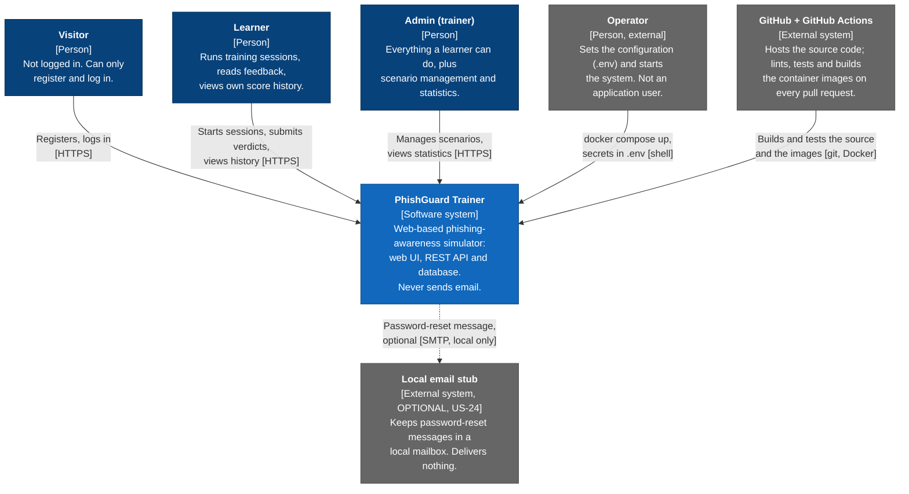
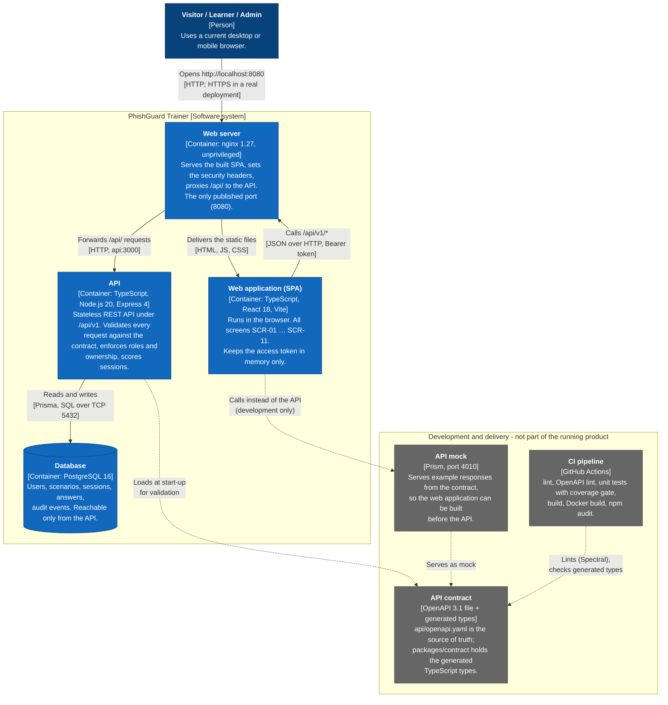
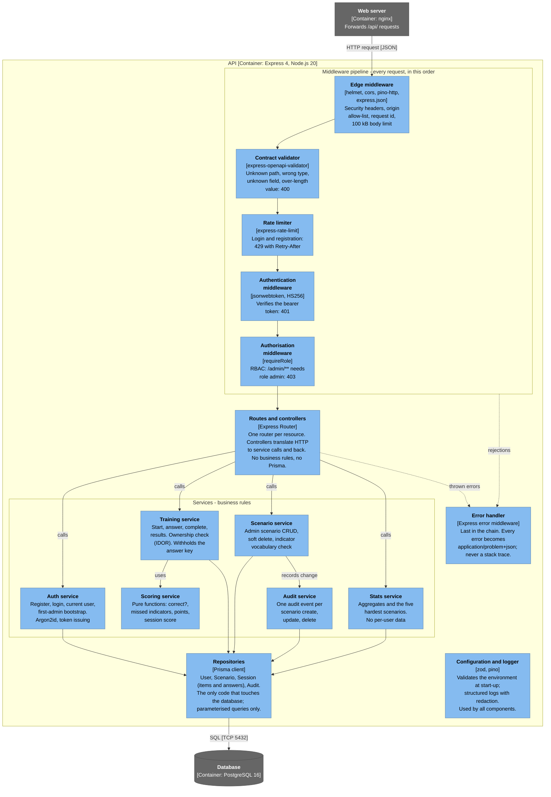
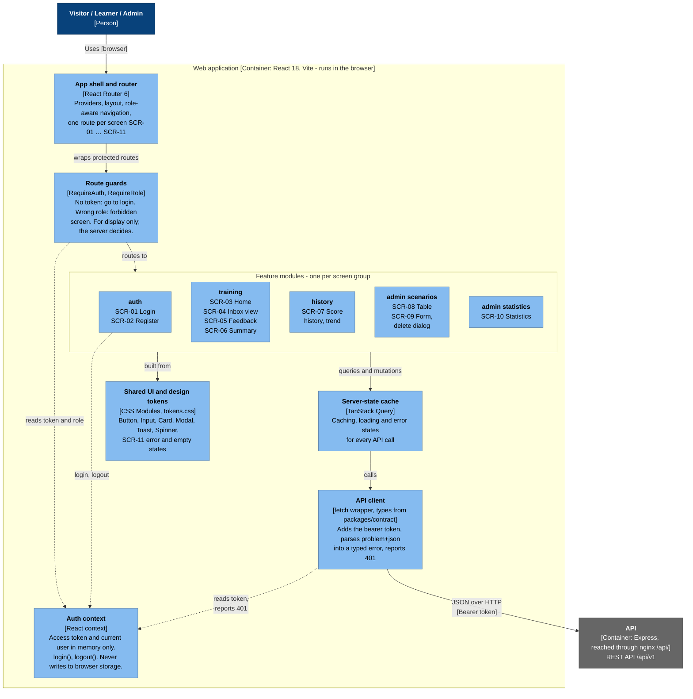
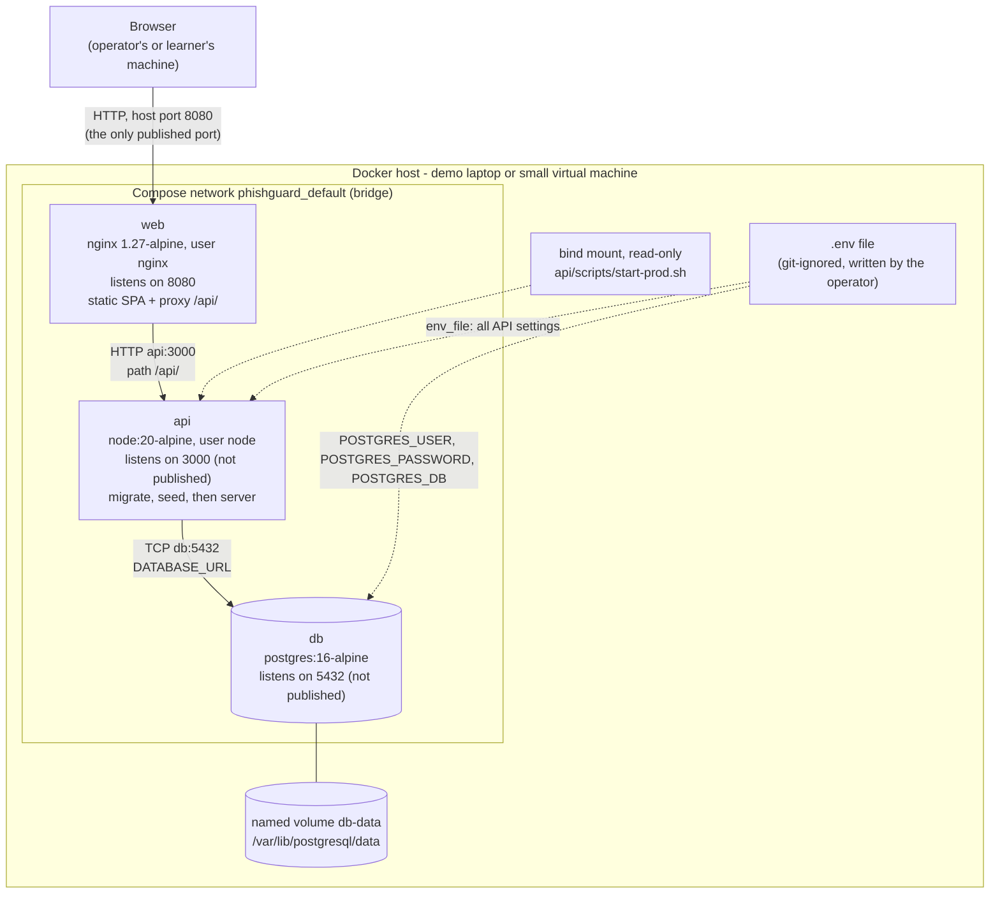

# Architecture Documentation – C4 Model

| Field | Value |
|---|---|
| Project | PhishGuard Trainer – a phishing-awareness simulator |
| Version | 1.0 |
| Date | 2026-11-15 |
| Owner | Ali Kaan Demiralp (`dalikaan`) – Lead Architect, DevOps |
| Team | SENG 321 – Team 16 |
| Related tasks | T-55 (this document), T-62 (ADR-0001 … ADR-0003), T-53 (SRS), T-56 (non-functional requirements), T-61 (UML models), T-78 (as-built update) |
| Related stories | Process (the architecture serves every story US-01 … US-25) |
| Notation | C4 model (Context, Container, Component), drawn as Mermaid flowcharts with C4 labels and colours |

---

## 1 About this document

This document describes **how PhishGuard Trainer is built**. The Software Requirements Specification ([`01-Software-Requirements-Specification.md`](01-Software-Requirements-Specification.md), called *SRS* below) says what the product does, the NFR document ([`02-Non-Functional-Requirements-and-Quality-Measures.md`](02-Non-Functional-Requirements-and-Quality-Measures.md)) says how well, and the architecture decision records in [`docs/adr/`](../adr/README.md) say why the technology was chosen. This document shows the structure that follows from them.

It uses the first three levels of the **C4 model**. Each level zooms into one box of the level above:

| Level | Question it answers | Section |
|---|---|---|
| 1 – System context | Who uses the system and what is around it? | 3 |
| 2 – Containers | Which separately running parts does it have and how do they talk? | 4 |
| 3 – Components (API) | What is inside the API and who is responsible for what? | 5 |
| 3 – Components (web) | What is inside the web application? | 6 |
| Deployment | Where do the containers run, with which ports, volumes and networks? | 7 |

Level 4 (code) is not drawn. The class, entity-relationship, sequence and state diagrams are in the UML models document (`07-UML-Models.md`, task T-61).

The document also contains the cross-cutting concerns (section 8), the table that maps every non-functional requirement to an architectural tactic (section 9), the main decisions and risks (section 10) and the consistency checks (section 11).

### 1.1 Status of the architecture

This is the **target architecture for the MVP**. At the date of this version the repository holds the skeleton: the three Compose services, the health route, the configuration loader, the user table and the user repository. Everything else in the diagrams is planned and is built in Sprint 3 and the Final sprint. The column *Built in* of the component tables names the task. The document is updated to the as-built state in task T-78.

### 1.2 How to read the diagrams

| Element | Meaning |
|---|---|
| Person | A human actor (Visitor, Learner, Admin, Operator). |
| System | The whole product, or another system it exchanges data with. |
| Container | Something that runs or stores data on its own: a web application, an API process, a database. A C4 container is **not** the same as a Docker container, although in this product each one happens to run in one Docker container. |
| Component | A group of code inside one container with one responsibility, for example a middleware or a service. |
| Arrow | "Uses" or "sends data to", in the direction of the arrow. The label says what is sent and how. |
| Dashed arrow | A relationship that is optional, exists only in development, or is not a request (reading a file, reporting an error). |
| Dark blue box | A person who uses the application. |
| Blue box | The system (level 1) or one of its containers (level 2). |
| Light blue box | A component inside a container (level 3). |
| Grey box | Outside the element that the diagram zooms into: an external actor or system, a neighbouring container, or a development tool. |

Every box carries the C4 label: **name**, `[type: technology]`, short responsibility.

**Notation choice.** The diagrams are Mermaid flowcharts styled like C4, not Mermaid's own `C4Context` / `C4Container` / `C4Component` diagram types. Those types were tried first; the renderer has no automatic layout for them, and relationship labels were drawn over the boxes, so the views could not be read in the PDF. The content of a C4 diagram (elements, types, technology, relationships) is unchanged.

Names of operations (for example `startSession`) are the `operationId` values of the API contract `api/openapi.yaml`.

---

## 2 Architecture drivers

The architecture is shaped by a small number of requirements and constraints. They are listed here so that the later sections can refer to them.

| # | Driver | Source | Effect on the architecture |
|---|---|---|---|
| AD-1 | The whole system starts with one Docker Compose command. | C-01, FR-68, NFR-15, NFR-37 | Three services (`db`, `api`, `web`) in one Compose file; migrations, seed and first-admin bootstrap run inside the API start-up; health checks order the start. |
| AD-2 | The API contract is the single source of truth. | C-03, NFR-02, NFR-05, ADR-0002 | Request validation is generated from `api/openapi.yaml` at run time; TypeScript types for both sides are generated into `packages/contract`; Prism serves the same file as a mock. |
| AD-3 | A security product must be secure itself. | NFR-18 … NFR-28, Sprint 1 security drivers | A fixed middleware pipeline in front of every route; role check in middleware and ownership check in the service; the answer key is removed by the type of the response, not by hand. |
| AD-4 | Five people work in parallel for ten weeks. | C-05, NFR-29 … NFR-34 | One language (TypeScript), a strict layering rule (routes → controllers → services → repositories) and one feature module per screen group, so that tasks do not collide. |
| AD-5 | Small load, one machine. | A-04, NFR-03 | A stateless single API process and one PostgreSQL instance. No cache, no queue, no second service. |
| AD-6 | Simulator only, minimal personal data. | C-06, C-08, C-09 | No outbound connection to any mail or identity system. The only optional external element is a local email stub. |

---

## 3 Level 1 – System context

The context is the same as in the Sprint 1 document [System Vision and System Boundary](../sprint-1/02-System-Vision-and-Boundary.md#system-context-diagram): the same four actors, the same optional email relay and the same CI system. Only the names follow the SRS now (*Visitor* instead of *Anonymous visitor*, *Local email stub* instead of *Email relay*, decision D-18).

| Element | Type | Description | Trust |
|---|---|---|---|
| Visitor | Person | Anyone who opens the application without a login. Only `registerUser`, `login` and `getHealth` are open to them. | Untrusted |
| Learner | Person | Primary user. Starts a session, judges each fake email, reads the feedback, follows the score history. Receives scenarios **without** the answer key until a verdict is submitted. | Authenticated, least privilege |
| Admin (trainer) | Person | Can do everything a learner can do and also maintains the scenario library and reads aggregate statistics. | Authenticated, elevated; role checked on the server on every request |
| Operator | Person (external) | Team member or grader who copies `.env.example` to `.env`, sets the secrets and the first-admin values and runs `docker compose up`. | Out of band |
| PhishGuard Trainer | System | The product: user interface, API and data store, delivered together. | – |
| GitHub + GitHub Actions | External system | Source hosting and CI. Receives source code, never production secrets. It does not talk to a running installation. | Trusted for build results only |
| Local email stub | External system (optional) | Only for the Could-have story US-24. A mailbox that stays on the same machine (D-18). Not part of the MVP stack. | Local only |

**What is deliberately not in the context:** mail providers, chat tools, external identity providers, analytics or any other third-party service (C-06, C-09). The running system makes no outbound network connection.

---

## 4 Level 2 – Containers

### 4.1 Runtime containers

| Container | Technology | Responsibility | Talks to | Docker service |
|---|---|---|---|---|
| Web server | nginx 1.27 (alpine), runs as non-root, `deploy/nginx.conf` | Serves the Vite build with a single-page-app fallback; adds CSP, `X-Content-Type-Options`, `Referrer-Policy` and `X-Frame-Options` to every response; forwards `/api/` to the API so that the browser sees one origin. | Browser (in), API (out) | `web` |
| Web application (SPA) | TypeScript, React 18, React Router 6, TanStack Query, CSS Modules | The user interface. Renders the screens, holds the access token in memory, calls the API through one typed client. Contains no business rule that the server does not re-check. | Web server (same origin) | delivered by `web`, runs in the browser |
| API | TypeScript, Node.js 20, Express 4, `express-openapi-validator`, Prisma client | All business logic and all security decisions: registration, login, token checks, roles, ownership, scenario selection, feedback, scoring, scenario CRUD, audit events, statistics. Stateless: any request can be served without server-side session state. | Database | `api` |
| Database | PostgreSQL 16 (alpine) | Durable storage with foreign keys, unique constraints and transactions. Data lives in the named volume `db-data`. | – | `db` |

### 4.2 Development and delivery containers

These are not part of the product that the operator starts. They exist to build and check it.

| Container | Technology | Responsibility | When it runs |
|---|---|---|---|
| API contract | `api/openapi.yaml` (OpenAPI 3.1) and `packages/contract` (`openapi-typescript`) | Single source of truth for paths, fields, lengths, status codes and security rules. The API validates against it; web, API and tests import its generated types. | Always (it is a file); types regenerated with `npm run gen:contract` |
| API mock | Prism (`npm run mock`), port 4010 | Answers every operation of the contract with example data. Lets frontend work start before the backend exists (Sprint 1 risk R5). | Developer machine only |
| Test database | PostgreSQL 16, Compose profile `test`, service `db-test`, `tmpfs` storage, bound to `127.0.0.1:5433` | Disposable database for the integration tests; empty at every start. | Developer machine and CI only |
| CI pipeline | GitHub Actions | Runs `lint`, `test` (with the 50 % line-coverage gate), `build` and `docker` as required checks on every pull request, plus the contract lint and `npm audit`. | On every pull request and push (from task T-44) |
| Static analysis | SonarQube Community in Docker, `sonar-scanner` | Produces the quality and technical-debt report (duplication, maintainability rating, debt ratio). | Sprint 3 (first scan) and Final |

### 4.3 Why these containers

- **nginx in front of the API** gives the browser a single origin. The demo needs no cross-origin request at all, the API port is never published (NFR-06) and the security headers of the static files are set in one place.
- **SPA and API are separate** because the Sprint 1 context and the contract define a REST boundary. The boundary is what makes the Prism mock, the Supertest integration tests and the parallel work of the team possible (ADR-0001, alternative 3).
- **One database, no cache or queue**, because the load is a class of learners on one laptop (AD-5). The API is stateless (ADR-0003), so nothing but the database holds state.

---

## 5 Level 3 – Components of the API

The API is layered. A request passes through a fixed chain of middleware, then goes **routes → controllers → services → repositories**. A layer may only call the layer directly below it. Prisma is used only in repositories.

### 5.1 Request pipeline (order matters)

Every request goes through the same steps in this order. A step that rejects a request ends it; later steps never see it.

| # | Step | Component | Rejects with | Why at this position |
|---|---|---|---|---|
| 1 | Security headers, hide `X-Powered-By` | `helmet` | – | Headers must be on every response, including errors. |
| 2 | CORS | `cors` with an allow-list of one origin (the web origin) | no allow header for a foreign origin | Before any work is done for a foreign origin. |
| 3 | Request log with a request id | `pino-http` | – | Every later log line and error carries the id. |
| 4 | Body parser, limit 100 kB | `express.json` | 400 (malformed JSON), 413 | The validator and the rate limiter need the parsed body. |
| 5 | Contract validation | `express-openapi-validator` loaded from `api/openapi.yaml` | 400 with `errors[]` (D-12); 404/405 for a path or method that is not in the contract | Nothing that is not described in the contract reaches hand-written code. |
| 6 | Rate limit (only `login` and `registerUser`) | `express-rate-limit`, key = client address + username | 429 with `Retry-After` | Before the expensive Argon2id verification. |
| 7 | Authentication (every operation except `getHealth`, `registerUser`, `login`) | JWT middleware | 401 | Establishes who the caller is; the token is the only source of identity and role. |
| 8 | Authorisation by role (`/admin/**`) | `requireRole('admin')` | 403 | RBAC decision before any controller code runs. |
| 9 | Controller → service → repository | see 5.2 | 403 (not the owner), 404, 409, 422 | Business rules, including the ownership check. |
| 10 | Error handler | last middleware | – | One place builds every problem response. |

The API runs behind nginx, so Express is configured with `trust proxy` for exactly one hop. Without it the rate limiter would see the address of the web container for every client.

### 5.2 Component responsibilities

| Component | Folder (planned) | Responsibility | Related FR / NFR | Built in |
|---|---|---|---|---|
| App factory and server | `api/src/app.ts`, `server.ts` | Builds the Express app without binding a port (so tests can drive it in-process); `server.ts` is the only place that listens. | NFR-29 | T-63 (exists) |
| Configuration | `api/src/config.ts` | Reads and validates the environment with a schema; fails fast and names the invalid variable without printing its value. | FR-15, FR-70, NFR-19 | T-63 (exists) |
| Logger | `api/src/utils/logger.ts` | `pino` with redaction of `password`, `authorization` and token fields. | NFR-18, DR-2 | T-13 |
| Error handler | `api/src/middleware/error-handler.ts` | Maps validation errors, domain errors and unexpected errors to `application/problem+json`; logs the cause, returns only title, status, detail and `errors[]`. | FR-18, FR-19, NFR-23 | T-13 |
| Contract validator | `api/src/middleware/openapi.ts` | Request validation always; response validation in development and tests. | FR-17, FR-27, FR-56, NFR-02 | T-12 |
| Rate limiter | `api/src/middleware/rate-limit.ts` | Counts failed logins per address and username in a fixed 60-second window (D-02); limit from `LOGIN_RATE_LIMIT_PER_MINUTE`. | FR-14 … FR-16, NFR-22 | T-10 |
| Authentication middleware | `api/src/middleware/authenticate.ts` | Verifies signature, algorithm (`HS256` only) and expiry of the bearer token. | FR-08, FR-12, NFR-20 | T-05, T-08 |
| Authorisation middleware | `api/src/middleware/require-role.ts` | **Enforces RBAC**: compares the `role` claim with the role the route needs. | FR-11, FR-12, NFR-20 | T-08 |
| Routes | `api/src/routes/*.routes.ts` | Connect a path and method of the contract to middleware and one controller function. | all operations | per feature task |
| Controllers | `api/src/controllers/*.controller.ts` | Read the validated input, call one service function, choose the status code. | all operations | per feature task |
| Auth service | `api/src/services/auth.service.ts` | Registration (unique username and email, role `learner`), login (same answer for unknown user and wrong password), token issuing, current user, first-admin bootstrap at start-up. | FR-01 … FR-09, FR-62, NFR-18 | T-02, T-05, T-40 |
| Training service | `api/src/services/training.service.ts` | Session lifecycle: random selection without repeats (random source injected, D-14), one answer per scenario, completion rules, own results. **Enforces ownership (IDOR protection)**: every function takes the caller's id and compares it with the session owner. Maps scenarios to the public shape without the answer key. | FR-13, FR-28 … FR-42, FR-48, FR-49, NFR-21, NFR-27 | T-19, T-20, T-24, T-27, T-30 |
| Scoring service | `api/src/services/scoring.service.ts` | Pure functions with no input or output besides their arguments: is the verdict correct, which indicators were missed, points, session score rounded half up (D-03). | FR-34, FR-39 | T-27 |
| Scenario service | `api/src/services/scenario.service.ts` | Admin create, list, read, replace, delete. A deleted scenario is marked, not removed, so old results keep their score (DR-7). Calls the audit service in the same transaction. | FR-52 … FR-57 | T-32 |
| Stats service | `api/src/services/stats.service.ts` | Totals, average score (one decimal) and the at most five hardest scenarios (D-11). Returns aggregates only. | FR-65, FR-66 | T-38 |
| Audit service | `api/src/services/audit.service.ts` | One event per scenario change with actor, time, action, scenario id and changed field names (D-06). | FR-57 | T-33 |
| Repositories | `api/src/repositories/*.ts` | `userRepository` (exists), `scenarioRepository`, `sessionRepository` (sessions, items, answers), `auditRepository`. Return plain domain objects; no HTTP knowledge. | NFR-16, ASVS V5.3.4 | T-01, T-65 and feature tasks |
| Domain constants | `api/src/domain/indicators.ts` | The fixed indicator vocabulary shared with the contract. | FR-25 … FR-27 | T-18 (exists) |
| Seed | `api/prisma/seed.ts` | Loads the 30 seed scenarios; safe to run again. | FR-21, FR-24 | T-16 |

### 5.3 Operation → component map

| operationId | Method and path | Token | Role guard | Service | Repositories |
|---|---|---|---|---|---|
| `getHealth` | GET `/health` | no | – | – (controller only) | – |
| `registerUser` | POST `/auth/register` | no (rate limited) | – | Auth | User |
| `login` | POST `/auth/login` | no (rate limited) | – | Auth | User |
| `getCurrentUser` | GET `/me` | yes | – | Auth | User |
| `startSession` | POST `/sessions` | yes | – | Training | Scenario, Session |
| `submitAnswer` | POST `/sessions/{sessionId}/answers` | yes | – (owner check in service) | Training, Scoring | Session, Scenario |
| `completeSession` | POST `/sessions/{sessionId}/complete` | yes | – (owner check in service) | Training, Scoring | Session |
| `listMyResults` | GET `/me/results` | yes | – (filtered by caller id) | Training | Session |
| `adminListScenarios` | GET `/admin/scenarios` | yes | admin | Scenario | Scenario |
| `adminCreateScenario` | POST `/admin/scenarios` | yes | admin | Scenario, Audit | Scenario, Audit |
| `adminGetScenario` | GET `/admin/scenarios/{scenarioId}` | yes | admin | Scenario | Scenario |
| `adminUpdateScenario` | PUT `/admin/scenarios/{scenarioId}` | yes | admin | Scenario, Audit | Scenario, Audit |
| `adminDeleteScenario` | DELETE `/admin/scenarios/{scenarioId}` | yes | admin | Scenario, Audit | Scenario, Audit |
| `adminGetStats` | GET `/admin/stats` | yes | admin | Stats | User, Session, Scenario |

All 14 operations of the contract are in the table.

---

## 6 Level 3 – Components of the web application

### 6.1 Component responsibilities

| Component | Folder (planned) | Responsibility | Related FR / NFR | Built in |
|---|---|---|---|---|
| App shell and router | `web/src/App.tsx`, `web/src/routes/` | Sets up the providers (query client, auth context), the page layout with header and navigation, and one route per screen. Navigation entries depend on the role (FR-61). Unknown routes show the *not found* state. | FR-46, FR-61, NFR-36 | T-69 |
| Route guards | `web/src/auth/RequireAuth.tsx`, `RequireRole.tsx` | Send a visitor to the login screen and show the *forbidden* state to a learner on an admin route. They improve the user experience only; the API refuses the request anyway. | FR-08, FR-61 | T-69 |
| Auth context | `web/src/auth/AuthContext.tsx` | Keeps the token and the profile in application memory (ADR-0003). `logout()` discards both and shows the login screen (FR-10). A page reload ends the login. | FR-06, FR-09, FR-10, ASVS V8.2.2 | T-69, T-06 |
| API client | `web/src/api/` | One function per `operationId`, typed with the generated contract types. Adds `Authorization: Bearer`, turns `application/problem+json` into a typed error with `status`, `detail` and `errors[]`, reads `Retry-After` on 429, and tells the auth context about a 401. | FR-18, NFR-02 | T-69 |
| Server-state cache | TanStack Query client | Gives every screen the same loading, error and retry behaviour. Cleared on logout so that no data of the previous user stays in memory. | NFR-04 | T-69 |
| Feature: auth | `web/src/features/auth/` | Login and registration forms with a message per field. | FR-01 … FR-07, NFR-12 | T-03, T-06 |
| Feature: training | `web/src/features/training/` | Home screen, inbox scenario view, verdict controls and indicator checklist, feedback panel, session summary. Scenario text and links are rendered as plain text; links show label and real target and are never anchors (FR-45). | FR-20, FR-28, FR-43 … FR-47, NFR-09, NFR-24 | T-22, T-23, T-25, T-29 |
| Feature: history | `web/src/features/history/` | Paged list of completed sessions with the trend per session (D-05). | FR-48 … FR-51 | T-31 |
| Feature: admin scenarios | `web/src/features/admin-scenarios/` | Scenario table, create/edit form with field validation, delete confirmation dialog. | FR-58 … FR-60 | T-35, T-36, T-37 |
| Feature: admin statistics | `web/src/features/admin-stats/` | Aggregate figures and hardest scenarios. | FR-67 | T-39 |
| Shared UI and design tokens | `web/src/components/`, `web/src/styles/tokens.css` | Base components from the prototype inventory and the tokens of the UI specification (colours with contrast ≥ 4.5:1, focus style, spacing). The SCR-11 states (forbidden, not found, error, please wait, empty). | NFR-10 … NFR-13 | T-69 |

### 6.2 Rules for the web application

- A feature module never calls `fetch` itself; it goes through the API client. So the token handling and the error format exist once.
- A feature module does not import from another feature module. Shared code moves to `components/` or `api/`.
- No `dangerouslySetInnerHTML` anywhere (lint rule). Scenario content is always a React text node.
- The role taken from the profile only decides what is **shown**. No security decision is made in the browser.

---

## 7 Deployment view

The diagram shows the stack that `docker compose up` starts from the `docker-compose.yml` at the repository root (Compose project name `phishguard`).

### 7.1 Services

| Service | Image | Runs as | Container port | Host port | Volumes | Health check | Starts after |
|---|---|---|---|---|---|---|---|
| `db` | `postgres:16-alpine` | `postgres` | 5432 | none | named volume `db-data` → `/var/lib/postgresql/data` | `pg_isready`, every 5 s | – |
| `api` | built from `api/Dockerfile` (multi-stage, `node:20-alpine`) | `node` (non-root) | 3000 | none | bind mount `api/scripts/start-prod.sh` (read-only) | `GET /api/v1/health` on `127.0.0.1:3000`, every 10 s | `db` is healthy |
| `web` | built from `web/Dockerfile` (multi-stage, `nginx:1.27-alpine`) | `nginx` (non-root) | 8080 | **8080** | none | `GET /healthz` | `api` is healthy |
| `db-test` (profile `test` only) | `postgres:16-alpine` | `postgres` | 5432 | `127.0.0.1:5433` | `tmpfs` (nothing on disk) | `pg_isready`, every 3 s | – |

### 7.2 Ports, networks and volumes

| Topic | Design | Requirement |
|---|---|---|
| Published ports | Exactly one in the default stack: `8080` of `web`. The API and the database have no host port. `db-test` belongs to the profile `test` and is bound to the loopback address only. | NFR-06, FR-69 |
| Network | One Compose default bridge network (`phishguard_default`). Services find each other by service name (`api`, `db`) through Docker's DNS. No service uses the host network. | NFR-06 |
| Volume | `db-data` keeps the database files. `docker compose down` keeps it; `docker compose down -v` deletes it. That is the documented way to remove all data (DR-5). | NFR-16, DR-6 |
| Start order | `db` healthy → `api` runs `prisma migrate deploy`, the seed and the first-admin bootstrap, then starts the server → `api` healthy → `web`. `docker compose up -d --wait` returns when all three are healthy. | FR-24, FR-62, FR-68, NFR-15 |
| Restart | `restart: unless-stopped` on the three services; `init: true` on `api` so that the stop signal reaches Node. | NFR-16 |
| Images | Multi-stage builds: the runtime images hold only production dependencies and compiled code, run as non-root and contain no secret. `NODE_ENV=production` in the API image. | NFR-19, ASVS V14.3.2 |

### 7.3 Configuration (`.env`)

| Variable | Used by | Purpose |
|---|---|---|
| `POSTGRES_USER`, `POSTGRES_PASSWORD`, `POSTGRES_DB` | `db` | Database account and name. Compose refuses to start with a clear message when one is missing. |
| `DATABASE_URL` | `api` | Connection string for Prisma (host `db`). |
| `JWT_SECRET` | `api` | Signing key of the access token; long and random. Changing it invalidates every token. |
| `ADMIN_BOOTSTRAP_USERNAME`, `ADMIN_BOOTSTRAP_PASSWORD` | `api` | First admin account, created at start-up when it does not exist (FR-62). |
| `LOGIN_RATE_LIMIT_PER_MINUTE` | `api` | Failed-login limit, default 5 (FR-15). |
| `TEST_DATABASE_URL` | integration tests | Points at `db-test`; throw-away credentials. |

Only `.env.example` with placeholder values is in the repository.

### 7.4 Other environments

| Environment | What runs | Address |
|---|---|---|
| Developer machine | `npm run dev`: Vite dev server (5173, proxies `/api` to 3000) and the API with reload; optionally Prism (4010) instead of the API; `db-test` for integration tests. | `http://localhost:5173` |
| CI (GitHub Actions) | Lint, contract lint, unit tests with coverage, build, Docker image build, `npm audit`. End-to-end tests start the same Compose stack as the demo. | – |
| Demo / grading | The Compose stack of the diagram above. | `http://localhost:8080` |
| Any real deployment | The same stack behind a TLS-terminating reverse proxy. Plain HTTP is accepted only on `localhost` (SRS 3.3, ASVS V9.1.1). | HTTPS |

---

## 8 Cross-cutting concerns

### 8.1 Authentication and authorisation

| Topic | Design | Where |
|---|---|---|
| Password storage | Argon2id with a per-password salt (`argon2` library, hashing off the main thread). The plain password exists only inside the Auth service during the request. | Auth service |
| Token | JWT signed with `HS256` and `JWT_SECRET`; claims `sub` (user id), `role`, `iat`, `exp`; lifetime 60 minutes (D-01). No refresh token, no server-side session (ADR-0003). | Auth service (issue), authentication middleware (verify) |
| Transport | `Authorization: Bearer <token>` header only. Never in a URL, never in a cookie, so cross-site request forgery does not apply. | API client, authentication middleware |
| Client storage | In memory only. Reload or closing the tab ends the login. | Auth context |
| **RBAC** | The authorisation middleware `requireRole` compares the `role` claim of the verified token with the role the route needs. All routes under `/admin` need `admin`. A role sent in a body is rejected by the validator as an unknown field. | Authorisation middleware |
| **Ownership (IDOR)** | The Training service receives the caller's id from the token and compares it with the owner of the session before it reads or changes anything: another user's session gives 403, an unknown session 404. `listMyResults` has no user parameter at all; the repository query is filtered by the caller's id. | Training service, session repository |
| Answer key | `startSession` returns the type `ScenarioPublic`, which has no `isPhishing`, `indicators` or `explanation`. The service builds this shape from an explicit list of fields, and response validation in tests fails when an extra field appears. | Training service, contract validator |
| Logout | The web application discards the token. The token stays valid on the server until `exp`; this accepted gap is recorded in ADR-0003. | Auth context |
| Defence in depth | The same rule is checked in up to three places: the web hides what the role may not use, the middleware checks the role, the service checks the owner. Only the server checks count as security. | all |

### 8.2 Validation

- **Shape** (types, formats, required fields, lengths, enums, unknown fields) is validated by `express-openapi-validator` from `api/openapi.yaml`. There is no second, hand-written schema for request bodies (ADR-0002).
- **Business rules** that a schema cannot express stay in the services: unique username and email (409), session ownership (403), one answer per scenario (409), all scenarios answered before completion (409), enough scenarios in the pool (422).
- **Responses** are validated against the contract in development and test runs, so a response that breaks the contract fails a test (NFR-02).
- **The database is the last line**: unique constraints and foreign keys make the rules hold even under concurrent requests (for example two simultaneous answers for the same scenario).
- **Web forms** validate for fast feedback only and use the same limits as the contract. The server result is authoritative; `errors[]` of a 400 response is shown next to the fields.
- **Output**: React escapes all text. Scenario bodies and links are rendered as text nodes; nginx sends a Content Security Policy that allows scripts only from the own origin.

### 8.3 Error handling

- Every error response is `application/problem+json` (RFC 9457) with `title` and `status`, normally `detail`, and `errors[]` (`field`, `message`) for validation errors (D-12).
- Services throw typed domain errors (`NotFoundError`, `ForbiddenError`, `ConflictError`, `UnprocessableError`). Controllers do not catch them. Async handlers are wrapped once (`async-handler`), so a rejected promise always reaches the error handler.
- The error handler is the only place that writes an error response. Known errors map to their status code; anything else becomes a generic 500 *Internal Server Error*. The cause is logged with the request id; stack traces, SQL or Prisma messages and file paths never leave the server (NFR-23).
- 429 responses carry `Retry-After` in whole seconds.
- In the web application the API client turns a problem response into one typed error. Screens show it next to the field (400, 409), as a wait message (429) or as an SCR-11 state (403, 404, unexpected). A 401 clears the auth context and shows the login screen.

### 8.4 Logging

- `pino` writes structured JSON lines to standard output; Docker collects them (`docker compose logs`). nginx writes its access and error log to standard output and error as well.
- Each request gets an id; every log line of the request carries it.
- Redaction is configured in the logger, not left to the caller: `password`, `authorization`, `accessToken` and the bootstrap password are never written. Request bodies of the auth routes are not logged at all.
- Log levels: `info` for requests and start-up steps, `warn` for rejected logins and rate-limit hits, `error` for unexpected errors.
- **Audit events are not log lines.** Scenario changes by admins are stored in the database through the Audit service (FR-57), because they must survive a restart and be queryable.

### 8.5 Configuration

- All configuration comes from environment variables, read once at start-up by `config.ts` and validated with a schema. A missing or invalid value stops the start with a message that names the variable but not its value.
- The rest of the code receives a typed `Config` object and never reads `process.env`.
- Secrets live only in `.env` on the operator's machine. The repository has `.env.example`; the images contain no secret; GitHub secret scanning with push protection guards the history (NFR-19).
- The web application has no run-time configuration: it calls the relative path `/api/v1`, so the same build works behind any host name.

### 8.6 Data access and transactions

- Only repositories import the Prisma client. Prisma sends parameterised queries, so SQL injection is excluded by construction.
- Operations that change more than one row run in one transaction: submitting an answer (answer row and the uniqueness check), completing a session (result and state), a scenario change together with its audit event.
- Schema changes are versioned Prisma migrations, applied with `prisma migrate deploy` at start-up. The seed is idempotent.

---

## 9 Quality-attribute tactics

The table maps **every** non-functional requirement NFR-01 … NFR-37 to the architectural tactic that satisfies it and to the element that carries the tactic. The metric and the target of each requirement are in the NFR document, section 2.3.

### 9.1 Functional suitability, performance, compatibility

| NFR | Requirement (short) | Architectural tactic | Carried by |
|---|---|---|---|
| NFR-01 | All Must FRs have passing evidence | *Traceability by structure*: one service function per operation and one feature module per screen group, so every FR has a named place in the code and a test next to it. | Layering (5.2, 5.3), feature modules (6.1) |
| NFR-02 | Every response conforms to the contract | *Single source of truth, generated checks*: run-time request validation and test-time response validation from the contract; generated types on both sides. | Contract validator, `packages/contract` |
| NFR-03 | p95 ≤ 300 ms for the three session operations | *Reduce overhead*: stateless token check without a database query; one transaction per operation; indexes on foreign keys; no remote call in the request path. *Bound resource demand*: the slow Argon2id hash is only in login and registration, which are rate limited. | Authentication middleware, repositories, database |
| NFR-04 | Login screen loads within 2 s | *Reduce payload and cache*: static production build served by nginx with gzip; content-hashed assets cached for a year; `index.html` never cached; no third-party request. | Web server, Vite build |
| NFR-05 | Contract lints; mock answers every operation | *Contract first with tooling*: Spectral lint in CI; Prism serves the same file. | API contract, CI pipeline, API mock |
| NFR-06 | Exactly one published host port | *Limit exposure, single entry point*: nginx is the only service with a host port and reverse-proxies the API; the database is reachable only on the Compose network. | Web server, deployment (7.2) |

### 9.2 Usability and accessibility

| NFR | Requirement (short) | Architectural tactic | Carried by |
|---|---|---|---|
| NFR-07 | First session finished within 5 minutes | *Minimise steps*: SPA with client-side routing, no page reload between scenarios; session start with a default of 10 scenarios in one call. | App shell and router, feature training |
| NFR-08 | SUS score ≥ 70 | *Consistency*: one set of shared components and one error presentation for all screens. | Shared UI, API client |
| NFR-09 | Feedback visible without scrolling at 1366×768 | *Immediate feedback in place*: `submitAnswer` returns the complete feedback in its response, so the panel is drawn in the same view without another request. | Training service, feature training |
| NFR-10 | Contrast ≥ 4.5:1 | *Centralise presentation decisions*: colours exist only as design tokens; screens use no local colour. | `tokens.css` |
| NFR-11 | Everything operable by keyboard | *Use native controls*: shared components are built on native buttons, inputs and dialogs. | Shared UI |
| NFR-12 | Every control has a label | *Enforce in the component*: the shared Input and Button components require a label. | Shared UI |
| NFR-13 | Visible focus indicator | *Centralise*: one global focus style defined with the tokens. | `tokens.css`, global styles |
| NFR-14 | No serious or critical axe violation | *Automated conformance check* over every route of the router. | Router (route list), E2E tests |

### 9.3 Reliability

| NFR | Requirement (short) | Architectural tactic | Carried by |
|---|---|---|---|
| NFR-15 | Healthy within 3 minutes from one command | *Ordered start with health monitoring*: health checks and `depends_on: service_healthy`; migrations, seed and bootstrap automated in the API start-up script. | Deployment (7.1), API start-up |
| NFR-16 | Data survives restarts | *Persistent state in one place*: all state in PostgreSQL on a named volume; stateless API; idempotent seed and migrations. | Database, volume `db-data` |
| NFR-17 | No open Critical or High defect | *Fault prevention*: strict layering, strict TypeScript and required CI checks stop defects before the merge. | CI pipeline, layering |

### 9.4 Security

| NFR | Requirement (short) | Architectural tactic | Carried by |
|---|---|---|---|
| NFR-18 | Argon2id hashes; password never in response or log | *Protect data at rest; limit exposure*: hashing in one service; the user repository never returns the hash outside the Auth service; logger redaction; response shapes from the contract have no password field. | Auth service, logger, contract validator |
| NFR-19 | No secret in repository or images | *Separate configuration from code*: environment variables from a git-ignored `.env`; multi-stage images without secrets; secret scanning. | Configuration, Dockerfiles |
| NFR-20 | `/admin` gives 403 to learners, 401 without token | *Authenticate and authorise actors* in middleware before any controller; role from the signed token only. | Authentication and authorisation middleware |
| NFR-21 | No access to another user's sessions or results | *Authorise per resource*: ownership check in the service with the caller id from the token; queries filtered by owner. | Training service, session repository |
| NFR-22 | 429 after 5 failed logins per minute, limit configurable | *Limit access / detect service abuse*: rate limiter in front of the login, keyed by address and username; limit from configuration. | Rate limiter, configuration |
| NFR-23 | No internal detail in any response; problem+json | *Central exception handling*: one error handler builds every error body from a fixed set of fields. | Error handler |
| NFR-24 | User-supplied text never executed | *Output encoding by default*: React text rendering only, lint rule against raw HTML; Content Security Policy as a second barrier. | Feature modules, web server |
| NFR-25 | Security headers, no technology disclosure, strict CORS | *Harden the edge once*: `helmet` and the CORS allow-list as first middleware; the same headers in nginx; `server_tokens off`, no `X-Powered-By`. | Edge middleware, web server |
| NFR-26 | No high or critical vulnerability in dependencies | *Manage third-party risk*: lock file, `npm audit` in CI, automatic update checks, small runtime images with production dependencies only. | CI pipeline, Dockerfiles |
| NFR-27 | Answer key not sent before the verdict | *Limit exposure by type*: a separate public response shape without the answer key; explicit field mapping; response validation in tests. | Training service, API contract |
| NFR-28 | OWASP ASVS Level 1 items pass | *Defence in depth*: the fixed request pipeline of 5.1 covers validation, authentication, authorisation, error handling and headers for every route. | Request pipeline |

### 9.5 Maintainability and portability

| NFR | Requirement (short) | Architectural tactic | Carried by |
|---|---|---|---|
| NFR-29 | Unit-test line coverage ≥ 50 % | *Design for testability*: app factory without a port; pure scoring functions; injected random source and clock; repositories behind functions that tests replace. | App factory, Scoring service, Training service |
| NFR-30 | No blocker or critical static-analysis issue | *Restrict dependencies*: one direction of calls between layers; no Prisma outside repositories; no `any`. | Layering |
| NFR-31 | Duplication ≤ 3 % | *Abstract common services*: shared contract types, one API client, shared UI components, one error handler. | `packages/contract`, API client, shared UI |
| NFR-32 | Maintainability rating A | *High cohesion, low coupling*: small single-purpose modules; features do not import each other. | Component structure (5.2, 6.1) |
| NFR-33 | Technical-debt ratio ≤ 5 % | Same as NFR-32, plus recorded decisions (ADRs) so that structure is not eroded by accident. | Component structure, ADRs |
| NFR-34 | Lint, format and type check pass | *One toolchain*: a single language and one ESLint, Prettier and TypeScript configuration for all workspaces. | Monorepo, CI pipeline |
| NFR-35 | Works in Chrome, Firefox and Edge | *Rely on standards*: standard web APIs only, Vite build for current browsers, no browser-specific code. | Web application |
| NFR-36 | No horizontal scrolling at 390×844 and 1366×768 | *Responsive layout from tokens*: one layout component with the breakpoints of the UI specification. | App shell, shared UI |
| NFR-37 | Installs on Windows and Linux with Docker and Git only | *Containerise the environment*: everything, including Node and PostgreSQL, runs in containers; no host tool besides Docker. | Deployment (7) |

---

## 10 Decisions and risks

### 10.1 Decisions behind this architecture

| Decision | Record | Short form |
|---|---|---|
| Technology stack | [ADR-0001](../adr/0001-technology-stack.md) | TypeScript monorepo; React + Vite; Express; PostgreSQL + Prisma; Vitest and Playwright; Docker Compose with nginx in front. |
| API-first contract | [ADR-0002](../adr/0002-api-first-contract.md) | `api/openapi.yaml` is the single source of truth; validation and types are generated from it. |
| Stateless JWT authentication | [ADR-0003](../adr/0003-stateless-jwt-auth.md) | 60-minute HS256 access token in memory; no refresh, no server-side revocation. |

### 10.2 Architectural risks and accepted limits

| # | Risk or limit | Consequence | Response |
|---|---|---|---|
| AR-1 | The rate limiter keeps its counters in the memory of the API process. | Counters are lost on restart and would not be shared between several API instances. | Accepted: the product runs as one instance (AD-5). A shared store would be needed before scaling out. |
| AR-2 | A token cannot be revoked before it expires. | A copied token works for up to 60 minutes after logout. | Accepted in ADR-0003; changing `JWT_SECRET` is the emergency measure. |
| AR-3 | Argon2id is CPU-heavy on a single Node process. | Many simultaneous logins slow other requests. | Hashing runs in the libuv thread pool; login and registration are rate limited; login is excluded from NFR-03. |
| AR-4 | The start-up does migration, seed and bootstrap before the server listens. | A failing migration stops the API, and `web` never starts. | Intended: better no start than a start on a wrong schema. The log names the failing step. |
| AR-5 | Plain HTTP between browser and nginx in the demo. | Tokens could be read on the network. | Only on `localhost`; any real deployment puts TLS in front (7.4). |
| AR-6 | The client address reaches the API only through `X-Forwarded-For`. | A wrong `trust proxy` setting would break or weaken the rate limit. | Trust exactly one hop (nginx); covered by the rate-limit integration test. |

---

## 11 Consistency checks

| Check | Result |
|---|---|
| The four C4 views (context, containers, API components, web components) and the deployment view are present. | Pass – sections 3, 4, 5, 6 and 7. |
| The context has the same actors and external systems as the Sprint 1 context diagram. | Pass – Visitor, Learner, Admin, Operator, GitHub + GitHub Actions, optional email element. |
| The container view contains the web SPA with nginx, the API, PostgreSQL, the Prism mock and CI. | Pass – section 4. |
| The API component view contains routes, authentication middleware, rate limiter, validator, controllers, the services Auth, Training, Scoring, Scenario, Stats and Audit, and the repositories. | Pass – section 5. |
| The web component view contains router, auth context, API client and feature modules. | Pass – section 6. |
| Every operation of the contract is mapped to components. | Pass – 14 of 14 (section 5.3). |
| Every NFR of the NFR document appears in the tactics table. | Pass – 37 of 37 (section 9). |
| Services, ports and volumes agree with `docker-compose.yml` and `deploy/nginx.conf`. | Pass – section 7. |
| The technology named here agrees with ADR-0001 … ADR-0003. | Pass. |

## Appendix – Revision history

| Version | Date | Author | Change |
|---|---|---|---|
| 1.0 | 2026-11-15 | Ali Kaan Demiralp | First version for Sprint 2 (task T-55). |
