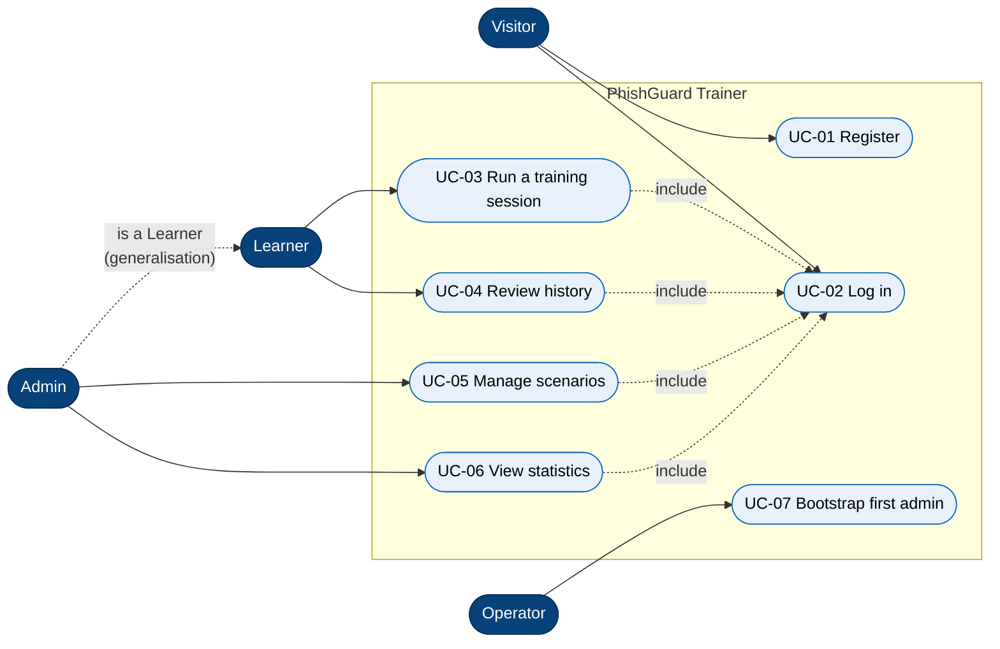
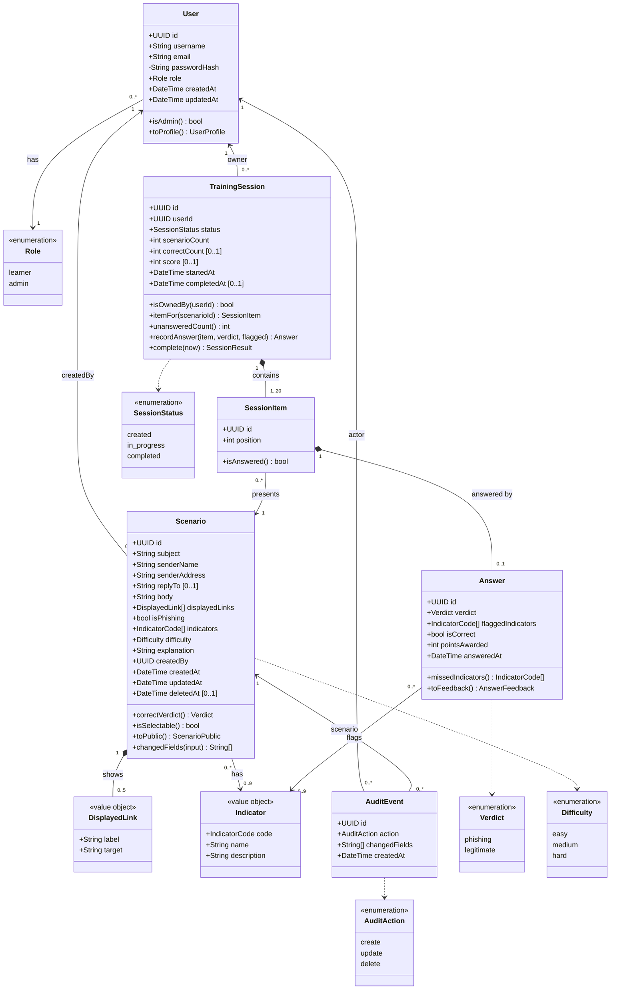
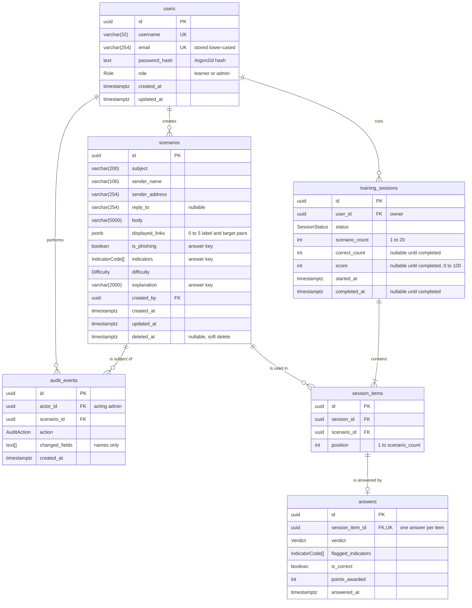
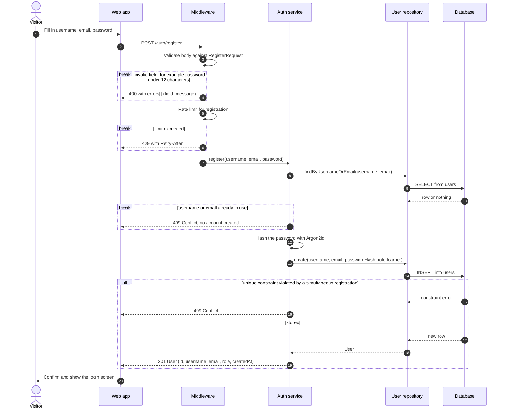
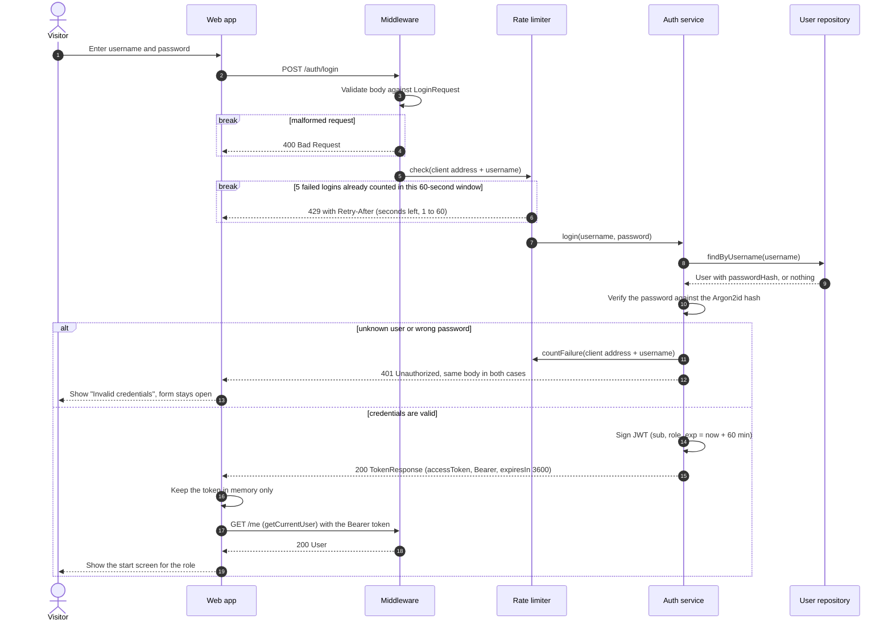
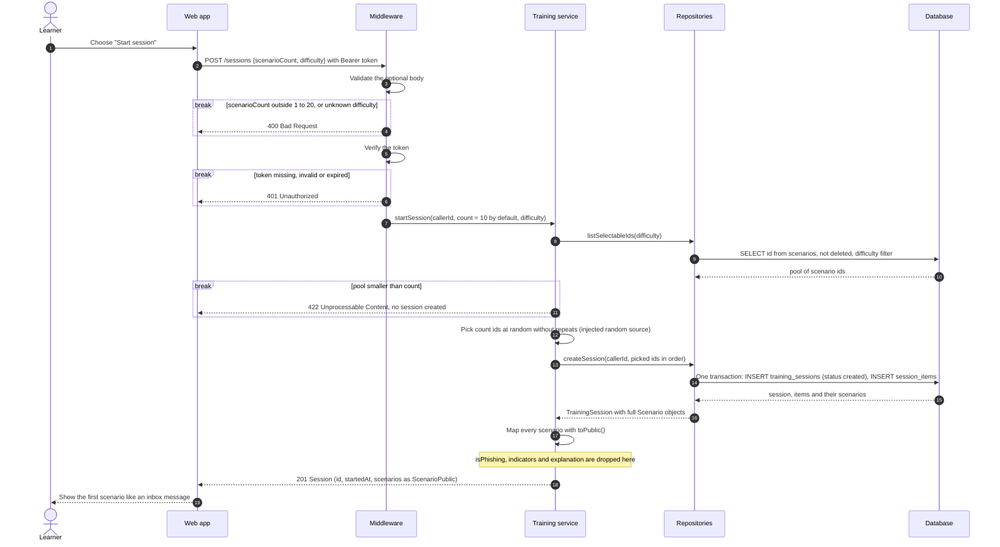
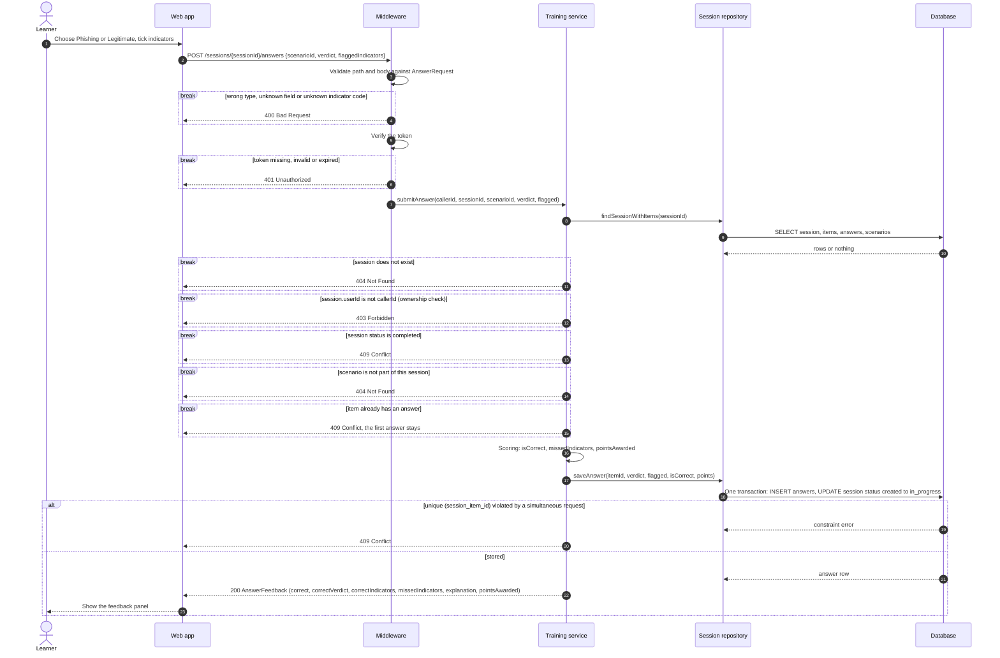
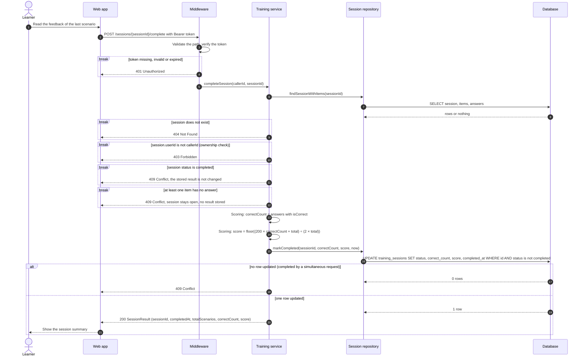
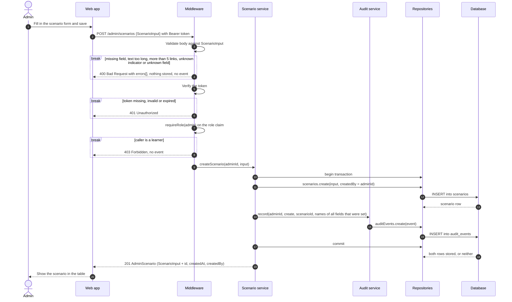

# UML Models

| Field | Value |
|---|---|
| Project | PhishGuard Trainer – a phishing-awareness simulator |
| Version | 1.0 |
| Date | 2026-11-15 |
| Owner | Ali Kaan Demiralp (`dalikaan`) – Lead Architect, DevOps |
| Team | SENG 321 – Team 16 |
| Related tasks | T-61 (this document), T-55 (C4 architecture), T-53 (SRS, use cases and conceptual entities), T-57 (decision log), T-65 (domain schema, built from section 4), T-78 (as-built update) |
| Related stories | Process (the models cover US-01 … US-17; the session models serve US-08, US-10, US-11) |
| Notation | UML 2 diagrams drawn with Mermaid: use case (as a flowchart), class, entity-relationship, sequence and state machine |

---

## 1 About this document

The architecture document ([`06-Architecture-C4.md`](06-Architecture-C4.md)) shows the system down to its components. This document is the next level of detail: **what the domain objects are, how they are stored, how the components talk during the main operations, and which states a training session can have**.

| Model | Question it answers | Section |
|---|---|---|
| Use case diagram | Who can do what? | 2 |
| Domain class diagram | Which objects exist, with which attributes, relations and operations? | 3 |
| Entity-relationship diagram | Which tables, keys and constraints will the database have? | 4 |
| Sequence diagrams | In which order do the components act in the six main operations? | 5 |
| State machine | Which states does a training session have and which requests are refused in which state? | 6 |

### 1.1 Sources and rules

- **The API contract wins.** Names of fields, enumerations, operations (`operationId`) and status codes are taken from `api/openapi.yaml` (version 0.2.0). Nothing in this document changes the contract.
- **Requirements** are taken from the SRS ([`01-Software-Requirements-Specification.md`](01-Software-Requirements-Specification.md)): use cases UC-01 … UC-07, functional requirements `FR-xx` and the conceptual entities of its section 6.1.
- **Decisions** `D-xx` are those of the decision log ([`../process/decision-log.md`](../process/decision-log.md)).
- **Components** in the sequence diagrams (middleware, controllers, services, repositories) are those of the C4 document, section 5. The order of the middleware is the request pipeline of its section 5.1.

### 1.2 Status of the models

The models describe the **planned design for the MVP**. At the date of this version the database holds only the table `users`; the other tables are built from section 4 in task T-65, and the operations of section 5 are built in Sprint 3. Where this document had to choose something that no requirement or decision fixes, the choice is marked as a **design choice** and listed in section 7.2. The document is updated to the as-built state in task T-78.

---

## 2 Use case diagram

Mermaid has no use case diagram type, so the diagram is drawn as a flowchart: rounded boxes with a stick-figure label are actors, ovals are use cases, the frame is the system boundary. It contains the same actors and use cases as section 5 of the SRS, where every use case is described step by step.

| Actor | Use cases | Notes |
|---|---|---|
| Visitor | UC-01 Register, UC-02 Log in | Not logged in. After UC-02 the visitor acts as Learner or Admin, depending on the role stored for the account. |
| Learner | UC-03 Run a training session, UC-04 Review history | Primary user. Sees only their own sessions and results (FR-13, FR-49). |
| Admin | UC-05 Manage scenarios, UC-06 View statistics, and through the generalisation UC-03 and UC-04 | "An admin can do everything a learner can do" (SRS section 5). The diagram shows this as a generalisation instead of two extra arrows. |
| Operator | UC-07 Bootstrap first admin | Not an application user: works with the configuration file and the start command only. |

| Use case | Operations of the contract | Sequence diagram |
|---|---|---|
| UC-01 Register | `registerUser` | 5.1 |
| UC-02 Log in | `login`, `getCurrentUser` | 5.2 |
| UC-03 Run a training session | `startSession`, `submitAnswer`, `completeSession` | 5.3, 5.4, 5.5 |
| UC-04 Review history | `listMyResults` | – |
| UC-05 Manage scenarios | `adminListScenarios`, `adminCreateScenario`, `adminGetScenario`, `adminUpdateScenario`, `adminDeleteScenario` | 5.6 (create) |
| UC-06 View statistics | `adminGetStats` | – |
| UC-07 Bootstrap first admin | none (start-up of the API); `getHealth` reports the result | – |

The *include* arrows mean that UC-03 … UC-06 need a logged-in user: a request without a valid token ends with 401 and the login screen (FR-08).

---

## 3 Domain class diagram

The diagram shows the domain objects that the services of the API work with. They are the eight entities of the task: **User, Role, Scenario, Indicator, TrainingSession, SessionItem, Answer, AuditEvent**, plus the small enumerations and the value object `DisplayedLink` that their attributes need.

Reading help: `+` public, `-` never leaves the API; `[0..1]` means the value can be empty; an operation is written where the rule belongs in the domain, although the code places it in a service function (C4 section 5.2).

### 3.1 Classes

| Class | Kind | Meaning | Rules |
|---|---|---|---|
| **User** | Entity | An account. | `username` and `email` are each unique; `email` is stored lower-cased. `passwordHash` is an Argon2id hash and is never part of a response (FR-05). Registration always gives the role `learner`; only the bootstrap creates an `admin` (FR-02, FR-62). |
| **Role** | Enumeration | `learner`, `admin` – the `Role` schema of the contract. | The role is read from the verified token on every request, never from the request body (FR-12). |
| **Scenario** | Entity | One fake email with its answer key. | The answer key is `isPhishing`, `indicators` and `explanation`. `toPublic()` builds the `ScenarioPublic` shape from an explicit list of fields, so the answer key cannot slip into a learner response (FR-31). A deleted scenario keeps its row and gets `deletedAt` (soft delete), so old sessions and audit events stay valid (DR-7). |
| **DisplayedLink** | Value object | A link shown in a scenario: a label and the real target, both as text. | 0 to 5 per scenario. Never rendered as a clickable link (FR-45). |
| **Indicator** | Value object | One red flag: code, learner-facing name, description. | Fixed list of nine codes; the `IndicatorCode` enum of the contract is canonical (D-13). Indicators are constants in the code (`api/src/domain/indicators.ts`), not rows that an admin can edit. |
| **TrainingSession** | Entity, aggregate root | One practice round of one user. | Belongs to exactly one user. `correctCount`, `score` and `completedAt` are empty until the session is completed and never change afterwards. Its states are described in section 6. |
| **SessionItem** | Entity inside the session | One scenario of the session at a fixed position. | 1 to 20 per session (FR-29). A scenario appears at most once per session (FR-30). |
| **Answer** | Entity inside the session | The verdict of the learner for one item, with the stored result. | At most one per item; never changed after it is stored (FR-35). |
| **AuditEvent** | Entity | Record of one scenario change by an admin. | One event per create, update and delete; holds names of changed fields only, no values (D-06). Never changed or deleted through the application. |
| SessionStatus, Verdict, Difficulty, AuditAction | Enumerations | Fixed value lists. | `Verdict` and `Difficulty` are schemas of the contract. `SessionStatus` and `AuditAction` are internal: no response of the contract carries them. |

### 3.2 Multiplicities

| Relation | Multiplicity | Reason |
|---|---|---|
| User – TrainingSession | 1 to 0..* | A user can run any number of sessions; a session has exactly one owner (FR-13). |
| User – Scenario (`createdBy`) | 1 to 0..* | The contract requires `createdBy` on every admin scenario. |
| User – AuditEvent (`actor`) | 1 to 0..* | Every event names the acting admin (D-06). |
| Scenario – AuditEvent | 1 to 0..* | A scenario has one *create* event and any number of later events. |
| Scenario – DisplayedLink | 1 to 0..5 | `maxItems: 5` in the contract. |
| Scenario – Indicator | 0..* to 0..9 | A scenario has zero or more indicators, each at most once (`uniqueItems`). A legitimate email normally has none. |
| TrainingSession – SessionItem | 1 to 1..20 | `scenarioCount` from 1 to 20, default 10 (FR-28, FR-29). |
| SessionItem – Scenario | 0..* to 1 | A scenario can be used in many sessions. |
| SessionItem – Answer | 1 to 0..1 | No answer yet, or exactly one (FR-35). |
| Answer – Indicator (`flags`) | 0..* to 0..9 | `flaggedIndicators` is optional, at most nine unique codes. |

### 3.3 Key operations

| Operation | What it does | Requirement | Code location (C4 5.2) |
|---|---|---|---|
| `User.toProfile()` | Returns id, username, email, role and creation time – the `User` schema of the contract, without the hash. | FR-02, FR-09 | Auth service |
| `Scenario.correctVerdict()` | `phishing` when `isPhishing` is true, otherwise `legitimate`. | FR-34 | Scoring service |
| `Scenario.isSelectable()` | True while `deletedAt` is empty. Only selectable scenarios form the pool of a new session. | FR-32, FR-55, D-14 | Scenario repository |
| `Scenario.toPublic()` | The `ScenarioPublic` shape: id, subject, sender name and address, reply-to, body, displayed links. | FR-31 | Training service |
| `Scenario.changedFields(input)` | Names of the fields in which the input differs from the stored scenario; used for the audit event of an update. | FR-57, D-06 | Scenario service |
| `TrainingSession.isOwnedBy(userId)` | Compares the caller's id from the token with `userId`. False gives 403. | FR-13, FR-36, FR-42 | Training service |
| `TrainingSession.itemFor(scenarioId)` | The item of the session that presents this scenario; none gives 404. | FR-37 | Training service |
| `TrainingSession.recordAnswer(...)` | Refuses when the session is completed or the item is answered (409); otherwise creates the answer, with `isCorrect` and `pointsAwarded` calculated on the server, and moves the session to `in_progress`. | FR-33 … FR-38 | Training service, Scoring service |
| `TrainingSession.complete(now)` | Refuses when the session is completed or `unansweredCount()` is above zero (409); otherwise counts the correct answers, calculates the score and moves the session to `completed`. | FR-39 … FR-41, D-03, D-04 | Training service, Scoring service |
| `Answer.missedIndicators()` | The indicators of the scenario that are not in `flaggedIndicators`. Derived, not stored. | FR-34 | Scoring service |
| `Answer.toFeedback()` | The `AnswerFeedback` shape: correct, correct verdict, correct indicators, missed indicators, explanation, points awarded. | FR-34 | Training service |

**Scoring rules** (pure functions of the Scoring service):

- `isCorrect` = the submitted verdict equals `correctVerdict()`. Flagged indicators do not change it.
- `pointsAwarded` = 1 for a correct verdict, 0 otherwise (*design choice*, section 7.2; it matches the score, which counts correct verdicts only).
- `score` = `floor((200 × correctCount + scenarioCount) ÷ (2 × scenarioCount))`, the whole-number form of "correct ÷ total × 100, rounded half up" (D-03).

---

## 4 Entity-relationship diagram

The diagram is the planned PostgreSQL 16 schema. It refines the conceptual model of the SRS (section 6.1) into tables. Task T-65 writes it as a Prisma schema and a migration. Table and column names are `snake_case`; the Prisma models keep the `camelCase` names of the class diagram and map them with `@map`, as the existing `users` table does.

`PK` primary key, `FK` foreign key, `UK` unique. Unique constraints over more than one column cannot be drawn and are listed in 4.2.

### 4.1 Enumerated types

| Database type | Values | Source |
|---|---|---|
| `Role` (exists) | `learner`, `admin` | Contract schema `Role` |
| `Difficulty` | `easy`, `medium`, `hard` | Contract schema `Difficulty` |
| `Verdict` | `phishing`, `legitimate` | Contract schema `Verdict` |
| `IndicatorCode` | `sender_domain_mismatch`, `urgent_language`, `suspicious_link`, `credential_request`, `unexpected_attachment`, `generic_greeting`, `spelling_grammar`, `too_good_to_be_true`, `mismatched_reply_to` | Contract schema `IndicatorCode` (D-13) |
| `SessionStatus` | `created`, `in_progress`, `completed` | Section 6 (internal) |
| `AuditAction` | `create`, `update`, `delete` | D-06 (internal) |

### 4.2 Keys and constraints

| Table | Constraint | Kind | Enforces |
|---|---|---|---|
| `users` | `users_username_key` on `username` | Unique (exists) | No second account with the same username, also under simultaneous registrations (FR-03). |
| `users` | `users_email_key` on `email`, check `email = lower(email)` | Unique + check (exists) | No second account with the same email in any letter case (FR-03). |
| `scenarios` | `created_by` → `users.id` | Foreign key, restrict | Every scenario names its creating admin. |
| `training_sessions` | `user_id` → `users.id` | Foreign key, restrict | Every session has exactly one owner (FR-13). |
| `training_sessions` | `scenario_count` between 1 and 20; `score` between 0 and 100 | Check | Limits of the contract (FR-29, FR-39). |
| `training_sessions` | `status = 'completed'` exactly when `completed_at`, `correct_count` and `score` are all set | Check | A result exists only for a completed session, and a completed session always has one (FR-40, D-04). |
| `session_items` | `session_id` → `training_sessions.id`, `scenario_id` → `scenarios.id` | Foreign keys, restrict | An item belongs to one session and one scenario. |
| `session_items` | **unique (`session_id`, `scenario_id`)** | Unique | A scenario appears at most once in a session (FR-30). |
| `session_items` | unique (`session_id`, `position`) | Unique | Positions in a session are distinct, so the order is stable. |
| `answers` | `session_item_id` → `session_items.id` | Foreign key, restrict | An answer can only exist for a scenario of the session (FR-37). |
| `answers` | **unique (`session_item_id`)** | Unique | At most one answer per item (FR-35). |
| `answers` | `points_awarded` ≥ 0 | Check | Limit of the contract. |
| `audit_events` | `actor_id` → `users.id`, `scenario_id` → `scenarios.id` | Foreign keys, restrict | Every event names an existing admin and scenario. Because scenarios are soft-deleted, the reference stays valid after a delete (D-06). |

**One answer per scenario per session** follows from the two bold constraints together: a session has one item per scenario, and an item has one answer. Two simultaneous `submitAnswer` requests for the same scenario both try to insert a row with the same `session_item_id`; the database accepts one and rejects the other, and the service turns that rejection into 409.

Other rules of the schema:

- **No row is ever deleted through the application.** Scenarios are soft-deleted; users, sessions, answers and audit events have no delete operation (DR-5). All foreign keys therefore use `ON DELETE RESTRICT`.
- **Indicators are stored as arrays of the enumerated type**, not in a table of their own and without join tables. The list is fixed by the contract and its texts live in the code (D-13), so a table would only repeat the enumeration. The database still rejects an unknown code. Uniqueness inside the array is checked by the contract validator (`uniqueItems`).
- **Displayed links are stored as JSON** (`jsonb`): they are always read and written together with their scenario and are never queried on their own. Their shape and the limit of five are checked by the contract validator.
- **Indexes** besides the keys: `training_sessions (user_id, completed_at)` for the score history, `session_items (scenario_id)` and `audit_events (scenario_id)` for the foreign keys, `scenarios (difficulty)` for the selection pool.
- Check constraints are added by hand to the migration, because Prisma has no syntax for them. The `users` migration already does this.

### 4.3 Class, table and contract side by side

The table shows that the three views agree: each class of section 3 has one table (or is a value inside one), and each field of a contract schema has one attribute and one column.

| Class (section 3) | Table / column type | Contract schema (`api/openapi.yaml`) |
|---|---|---|
| User | `users` | `User`; `RegisterRequest` and `LoginRequest` as input |
| Role | type `Role` | `Role` |
| Scenario | `scenarios` | `ScenarioInput`, `AdminScenario`, `ScenarioPublic` |
| DisplayedLink | `scenarios.displayed_links` (jsonb) | `displayedLinks[]` items |
| Indicator | type `IndicatorCode`; names and descriptions in `api/src/domain/indicators.ts` | `IndicatorCode` |
| TrainingSession | `training_sessions` | `Session`, `SessionResult` |
| SessionItem | `session_items` | order of `Session.scenarios[]` |
| Answer | `answers` | `AnswerRequest`, `AnswerFeedback` |
| AuditEvent | `audit_events` | none (no operation returns audit events) |

| Contract field | Class attribute | Column | Note |
|---|---|---|---|
| `User.id`, `username`, `email`, `role`, `createdAt` | same names on `User` | `users.id`, `username`, `email`, `role`, `created_at` | `password` of `RegisterRequest` is stored only as `password_hash`. |
| `ScenarioInput.subject`, `senderName`, `senderAddress`, `replyTo`, `body` | same names on `Scenario` | `subject`, `sender_name`, `sender_address`, `reply_to`, `body` | Same maximum lengths: 200, 100, 254, 254, 5000. |
| `ScenarioInput.displayedLinks` | `displayedLinks` | `displayed_links` | 0 to 5 items. |
| `ScenarioInput.isPhishing`, `indicators`, `explanation` | `isPhishing`, `indicators`, `explanation` | `is_phishing`, `indicators`, `explanation` | The answer key. Missing in `ScenarioPublic`. |
| `ScenarioInput.difficulty` | `difficulty` | `difficulty` | |
| `AdminScenario.id`, `createdAt`, `createdBy` | `id`, `createdAt`, `createdBy` | `id`, `created_at`, `created_by` | |
| `Session.id`, `startedAt` | `TrainingSession.id`, `startedAt` | `training_sessions.id`, `started_at` | |
| `Session.scenarios[]` | `SessionItem` → `Scenario.toPublic()` | `session_items` ordered by `position` | |
| `AnswerRequest.scenarioId` | `TrainingSession.itemFor(scenarioId)` | `session_items.scenario_id` | Finds the item; not stored again in `answers`. |
| `AnswerRequest.verdict`, `flaggedIndicators` | `Answer.verdict`, `flaggedIndicators` | `answers.verdict`, `flagged_indicators` | |
| `AnswerFeedback.correct`, `pointsAwarded` | `Answer.isCorrect`, `pointsAwarded` | `answers.is_correct`, `points_awarded` | |
| `AnswerFeedback.correctVerdict`, `correctIndicators`, `explanation` | `Scenario.correctVerdict()`, `indicators`, `explanation` | `scenarios.is_phishing`, `indicators`, `explanation` | Read from the scenario, not copied into the answer. |
| `AnswerFeedback.missedIndicators` | `Answer.missedIndicators()` | – | Derived. |
| `SessionResult.sessionId`, `completedAt` | `TrainingSession.id`, `completedAt` | `training_sessions.id`, `completed_at` | |
| `SessionResult.totalScenarios`, `correctCount`, `score` | `scenarioCount`, `correctCount`, `score` | `scenario_count`, `correct_count`, `score` | |
| `Stats.*` | – | – | Calculated by queries over `users`, `training_sessions`, `answers` and `scenarios`; nothing is stored. |

Columns without a contract field are internal: `users.password_hash`, `users.updated_at`, `scenarios.updated_at`, `scenarios.deleted_at`, `training_sessions.user_id`, `training_sessions.status`, `session_items.*`, `answers.answered_at` and the whole table `audit_events`.

---

## 5 Sequence diagrams

All six diagrams use the same participants, which are the components of the C4 document (section 5):

| Participant | Component | Role in the diagrams |
|---|---|---|
| Web app | React single-page application in the browser | Sends the request through nginx (`/api/v1/...`). nginx only forwards and is not drawn. |
| Middleware | Request pipeline: contract validator → rate limiter → authentication → authorisation | Rejects with 400, 429, 401 or 403 before any controller code runs. The checks are drawn in the order of the pipeline. |
| Service | Controller and service of the operation | Business rules: 403 (not the owner), 404, 409, 422. The controller only passes the validated input on and chooses the success status. |
| Repository | Prisma repositories | The only code that talks to the database. |
| Database | PostgreSQL | Stores the rows; its unique constraints are the last line of defence. |

Every refusal is an `application/problem+json` body built by the error handler (FR-18). A `break` frame means: the request ends there with that response.

### 5.1 Register – `registerUser`

`POST /auth/register` · UC-01 · FR-01 … FR-05, FR-16

- The role is never taken from the request: `RegisterRequest` has no `role` field and unknown fields are rejected with 400 (FR-12, FR-17).
- The password exists in plain form only inside the Auth service during this request. The response is built by `toProfile()` and has no password or hash (FR-05).
- The lookup in step 8 gives a clear answer in the normal case; the unique constraints of `users` cover the case that two registrations arrive at the same moment.

### 5.2 Log in – `login`, with the rate-limit branch

`POST /auth/login` · UC-02 · FR-06, FR-07, FR-14, FR-15 · D-01, D-02

- **Rate-limit branch (D-02).** The counter key is the pair of client address and submitted username. Only failed logins are counted. Failed attempts 1 to 5 in a fixed 60-second window get 401; the 6th and every further attempt in that window gets 429 without the password being checked at all, which also keeps the expensive hash away from an attacker. The limit comes from `LOGIN_RATE_LIMIT_PER_MINUTE` (FR-15).
- **Same answer for unknown user and wrong password** (FR-07): status, title and detail are identical, so the response does not tell which usernames exist.
- **Token** (D-01, ADR-0003): 60 minutes, claims `sub` and `role`. There is no logout operation; the web application discards the token.

### 5.3 Start a session – `startSession`, answer key withheld

`POST /sessions` · UC-03 steps 1–2 · FR-28 … FR-32, FR-84, FR-85 · D-14

- **Answer key withheld (FR-31).** The service copies an explicit list of fields into the `ScenarioPublic` shape; it does not delete fields from a full object. A new column can therefore never reach the learner by accident. In tests the response is also validated against the contract.
- **Random selection (D-14).** The random source is a parameter of the selection function. Tests pass a seeded source and get the same scenarios every time.
- **422 rule (D-14, D-19).** The pool is counted after the difficulty filter. The session is never filled up with other difficulties.
- Session and items are written in one transaction, so a session without items cannot exist.

### 5.4 Submit an answer – `submitAnswer`, ownership check and 409 duplicate

`POST /sessions/{sessionId}/answers` · UC-03 steps 4–5 · FR-33 … FR-38

- **Ownership check (IDOR protection, FR-13, FR-36).** The caller's id comes from the verified token, never from the request. The service compares it with the owner of the session before it reads or changes anything else. Another user's session gives 403; a session that does not exist gives 404.
- **Order of the checks** (*design choice*, section 7.2, following the order that D-04 fixes for `completeSession`): 404 session, 403 owner, 409 completed, 404 scenario not in the session, 409 already answered.
- **409 duplicate (FR-35).** The check in the service gives the normal answer. The unique constraint on `answers.session_item_id` gives the same answer when two requests arrive at the same moment, so a second answer can never be stored.
- **The answer key leaves the API here for the first time** – for this one scenario and only after the verdict is stored (DR-8).

### 5.5 Complete a session – `completeSession`, scoring

`POST /sessions/{sessionId}/complete` · UC-03 steps 7–9 · FR-39 … FR-42 · D-03, D-04

- **Order of the checks** is fixed by D-04: 404, 403, 409 (already completed), 409 (unanswered scenarios).
- **Scoring (D-03).** The score is calculated with whole numbers, so 1 of 8 gives 13 and 7 of 8 gives 88 without floating-point surprises. It is calculated from the stored answers, never from numbers sent by the client: `completeSession` has no request body.
- **No double scoring.** The update in step 16 only matches a session that is not completed yet. If two completion requests arrive together, the first changes the row and the second finds nothing to change and gets 409. Section 6.2 gives the complete argument.

### 5.6 Admin creates a scenario – `adminCreateScenario`, with audit event

`POST /admin/scenarios` · UC-05 step 3 · FR-11, FR-52, FR-56, FR-57 · D-06

- **Role check before any business code (FR-11, FR-12).** The role is the claim of the verified token. A learner never reaches the Scenario service.
- **Scenario and audit event share one transaction (D-06).** Either both rows exist or neither: there is no scenario change without an event and no event without a change. A rejected request (400, 401, 403) writes no event.
- **Content of the event:** actor = the admin's id, action = `create`, the scenario id, the time, and the names of all fields that were set. No field values are stored.
- `adminUpdateScenario` and `adminDeleteScenario` follow the same pattern with two differences: they first load the scenario and answer 404 when it does not exist or is already deleted, and the event carries only the names of the fields that differ (update) or an empty list (delete). Delete sets `deleted_at` instead of removing the row and answers 204.

---

## 6 State machine of a training session

A training session is in exactly one of three states, stored in `training_sessions.status`. The states are internal: the contract has no status field, and the client learns the state from the responses.

```mermaid
stateDiagram-v2
    direction TB
    [*] --> created : startSession / 201
    created --> in_progress : submitAnswer, first answer / 200
    in_progress --> completed : completeSession, all scenarios answered / 200, result stored
    completed --> [*]

    created --> created : completeSession / 409 (scenarios unanswered)
    in_progress --> in_progress : submitAnswer, next unanswered scenario / 200; submitAnswer for an answered scenario / 409; completeSession with unanswered scenarios / 409
    completed --> completed : submitAnswer or completeSession / 409

    note right of completed
        Final state. correctCount, score and
        completedAt are written once, on entry,
        and never change afterwards.
    end note
```

A loop arrow is a request that leaves the state unchanged. The loop on `in_progress` stands for three requests (rows 3, 6 and 7 of the table in 6.1); they share one arrow so that the labels stay readable.

| State | Meaning | Data |
|---|---|---|
| `created` | The session and its items exist; no answer has been given. | `correct_count`, `score` and `completed_at` are empty. |
| `in_progress` | At least one scenario is answered; the session is not completed. | As above; one `answers` row per answered item. |
| `completed` | The session is scored. Final state. | `correct_count`, `score` and `completed_at` are set and fixed. The session appears in the score history (`listMyResults`). |

### 6.1 Transitions

| # | From | Request | Condition | To | Response |
|---|---|---|---|---|---|
| 1 | – | `startSession` | Enough selectable scenarios | `created` | 201 `Session` |
| 2 | `created` | `submitAnswer` | Scenario belongs to the session | `in_progress` | 200 `AnswerFeedback` |
| 3 | `in_progress` | `submitAnswer` | Scenario belongs to the session and has no answer | `in_progress` | 200 `AnswerFeedback` |
| 4 | `in_progress` | `completeSession` | Every scenario has an answer | `completed` | 200 `SessionResult` |
| 5 | `created` | `completeSession` | – (nothing is answered yet) | `created` (unchanged) | **409** (D-04) |
| 6 | `in_progress` | `completeSession` | At least one scenario has no answer | `in_progress` (unchanged) | **409** (D-04) |
| 7 | `in_progress` | `submitAnswer` | The scenario already has an answer | `in_progress` (unchanged) | **409** (FR-35) |
| 8 | `completed` | `submitAnswer` | any | `completed` (unchanged) | **409** (FR-38) |
| 9 | `completed` | `completeSession` | any | `completed` (unchanged) | **409** (FR-41) |

Rows 5 to 9 are the **invalid transitions**. Each of them is answered with 409 and changes nothing: no answer is stored, no result is stored, the state stays the same.

Notes:

- There is no way from `created` directly to `completed`: a session has at least one scenario, and completion needs all scenarios answered. There is no way back from `completed`, and no state "abandoned": a session that the learner leaves stays `created` or `in_progress` with its answers stored (UC-03 postcondition) and can be continued until it is completed.
- The checks for existence (404), ownership (403) and the token (401) come before the state check. A user who is not the owner never learns the state of a session.
- `startSession` with too few scenarios (422) or invalid input (400) creates no session, so no state exists.

### 6.2 How the state machine prevents double scoring

"Double scoring" would mean that a scenario counts twice in a score, or that a session gets a second or a changed result. Four rules together exclude it:

1. **One answer per scenario.** An item has at most one answer (unique constraint on `answers.session_item_id`), and an answer is never updated. Transition 7 refuses a second verdict with 409. A learner can therefore not answer again after reading the feedback, and no scenario can be counted twice.
2. **Completion needs every answer.** Transitions 5 and 6 refuse completion while a scenario is unanswered (D-04). So the score is always calculated over the full, final set of answers.
3. **`completed` is final.** Transitions 8 and 9 refuse every further answer and every further completion. The result written on entry cannot be reached by any later request.
4. **The transition to `completed` is one guarded database update**: `UPDATE training_sessions SET status = 'completed', ... WHERE id = ? AND status <> 'completed'`. Of two simultaneous completion requests only one can change the row; the other updates nothing and gets 409. The check constraint of section 4.2 makes sure that the result fields and the state can only change together.

Because of rule 2, an answer cannot arrive "between" the score calculation and the state change: when completion is possible at all, every item already has its answer, and any further `submitAnswer` is a duplicate (rule 1).

The score itself is calculated on the server from the stored answers and the stored answer key. The client sends no score, no count and no "correct" flag in any request.

---

## 7 Consistency checks and design choices

### 7.1 Checks

| Check | Result |
|---|---|
| The use case diagram has the actors Visitor, Learner, Admin, Operator and the use cases UC-01 … UC-07 of the SRS. | Pass – section 2. |
| The class diagram contains User, Role, Scenario, Indicator, TrainingSession, SessionItem, Answer and AuditEvent with attributes, multiplicities and key operations. | Pass – sections 3, 3.2 and 3.3. |
| Every entity class has a table, and every table has a class. | Pass – 6 entity classes, 6 tables; Role, Indicator and DisplayedLink are a type, a type and a column (section 4.3). |
| Class attributes and columns agree. | Pass – same attributes in sections 3 and 4; `userId`, `createdBy` and the associations of `SessionItem`, `Answer` and `AuditEvent` are the foreign-key columns. |
| Every field of the contract schemas `User`, `ScenarioInput`, `AdminScenario`, `ScenarioPublic`, `Session`, `AnswerRequest`, `AnswerFeedback` and `SessionResult` has an attribute and a column, or is derived. | Pass – table in section 4.3. |
| Enumeration values equal the contract (`Role`, `Difficulty`, `Verdict`, `IndicatorCode`). | Pass – section 4.1. |
| The ER diagram covers the conceptual entities of the SRS (section 6.1). | Pass – User, Scenario, TrainingSession, SessionItem, Answer, AuditEvent are tables; Indicator is an enumerated type (see 7.2, choice 2). |
| The ER diagram shows primary keys, foreign keys and unique constraints. | Pass – diagram and section 4.2. |
| The six sequence diagrams exist: register, login with rate-limit branch, start session, submit answer, complete session, admin create scenario. | Pass – sections 5.1 … 5.6. |
| The sequence diagrams use real `operationId` values. | Pass – `registerUser`, `login`, `getCurrentUser`, `startSession`, `submitAnswer`, `completeSession`, `adminCreateScenario`. |
| Every status code in a sequence diagram is declared for that operation in the contract. | Pass – see the table below. |
| The state machine has `created`, `in_progress` and `completed`, and every invalid transition gives 409. | Pass – section 6.1, rows 5 … 9. |

| Operation | Status codes in the diagram | Status codes in the contract |
|---|---|---|
| `registerUser` | 201, 400, 409, 429 | 201, 400, 409, 429 |
| `login` | 200, 400, 401, 429 | 200, 400, 401, 429 |
| `getCurrentUser` | 200 | 200, 401 |
| `startSession` | 201, 400, 401, 422 | 201, 400, 401, 422, 429 |
| `submitAnswer` | 200, 400, 401, 403, 404, 409 | 200, 400, 401, 403, 404, 409 |
| `completeSession` | 200, 401, 403, 404, 409 | 200, 401, 403, 404, 409 |
| `adminCreateScenario` | 201, 400, 401, 403 | 201, 400, 401, 403 |

The 429 of `startSession` is declared in the contract for a possible general rate limit; the MVP limits only `login` and `registerUser` (C4 section 5.1), so the diagram does not show it.

### 7.2 Design choices made in this document

These points are not fixed by a requirement, a decision or the contract. They are chosen here so that task T-65 and the Sprint 3 tasks have one answer. None of them changes the contract. If the Product Owner decides otherwise, the decision log wins and this document is updated.

| # | Choice | Reason | Affects |
|---|---|---|---|
| 1 | `pointsAwarded` is 1 for a correct verdict and 0 otherwise. | The contract only says "integer, at least 0". The score counts correct verdicts (FR-39), so one point per correct verdict keeps both numbers in step. | T-24, T-27 |
| 2 | Indicators are an enumerated type and array columns, not a table. | The list is fixed by the contract and its texts live in the code (D-13). | T-65 |
| 3 | An answer references its session item (`session_item_id`, unique). | Together with unique (`session_id`, `scenario_id`) on the items this gives "one answer per scenario per session" and also guarantees that the scenario belongs to the session. | T-65, T-24 |
| 4 | A session has the stored states `created`, `in_progress`, `completed`. | Task definition; `created` and `in_progress` behave the same for the client but tell started sessions from untouched ones. | T-65, T-24, T-27 |
| 5 | Order of the checks in `submitAnswer`: 404 session, 403 owner, 409 completed, 404 scenario not in session, 409 duplicate. | Same order as D-04 fixes for `completeSession`: existence, owner, state. | T-24, T-26 |
| 6 | Scenarios are soft-deleted with `deleted_at`. An admin read, update or delete of a deleted scenario answers 404. | C4 section 5.2 and DR-7: old results and audit events must stay valid. | T-65, T-32 |
| 7 | `created_by` of a scenario is mandatory. | The contract requires `createdBy`. The seed therefore needs an existing admin account for the 30 seed scenarios; how the seed gets it (order of bootstrap and seed) is settled in tasks T-16 and T-40. | T-16, T-40 |

## Appendix – Revision history

| Version | Date | Author | Change |
|---|---|---|---|
| 1.0 | 2026-11-15 | Ali Kaan Demiralp | First version for Sprint 2 (task T-61). |
